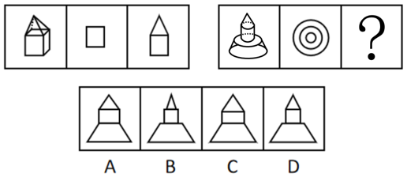

# 三视图（立体图—俯视图—左视图的投影对应）

考点：[[20-考点/判断推理/图形推理/三视图（立体图—俯视图—左视图的投影对应）|图形推理 / 三视图（立体图—俯视图—左视图的投影对应）]]

**问法模型**：两段式图形推理问'？处填入最合适图形'→先归纳第一组'立体图→俯视图→左视图'对应规律，再套用到第二组求组合体的左视图

## 推理链
1. 第1步：第一组图1为立体图（正方体顶部叠放三棱柱状'房顶'），图2为正方形，图3为'上三角下矩形'的五边形
2. 第2步：验证投影关系——图2恰是图1从上往下看的俯视图，图3恰是图1从左往右看的左视图，故规律为'立体图→俯视图→左视图'
3. 第3步：第二组图1为回转体组合（下方圆台、上方圆锥，顶部带小圆柱/小圆），图2为三个同心圆，正是该立体图的俯视图（三圈直径分别对应圆台底面、圆台顶面/锥底、顶部小圆）
4. 第4步：套用规律，？处应为第二组图1的左视图：圆台侧视为等腰梯形、圆锥侧视为等腰三角形，整体轮廓应为'上三角形+下梯形'
5. 第5步：四个选项轮廓均近似'三角形+梯形'，先比图形大小——按立体图各高度处直径与高度的实际比例，A、C两项比例失真（过大/过宽），排除A、C
6. 第6步：再按图形上方圆锥与小圆柱的衔接关系验证——俯视图中间圈与最内圈的直径差表明锥体部分应有相应宽度，B项上部三角形画得过窄过尖，与锥、柱实际比例不符，排除B
7. 第7步：D项轮廓与各段宽高比例均与左视图一致，故选D

**最快解法**：⚡ 三视图规律法＋比例排除：由第一组确定'？=左视图'→按'锥侧视为三角形、台侧视为梯形'保留A/C/D→按立体图宽高比例排除A、C→按锥与小圆柱衔接宽度排除B，锁定D

## 易错点
- ⚠ 把规律误判为图形旋转或叠加，想不到'俯视图—左视图'的投影对应
- ⚠ A、C、D轮廓几乎相同，只看形状不比比例大小，无法排除A、C
- ⚠ 忽略俯视图三个同心圆的直径差对应左视图各段宽度，误选锥体画得过窄的B

## 母题抽象
> 🧩 当两组图形呈'立体图→俯视图→左视图'结构且？处为第三幅时，先按投影轮廓规律（柱→矩形、锥→三角形、台→梯形、球→圆）排除形状不符项，再按原图各段直径与高度的比例排除大小失真项，两层排除后锁定答案

**同类特征**：两段式图形推理、第一组：立体图+正方形俯视图+五边形左视图、第二组：圆台与圆锥（顶部带小圆柱）组合体、俯视图为三个同心圆、问号处求左视图、选项轮廓相同需比较比例大小

## 相关题
（暂无）

---

### 题干

从所给的四个选项中，选择最合适的一个填入问号处，使图形呈现一定的规律性：

### 选项
- A. A
- B. B
- C. C
- D. D　✅

### 官方解析
本题考查三视图，第一组图形中，第二个图形和第三个图形分别是第一个图的俯视图和左视图。第二组应用规律，？处应该是第一个图的左视图。根据图形大小可以排除A、C两项。再根据图形上方圆锥与圆柱的关系，可以排除B项。
故正确答案为D。

### 给定材料
（无）
