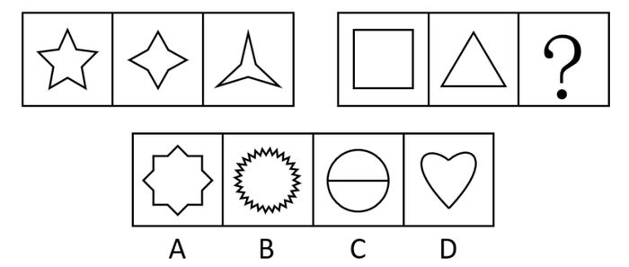

# 对称性-对称轴数量递变

考点：[[20-考点/判断推理/图形推理/对称性-对称轴数量递变|图形推理 / 对称性-对称轴数量递变]]

**问法模型**：两组图填问号求规律 → 依次数每组图形的对称轴数量，找数量递变（递减/递增）规律并匹配选项

## 推理链
1. 第1步：两组图元素组成不同且整体规整（五角星、四角星、三角星、正方形、三角形），优先考虑属性规律中的对称性
2. 第2步：数第一组对称轴数量：五角星有5条，四角星有4条，三星形有3条，呈5、4、3递减规律
3. 第3步：数第二组前两图：正方形有4条，等边三角形有3条，按递减规律？处应为2条对称轴的图形
4. 第4步：逐项数对称轴：A为八角星形有8条；B为锯齿太阳形有多条对称轴；C为圆加一条水平直径，只剩2条（沿直径1条+垂直平分直径1条）；D心形仅1条
5. 第5步：只有C项恰好2条对称轴，满足4、3、2递减规律，故选C

**最快解法**：⚡ 数对称轴法+排除法：先由第一组5、4、3锁定'递减1'规律，得出目标'2条对称轴'，快速排除A（8条）、D（1条），再排除B（多条），直选C（圆+横线恰2条）

## 易错点
- ⚠ C项'圆+横线'易被圆的'无数条对称轴'带偏：加一条直径后只剩沿直径和垂直于直径的2条
- ⚠ B项锯齿太阳形易被当作符合'轴对称'就入选，实际对称轴数量远多于2条，不符合数量规律
- ⚠ D项心形易误以为有上下、左右2条对称轴，实际只有竖直1条

## 母题抽象
> 🧩 当两组图图形规整、元素组成不同时，优先数各图'对称轴数量'，用组内等差递变（如5、4、3→4、3、2）锁定问号，再按数量排除选项

**同类特征**：两组图对比求同规律、图形整体规整、均为轴对称图形、五角星/四角星/三角星系列、正方形/等边三角形、对称轴数量递减

## 相关题
- [[10-真题/判断推理/图形推理/12304868 属性规律-对称性（斜轴对称→横轴对称→仅中心对称递变）＋数量规律-黑球个数等差递增（双规律验证）|12304868]]（江苏 2024，相关度1）
- [[10-真题/判断推理/图形推理/12561860 数量规律-面数量与属性规律-对称轴数量的复合对应规律|12561860]]（浙江 2024，相关度1）
- [[10-真题/判断推理/图形推理/16095265 属性规律-对称性（轴对称+对称轴方向旋转）|16095265]]（江苏 2024，相关度1）
- [[10-真题/判断推理/图形推理/2031008 属性规律（轴对称+对称轴旋转）与数量规律（直线数）综合考查|2031008]]（北京 2017，相关度1）
- [[10-真题/判断推理/图形推理/2045700 属性规律（轴对称、曲直性）+数量规律（面数量等差递增）综合|2045700]]（广州市考 2017，相关度1）

---

### 题干

从所给的四个选项中，选择最合适的一个填入问号处，使之呈现一定的规律性。

 

### 选项
- A. A
- B. B
- C. C　✅
- D. D

### 官方解析
元素组成不同，优先考虑属性规律。图形整体比较规整，优先考虑对称性。第一组图，图形均为轴对称图形，且对称轴的数量依次为5、4、3，对称轴数量呈递减规律；第二组图，前两个图均为轴对称图形，且对称轴数量依次为4、3，故？处应填入有2条对称轴的图形，只有C项符合。
故正确答案为C。

### 给定材料
（无）
