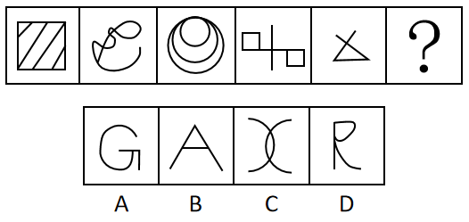

# 数量规律-面数量（封闭区域数）等差递减

考点：[[20-考点/判断推理/图形推理/数量规律-面数量（封闭区域数）等差递减|图形推理 / 数量规律-面数量（封闭区域数）等差递减]]

**问法模型**：问号处填入图形使一组图形呈现规律 → 元素组成不同先看属性、属性无规律转数面（封闭区域）数量

## 推理链
1. 第1步：题干五幅图元素组成各不相同，对称性、曲直性、开闭性等属性无明显统一规律，考虑数量规律
2. 第2步：图一为正方形被多条斜线明显分割，是'优先数面'的典型特征，逐图清点封闭区域数
3. 第3步：图一正方形被斜线分割成5个封闭区域；图二曲线交叉缠绕围成4个面；图三圆形嵌套结构有3个面；图四两个小正方形（加十字交叉线）为2个面；图五'X'形线段与底部横线围成1个三角形，为1个面
4. 第4步：面数量依次为5、4、3、2、1，构成公差为-1的等差数列，故问号处图形面数量应为0
5. 第5步：逐项数面：A项字母G开口不封闭，0个面；B项字母A围成1个三角形封闭区域，1个面；C项两条曲线相交，中部围成1个封闭区域，1个面；D项字母R上部圈状结构封闭，1个面
6. 第6步：仅A项面数量为0，与等差递减规律吻合，故选A

**最快解法**：⚡ 数面法+等差数列：口诀'图形被分割、嵌套先数面'。快速点出题干面数为5、4、3、2、1，锁定问号处需0面（无任何封闭区域），一眼排除含封闭区域的B（A的三角）、C（曲线相交围成的区域）、D（R的圆圈），选G。

## 易错点
- ⚠ 图二为多条曲线交叉缠绕，小封闭区域密集，容易数漏或多数，需逐个清点确认是4个面
- ⚠ C项两条曲线相交看似'开放'，实际中部围成了封闭区域（1个面），误判为0面会错选C
- ⚠ 从'开闭性'属性角度切入：可能注意到A项全开放就选A，但题干各图均有封闭面，规律本质是面数量递减而非开闭性变化，走属性规律方向容易混淆依据

## 母题抽象
> 🧩 当一组图形元素组成不同、属性规律（对称/曲直/开闭）不明显，且其中某图出现明显分割、嵌套、交叉缠绕特征时，优先数封闭区域（面）的数量，验证是否构成等差数列或常数数列，再据此排除选项。

**同类特征**：元素组成不同且无明显属性规律、图一正方形被斜线明显分割、圆形嵌套/曲线缠绕/小方块并列、面数量依次为5、4、3、2、1、等差递减数列求问号

## 相关题
- [[10-真题/判断推理/图形推理/14403697 图形推理-数量规律（外框边数与内部元素个数作差恒定分组）|14403697]]（山东 2025，相关度1）
- [[10-真题/判断推理/图形推理/16070043 数量规律-灰色多边形边数与白色面数量的差值运算分组|16070043]]（贵州 2026，相关度1）
- [[10-真题/判断推理/图形推理/16070177 数量规律-部分数（黑白块分堆-同色连通区域数）|16070177]]（重庆 2026，相关度1）
- [[10-真题/判断推理/图形推理/2423328 图形推理-数量规律（内部线条与外框角端点相接个数）|2423328]]（甘肃 2019，相关度1）
- [[10-真题/判断推理/图形推理/2448487 数量规律-曲直交点数与曲线数的倍数运算关系|2448487]]（国考 2020，相关度1）

---

### 题干

从所给的四个选项中，选择最合适的一个填入问号处，使之呈现一定的规律性：

### 选项
- A. A　✅
- B. B
- C. C
- D. D

### 官方解析
元素组成不同，且无明显属性规律，考虑数量规律。观察题干图形，图一明显被分割，考虑面数量，题干图形面数量依次为5、4、3、2、1、？，故？处图形面数量应为0，只有A项符合。
故正确答案为A。

### 给定材料
（无）
