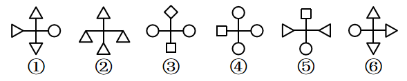

# 属性规律-对称性（对称轴方向：横轴对称与竖轴对称）

考点：[[20-考点/判断推理/图形推理/属性规律-对称性（对称轴方向：横轴对称与竖轴对称）|图形推理 / 属性规律-对称性（对称轴方向：横轴对称与竖轴对称）]]

**问法模型**：六个图形分成两类（3+3分组分类）→ 元素组成不同，优先考虑属性规律，用对称轴方向（横轴/竖轴）分组

## 推理链
1. 第1步：六个图形均为'十字骨架+四端小元素'结构，元素组成不同，排除位置/样式规律，转向属性规律
2. 第2步：图形中出现三角形、圆、正方形、菱形等对称图形，考虑对称性，并比较对称轴方向
3. 第3步：图①上△下▽、左◁右○，沿水平中轴对折重合，为横轴对称；图④上○下○、左□右○，水平轴对折重合，为横轴对称；图⑥上△下▽、左○右▷，水平轴对折重合，为横轴对称
4. 第4步：图②上△下△、左右两三角镜像，竖轴对折重合，为竖轴对称；图③左○右○（上◇下□各自关于竖轴对称），竖轴对折重合，为竖轴对称；图⑤左◁右▷镜像（上□下○各自对称），为竖轴对称
5. 第5步：①④⑥为横轴对称一组，②③⑤为竖轴对称一组，对应D项

**最快解法**：⚡ 图形规律口诀'元素不同看属性，对称图形看轴方向'：逐图只判断对称轴是横是竖——①④⑥横轴、②③⑤竖轴，直接锁定D

## 易错点
- ⚠ 只统计小元素种类（圆、三角、方形数量）而忽略对称轴方向这一核心属性
- ⚠ 图③上下为不同元素（菱形与正方形），误以为整图不对称，实际上左右两圆关于竖轴重合即为竖轴对称
- ⚠ 图①⑥中三角形的指向（▽与△、▷）决定折线后能否重合，看错指向会把横轴误判为竖轴

## 母题抽象
> 🧩 当题干为多个'十字/骨架+四端小图形'且元素组成不同时，优先用属性规律，以对称轴方向（横轴对称 vs 竖轴对称）作分组标准验证

**同类特征**：元素组成不同、十字骨架四端挂小元素、出现三角形/圆/正方形/菱形等对称图形、分组分类问法（3+3）、按对称轴方向分横轴、竖轴两组

## 相关题
- [[10-真题/判断推理/图形推理/10204454 数量规律-部分数（黑白球连通区域数做和）|10204454]]（甘肃 2024，相关度1）
- [[10-真题/判断推理/图形推理/10204604 数量规律-线数量（汉字横线数）|10204604]]（辽宁 2024，相关度1）
- [[10-真题/判断推理/图形推理/10297050 数量规律-特殊计数（线条穿过小白球的数量）|10297050]]（天津 2025，相关度1）
- [[10-真题/判断推理/图形推理/10297127 图形间关系-相交图形中不相交边数量（黑白图形相交）|10297127]]（天津 2025，相关度1）
- [[10-真题/判断推理/图形推理/10297148 数量规律-线的细化（端点连线穿过线条数；备选：平行线组数）|10297148]]（天津 2025，相关度1）

---

### 题干

把下面的六个图形分为两类，使每一类图形都有各自的共同特征或规律，分类正确的一项是：

### 选项
- A. ①④⑤，②③⑥
- B. ①②⑤，③④⑥
- C. ①③⑤，②④⑥
- D. ①④⑥，②③⑤　✅

### 官方解析
本题为分组分类题目。元素组成不同，优先考虑属性规律。观察发现图形中出现三角形等对称图形，考虑对称性。其中图①④⑥横轴对称，图②③⑤竖轴对称，即图①④⑥为一组，图②③⑤为一组。
故正确答案为D。

### 给定材料
（无）
