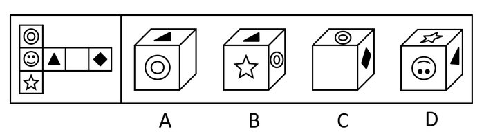

# 空间重构-六面体折叠（相对面判定+特征面指向）

考点：[[20-考点/判断推理/图形推理/空间重构-六面体折叠（相对面判定+特征面指向）|图形推理 / 空间重构-六面体折叠（相对面判定+特征面指向）]]

**问法模型**：给定纸盒外表面展开图，问哪一项可折叠而成 → 先用'隔一面为相对面'定三对相对面，再以有方向性的图案（三角形尖角、五角星头）所对的面为锚点逐项比对排除

## 推理链
1. 第1步：展开图共六个面——圆环◎、笑脸☺、五角星☆、黑三角▲、空白面、菱形◆；竖列为'圆环—笑脸—五角星'，横行为'笑脸—三角形—空白—菱形'（1-4-1型）
2. 第2步：用'隔一面为相对面'规则确定：圆环与五角星相对、三角形与菱形相对、笑脸与空白面相对
3. 第3步：提取方向性特征面的指向关系——三角形头顶（尖角朝上）所对面为圆环、底边所对面为五角星；五角星头顶所对面为笑脸
4. 第4步：A项中三角形底边所对的面为圆环，与展开图'底边对五角星'矛盾，排除
5. 第5步：B项中五角星头顶所对的面为三角形，与展开图'头顶对笑脸'矛盾（且五角星与圆环本为相对面却相邻出现），排除
6. 第6步：D项中三角形头顶所对的面为笑脸，与展开图'头顶对圆环'矛盾，排除
7. 第7步：C项中圆环、空白面、菱形三个面两两相邻、不含任何一对相对面，且均无方向性冲突，与展开图一致，当选

**最快解法**：⚡ 相对面排除+特征面指向法：先用'隔一面相对'快速定三对相对面（圆环↔五角星、三角形↔菱形、笑脸↔空白），再抓三角形头顶和五角星头顶这两个'指南针'图案，比对选项中头顶/底边所贴邻的面：A底边对圆环✗、B星头对三角✗、D三角头对笑脸✗，秒选C

## 易错点
- ⚠ 只验证相邻关系忽略图案方向：三角形、五角星是带'头顶/底边'朝向的特征面，仅凭面相邻不查指向会误选D
- ⚠ 折叠后指向想象错误：把展开图中'三角形头顶对圆环'在脑中翻转为'头顶对笑脸'（D项正是该陷阱）
- ⚠ 忽略相对面硬性约束：B项中五角星与圆环本是相对面却以相邻关系出现，应直接排除

## 母题抽象
> 🧩 当六面体展开图中出现有明确朝向的图案（尖角、头部、箭头等）时，先定相对面排除，再以'该图案头顶/底边所贴邻的面'为锚点在展开图与选项间逐项比对，指向不一致即排除

**同类特征**：纸盒外表面展开图折叠、1-4-1型展开图（竖三横四）、图案具方向性（三角形头顶/底边、五角星头顶）、隔一面为相对面、特征面指向比对、选项为三个可见面的立体图

## 相关题
- [[10-真题/判断推理/图形推理/12561915 空间重构-六面体折叠（相对面排除+公共点法）|12561915]]（浙江 2024，相关度1）
- [[10-真题/判断推理/图形推理/1746880 空间重构-六面体折叠（相对面排除+画边法）|1746880]]（国考 2016，相关度1）
- [[10-真题/判断推理/图形推理/2042734 空间重构-六面体折叠（画边法+相对面排除）|2042734]]（江苏 2017，相关度1）
- [[10-真题/判断推理/图形推理/2172154 空间重构-六面体折纸盒（相对面排除＋公共点法）|2172154]]（广州市考 2018，相关度1）
- [[10-真题/判断推理/图形推理/2172377 空间重构-六面体折叠（相对面排除＋相邻面特征定位）|2172377]]（江苏 2018，相关度1）

---

### 题干

左图是给定纸盒的外表面，以下哪一项是由它折叠而成的？

### 选项
- A. A
- B. B
- C. C　✅
- D. D

### 官方解析
本题为空间重构类题目。
A项：展开图中三角形底边所对的面是五角形，选项中三角形底边所对的面为圆环，选项与题干不一致，排除；
B项：展开图中五角星头顶所对的面是笑脸，选项中五角星头顶所对的面为三角形，选项与题干不一致，排除；
C项：选项与题干一致，当选；
D项：展开图中三角形头顶所对的面是圆环，选项中三角形头顶所对的面为笑脸，选项与题干不一致，排除。
故正确答案为C。

### 给定材料
（无）
