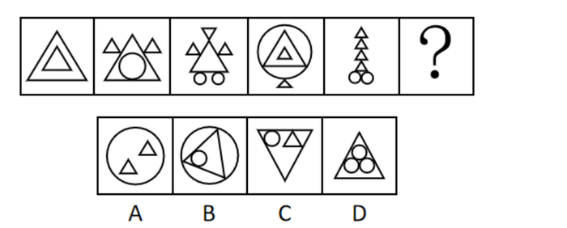

# 属性规律-对称性（轴对称+对称轴方向为竖直）

考点：[[20-考点/判断推理/图形推理/属性规律-对称性（轴对称+对称轴方向为竖直）|图形推理 / 属性规律-对称性（轴对称+对称轴方向为竖直）]]

**问法模型**：‘填入问号处使之呈现一定规律性’且图形元素组成不同 → 优先属性规律，本题考查轴对称及对称轴方向一致

## 推理链
1. 第1步：题干五幅图元素组成不同（三角、圆的组合各不相同），依‘元素组成不同优先属性’锁定属性规律
2. 第2步：观察共同特征——每幅图均含等腰三角形且整体规整，提示对称性考点
3. 第3步：逐图验证对称性：图1大三角套小三角、图2三角内含圆且两侧各一小三角、图3三角组合下挂双圆、图4圆内套三角下悬小三角、图5一列小三角下双圆，沿竖直方向对折左右均完全重合，故题干均为轴对称图形且对称轴均为竖直方向
4. 第4步：归纳规律：‘？’处应为关于竖轴对称的图形
5. 第5步：逐项对照：A项圆内两小三角位置一上一下偏置，非竖轴对称；B项圆内三角形与圆偏置，不对称；C项倒三角内圆与三角分布左右不重合，非竖轴对称；D项正三角内三圆沿竖直中线对称排列，关于竖轴对称，符合规律

**最快解法**：⚡ 对称轴方向判定法——题干每幅图沿竖直线对折均重合（对称轴均为竖直方向），直接逐项检验：A、B、C均无法沿竖直线对折重合，仅D关于竖轴对称，秒选D

## 易错点
- ⚠ 看到元素组成不同先去数三角形、圆的个数走数量规律，而本题数量无一致规律，浪费考场时间
- ⚠ 发现每幅图‘都含三角形’便去选项中找含三角形的，忽略A、B、C虽含三角形但整体不关于竖轴对称，对称轴方向才是核心规律
- ⚠ C项是规整的大三角形易被误认为对称，实际其内部圆与三角形的分布左右不重合，需内部外部一起验证对称性

## 母题抽象
> 🧩 当题干图形元素组成不同但整体规整、含等腰/等边等特征元素时，优先看对称性，重点比对对称轴的方向（竖直/水平/多条），在选项中选对称轴方向与题干完全一致的那个

**同类特征**：元素组成不同、每幅图均含等腰三角形、图形规整、轴对称图形、对称轴均为竖直方向、对称性需内外元素整体验证

## 相关题
- [[10-真题/判断推理/图形推理/11367775 属性规律-对称性（对称轴数量等差递减）|11367775]]（江苏 2025，相关度2）
- [[10-真题/判断推理/图形推理/14403693 属性规律-对称性（轴对称且仅有1条对称轴）|14403693]]（山东 2025，相关度2）
- [[10-真题/判断推理/图形推理/15833781 属性规律-对称性（轴对称与中心对称组合分组）|15833781]]（内蒙古 2026，相关度2）
- [[10-真题/判断推理/图形推理/2137206 属性规律-轴对称（对称轴数量递增）|2137206]]（上海 2018，相关度2）
- [[10-真题/判断推理/图形推理/2188222 属性规律-对称性（轴对称及对称轴方向为竖直）|2188222]]（江西 2018，相关度2）

---

### 题干

从所给的四个选项中，选择最合适的一个填入问号处，使之呈现一定的规律性。

### 选项
- A. A
- B. B
- C. C
- D. D　✅

### 官方解析
题干元素组成不同，优先考虑属性规律。观察发现，题干每幅图形中都有等腰三角形且图形规整，优先考虑对称性。题干均是轴对称图形，且对称轴均为竖直方向，所以“？”处应为关于竖轴对称的图形，只有D项符合。
故正确答案为D。

### 给定材料
（无）
