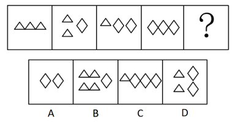

# 数量规律-等价元素换算（两种元素的等差替换）

考点：[[20-考点/判断推理/图形推理/数量规律-等价元素换算（两种元素的等差替换）|图形推理 / 数量规律-等价元素换算（两种元素的等差替换）]]

**问法模型**：“选最合适的一个填入问号处使之呈现规律性”且图形仅由两种小元素组成 → 采用元素等价换算模型，统一换算后找等差规律

## 推理链
1. 第1步：题干五幅图均由独立小图形△（三角形）与◇（菱形）组成，图1为3个△，图2为2个△+1个◇，图3为1个△+2个◇，图4为3个◇，元素组成不同且无属性/位置规律，优先考虑数量规律
2. 第2步：直接数元素种类与个数无明显规律，但题干只出现2种小元素，这是“元素等价换算”的典型信号
3. 第3步：比较相邻图定换算比：图1=3个△，图2=2个△+1个◇，要使序列递增差为1，需1◇=2△，则图2换算后为4个△，比图1恰多1个△
4. 第4步：将所有◇统一换算为△：图1=3△，图2=2△+1◇=4△，图3=1△+2◇=5△，图4=3◇=6△，构成3、4、5、6的等差数列
5. 第5步：依等差规律，问号处应等价于7个△
6. 第6步：逐项换算对照：A项2◇=4△，排除；B项4△+1◇=6△，排除；C项1△+3◇=7△，符合，当选；D项2△+2◇=6△，排除

**最快解法**：⚡ 元素换算法：两种小元素时，先由相邻两图差值定比例（图2-图1差1个△→1◇=2△），再把全部图形换算成同一元素数△，按3、4、5、6、7等差递增，取7△对应C项

## 易错点
- ⚠ 只数元素总个数或种类个数，发现无规律就放弃，漏掉“仅两种元素→等价换算”的信号
- ⚠ 换算比设错：若按1◇=1△或1◇=3△，各图无法构成等差数列，应用相邻图差值校准比例
- ⚠ B、D两项换算后均为6△，恰等于图4的数量，误以为“循环/重复”而误选，忽略问号处应为7△

## 母题抽象
> 🧩 当图形由且仅由两种独立小元素组成、直接数数无规律时，先比较相邻两图元素差值设定换算比，把所有元素统一换算后验证是否构成等差数列，再按下一项数值选答案

**同类特征**：元素组成不同、仅出现两种小元素（△与◇）、独立小图形排列、直接数数无规律、元素等价换算、等差递增数列3、4、5、6、7

## 相关题
- [[10-真题/判断推理/图形推理/10204454 数量规律-部分数（黑白球连通区域数做和）|10204454]]（甘肃 2024，相关度1）
- [[10-真题/判断推理/图形推理/10204604 数量规律-线数量（汉字横线数）|10204604]]（辽宁 2024，相关度1）
- [[10-真题/判断推理/图形推理/10297050 数量规律-特殊计数（线条穿过小白球的数量）|10297050]]（天津 2025，相关度1）
- [[10-真题/判断推理/图形推理/10297127 图形间关系-相交图形中不相交边数量（黑白图形相交）|10297127]]（天津 2025，相关度1）
- [[10-真题/判断推理/图形推理/10297148 数量规律-线的细化（端点连线穿过线条数；备选：平行线组数）|10297148]]（天津 2025，相关度1）

---

### 题干

从选项中选择最合适的一个填入问号处，使之呈现出一定的规律性。

### 选项
- A. A
- B. B
- C. C　✅
- D. D

### 官方解析

元素组成不同，且无明显属性规律，优先考虑数量规律。观察发现，题干图形均由独立小图形组成，考虑元素的种类和数量，无明显规律或答案。再观察发现题干中只出现了2种小元素，考虑元素换算。题干中图2图1◇△，若1◇2△，那么图2与图1之间的差为1个△，此时将题干中菱形全部换算为三角形，那么三角形数量依次为3、4、5、6、？，故？处应有7个三角形。A项换算为4个三角形，排除；B项换算为6个三角形，排除；C项换算为7个三角形，当选；D项换算为6个三角形，排除。

故正确答案为C。

### 给定材料
（无）

> [!warning] 疑点（官方解析可能有误，待人工复核）
> 官方解析首句“题干中图2图1◇△”存在文字残缺（应为表述图2比图1多1个◇/换算后多1个△），属笔误，不影响换算逻辑（1◇=2△可由各图数量验证成立）与答案C的正确性
