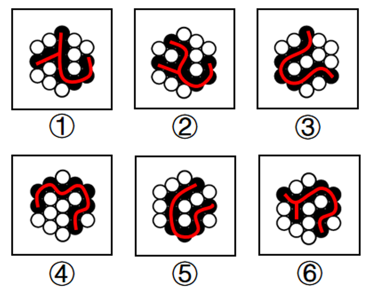

# 图形推理-一笔画（黑球连线的奇点数与笔画数）

考点：[[20-考点/判断推理/图形推理/图形推理-一笔画（黑球连线的奇点数与笔画数）|图形推理 / 图形推理-一笔画（黑球连线的奇点数与笔画数）]]

**问法模型**：六个图形'分为两类'→ 元素组成相同先试位置规律，无位置规律时将相连黑球抽象为线条图，按一笔画/多笔画分组

## 推理链
1. 第1步：六个图形均为黑白球阵列，元素组成相同，但黑球位置不一，无平移、旋转等位置规律
2. 第2步：观察共性——每个图中黑球全部相连，故把所有黑球抽象连成一条线，构成'点线图'，考查一笔画规律
3. 第3步：数奇点（从该点引出奇数条线的点）：图①②⑥的黑球连线图中各含4个奇点，笔画数=奇点数÷2=2笔，为两笔画图形
4. 第4步：图③④⑤的黑球连线图奇点数为0或2，满足一笔画条件，可一笔画成
5. 第5步：按笔画数分类：①②⑥（两笔画）一组，③④⑤（一笔画）一组，对照选项只有C符合

**最快解法**：⚡ 一笔画规律口诀：黑球全部相连→把黑球连成线数奇点；奇点为0或2个→一笔画（③④⑤），奇点为4个→两笔画（①②⑥），直接锁定C

## 易错点
- ⚠ 思路停留在黑白球数量、对称或黑白交替等常规规律上，想不到'黑球连线一笔画'这一细化考点
- ⚠ 奇点数错：把只有一条线引出的端点漏数，或把偶数条线的交叉点误判为奇点
- ⚠ 把一笔画对象误当成'黑球整体轮廓'而非抽象线条图，导致数点位置找错

## 母题抽象
> 🧩 当分组分类题中各图由同类小元素（球/点）构成且元素相连、又无位置规律时，将相连元素抽象为线条图，用奇点个数判定一笔画/两笔画进行分组

**同类特征**：黑白球组合图形、元素组成相同、黑球全部相连、无明显位置规律、分组分类问法、考查一笔画/奇点数

## 相关题
- [[10-真题/判断推理/图形推理/4637321 数量规律-部分数（黑白球连通部分数，两级辨析）|4637321]]（国考 2022，相关度3）
- [[10-真题/判断推理/图形推理/13504530 属性规律-对称性（黑白球分开看＋对称轴方向顺时针旋转）|13504530]]（河南 2025，相关度2）
- [[10-真题/判断推理/图形推理/16069886 数量规律-黑块部分数（连通分堆数）|16069886]]（贵州 2026，相关度2）
- [[10-真题/判断推理/图形推理/19283870 图形推理-位置规律（两元素连线的平行-垂直关系）|19283870]]（国考 2025，相关度2）
- [[10-真题/判断推理/图形推理/19283951 属性规律-对称性（黑球整体轴对称+对称轴经过黑球个数的二级辨析）|19283951]]（国考 2025，相关度2）

---

### 题干

把下面的六个图形分为两类，使每一类图形都有各自的共同特征或规律，分类正确的一项是（    ）。

### 选项
- A. ①③④，②⑤⑥
- B. ①③⑤，②④⑥
- C. ①②⑥，③④⑤　✅
- D. ①④⑥，②③⑤

### 官方解析

本题为分组分类题目。元素组成相同，但无明显位置规律。观察发现，所有图形中黑球全部相连，如果将所有黑球连成线，图③④⑤中所有黑球连成的线能一笔画成，而图①②⑥中所有黑球连成的线存在4个奇点，为两笔画成，如下图所示。因此图①②⑥一组，图③④⑤一组。

故正确答案为C。

### 给定材料
（无）
