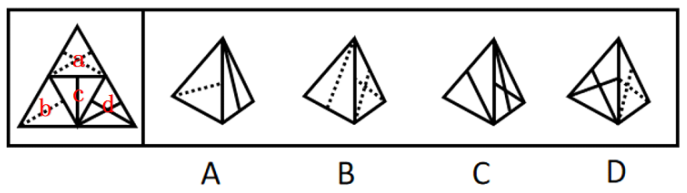
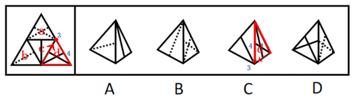

# 空间重构-四面体折纸盒（相邻面与公共边的时针路径验证）

考点：[[20-考点/判断推理/图形推理/空间重构-四面体折纸盒（相邻面与公共边的时针路径验证）|图形推理 / 空间重构-四面体折纸盒（相邻面与公共边的时针路径验证）]]

**问法模型**：题干给四面体展开图、问'哪项能由它折叠而成'→先给四个面标号，再用'起点+顺时针画边'法核对每个选项中各边相邻的面是否与展开图一致，不符即排除。

## 推理链
1. 第1步：题干为正四面体展开图（大三角形分四个小三角形），依次标注面a、b、c、d：面a含虚线、面b为双实线、面c为内嵌小三角形加竖线、面d为虚线加实短线，各面图案相近。
2. 第2步：单看图案无法锁定，采用'以图案端点为起点、顺时针画边'法：按选项所示两个面，从其中一面的特征点出发顺时针描边，逐一核对每条边在展开图中相邻的面。
3. 第3步：A项由面b和面c构成，以面c中的点1为起点顺时针画边，展开图中与边2相邻的面是面d，而A项中与边2相邻的是面b，相邻关系不符，排除。
4. 第4步：B项按同一起点画边核验，各边相邻面与展开图完全一致，保留。
5. 第5步：C项由面c和面d构成，以面d中的点3为起点顺时针画边，展开图中与边4相邻的面是面a，而C项中与边4相邻的是面c，不符，排除。
6. 第6步：D项由面a和面d构成，以面a中的点5为起点顺时针画边，展开图中与边6相邻的面是面b，而D项中与边6相邻的是面d，不符，排除。
7. 第7步：只有B项的面-边相邻关系与展开图全部吻合，故选B。

**最快解法**：⚡ 起点画边法（时针路径法）：先由图案特征给四面标号，针对每个选项所示两面，从一面的图案端点（点1/点3/点5）为起点顺时针画边，直接比对'该边在展开图中挨着哪个面'与'选项中挨着哪个面'，不一致立即排除，四个选项三次排除后剩B。

## 易错点
- ⚠ 只比对面上图案形状、不核对边与面的相邻关系——四面体四面图案相近（虚实线组合），最易误选镜像选项
- ⚠ 画边方向出错：须沿选项立体图的观察方向顺时针描边，方向反了会把相邻面判反
- ⚠ 展开图四面标号错位：b、c、d面均含线条，标号错则后续逐项核验全错，应先用最独特的图案（如内嵌小三角形加竖线的面c）锚定

## 母题抽象
> 🧩 当题干给出四面体（或纸盒）展开图且各面图案相近时，先给面标号，再对每个选项用'图案端点为起点+顺时针画边'核对每条边相邻的面，与展开图不一致的直接排除，全部一致者即答案。

**同类特征**：四面体展开图（大三角形内含四个小三角形）、问法'哪项能由它折叠而成'、四个面均带线条图案且虚实线相近、选项为立体图、仅露出两个面、需核对边与面的相邻（时针）关系、官方解析以点1/点3/点5为画边起点

## 相关题
（暂无）

---

### 题干

左边给定的是纸盒外表面的展开图，下列哪项能由它折叠而成？

### 选项
- A. A
- B. B　✅
- C. C
- D. D

### 官方解析

将题干展开图中的面依次标注为面a、b、c、d，如下图：

A项：由面b和面c构成，以面c中的点1为起点，顺时针画边，如下图：

题干展开图中与边2相邻的面是面d，而选项中与边2相邻的面是面b，与题干不符，排除；

B项：选项与题干一致，当选；

C项：由面c和面d构成，以面d中的点3为起点，顺时针画边，如下图：

题干展开图中与边4相邻的面是面a，而选项中与边4相邻的面是面c，与题干不符，排除；

D项：由面a和面d构成，以面a中的点5为起点，顺时针画边，如下图：

题干展开图中与边6相邻的面是面b，而选项中与边6相邻的面是面d，与题干不符，排除。

故正确答案为B。

### 给定材料
（无）
