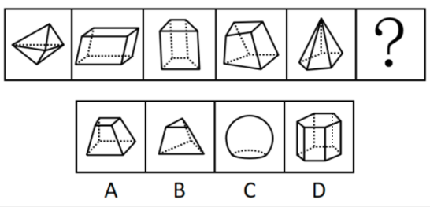

# 数量规律-立体图形的面数量（外表面数）

考点：[[20-考点/判断推理/图形推理/数量规律-立体图形的面数量（外表面数）|图形推理 / 数量规律-立体图形的面数量（外表面数）]]

**问法模型**：题干要求填入问号处使之呈现规律性，且五幅图全部为立体图形→立体图形属性规律不明显时，统一数'外表面（面）数量'找常数规律

## 推理链
1. 第1步：题干五幅图元素组成不同、无统一对称/曲直等属性规律，且每幅图均为立体图形（多面体），优先转向数量规律
2. 第2步：立体图形数量考点按'点—线—面'排查，本题数每个立体图形的外表面数量（虚线表示被遮挡的棱与面，需一并计入）
3. 第3步：逐一清点：图1为三棱双锥（上下两个锥体共尖对尖），6个三角形外表面；图2为平行六面体，6个四边形外表面；图3、图4均为六面体，各含6个外表面；图5为锥体（含虚线底面），外表面合计6个，题干规律为'外表面数量恒为6'
4. 第4步：由此问号处应填入一个外表面数量为6的立体图形
5. 第5步：选项对照：A项四棱台＝上下2个四边形底面＋4个梯形侧面＝6个面，符合规律；B项三棱台＝2个三角形底面＋3个侧面＝5个面，C项球体仅1个曲面，D项六棱柱＝2个六边形底面＋6个矩形侧面＝8个面，均不符合

**最快解法**：⚡ 数面法＋排除法：题干全是立体图形→直接数外表面数，确认均为6；再数选项——A四棱台按'2底＋4侧'数出6面，与题干一致秒选；B数出5面、C为1个曲面、D按'2＋6'数出8面，直接排除

## 易错点
- ⚠ 漏数虚线表示的被遮挡面（如锥体、台体的底面），导致每个立体的面数清点错误
- ⚠ A、B外形都像'台体'而不细辨底面边数：A为四棱台6个面，B为三棱台5个面，恰好差一个面而出错
- ⚠ 误数棱数或顶点数代替面数，或把'外表面数量'误解为'视角内看得见的面数'而漏算背面

## 母题抽象
> 🧩 当题干全部为立体（多面体）图形且属性规律不明显时，数每个立体图形的外表面数量找相同常数，问号处选择面数相同的选项（柱体、台体按'2底面＋n侧面'清点，虚线面勿漏）

**同类特征**：题干五幅图全部为立体图形、元素组成不同、无明显属性规律、图中带虚线（表示隐藏棱/面）、外表面数量呈现恒定常数6

## 相关题
- [[10-真题/判断推理/图形推理/10204454 数量规律-部分数（黑白球连通区域数做和）|10204454]]（甘肃 2024，相关度2）
- [[10-真题/判断推理/图形推理/10297050 数量规律-特殊计数（线条穿过小白球的数量）|10297050]]（天津 2025，相关度2）
- [[10-真题/判断推理/图形推理/10297262 数量规律-面的形状种类（封闭面种类数分组）|10297262]]（浙江 2025，相关度2）
- [[10-真题/判断推理/图形推理/10297314 数量规律-交点数（曲直交点）|10297314]]（浙江 2025，相关度2）
- [[10-真题/判断推理/图形推理/11454020 数量规律-小元素按行排布（每行个数自上而下递增1）|11454020]]（选调 2024，相关度2）

---

### 题干

从所给的四个选项中，选择最合适的一个填入问号处，使之呈现一定的规律性：

### 选项
- A. A　✅
- B. B
- C. C
- D. D

### 官方解析
元素组成不同，且无明显属性规律，优先考虑数量规律。观察发现，题干均为立体图形，考虑数立体图形外表面的数量，题干立体图形外表面数量均为6，故问号处应选择一个外表面数量为6的立体图形，只有A项符合。
故正确答案为A。

### 给定材料
（无）
