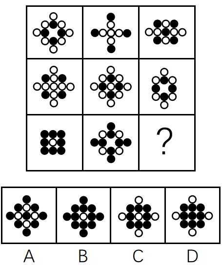

# 样式规律-去同求异（黑白圆叠加，白圆被黑圆遮挡）

考点：[[20-考点/判断推理/图形推理/样式规律-去同求异（黑白圆叠加，白圆被黑圆遮挡）|图形推理 / 样式规律-去同求异（黑白圆叠加，白圆被黑圆遮挡）]]

**问法模型**：九宫格'填入问号处使之呈现一定的规律性'→ 元素相似先看样式规律，横行无规律则逐列做'去同求异+黑白遮挡'叠加验证

## 推理链
1. 第1步：题干九宫格每个图形均由黑圆和白圆组成，元素组成相似，优先考虑样式规律（叠加类）
2. 第2步：九宫格优先横向比较，逐行观察无统一规律，转向纵向逐列比较
3. 第3步：验证第一列——图一（菱形分布黑白圆）与图二（十字分布黑白圆）相同位置的圆消去、不同位置的圆保留，叠加时白圆被黑圆遮挡，恰得第三行的黑圆块，'去同求异'规律成立
4. 第4步：验证第二列——前两图去同求异（白圆被黑圆遮挡）同样得到第三图，确认纵向规律一致
5. 第5步：规律迁移至第三列——图一（十字分布黑白圆）与图二（菱形分布、中心白圆）去同求异：相同位置圆消去，不同位置圆保留，且白圆被黑圆遮挡
6. 第6步：逐项对照选项，A、B、C均多出或缺少相应位置的圆，只有D项符合去同求异后的结果，故选D

**最快解法**：⚡ 逐列求异法：横向无规律立即转纵向，对每列前两图做'去同求异'，叠加时记住'黑遮白'（黑圆优先显现），按第三列图一、图二逐位置比对消去/保留，直接锁定D排除A、B、C

## 易错点
- ⚠ 只盯着横向找规律，发现无规律后未及时转向纵向比较
- ⚠ 忽略'白圆被黑圆遮挡'这一黑白叠加细节，把相同位置一黑一白误当'相同'消去或误保留
- ⚠ 把'去同求异'误操作成'去异求同'（保留相同部分），得出错误图形

## 母题抽象
> 🧩 当九宫格图形由黑白圆（或同类小元素）组成且元素相似、横行无规律时，逐列做'去同求异'叠加（注意黑遮白的遮挡规则），第三图=前两图异或叠加，据此排除选项

**同类特征**：九宫格、黑圆白圆组成、元素组成相似、横向无规律、纵向去同求异、白圆被黑圆遮挡

## 相关题
- [[10-真题/判断推理/图形推理/10204610 样式规律-加减同异（去同存异），九宫格列规律|10204610]]（辽宁 2024，相关度2）
- [[10-真题/判断推理/图形推理/10297349 样式规律-黑白运算|10297349]]（浙江 2025，相关度2）
- [[10-真题/判断推理/图形推理/10297407 样式规律-黑白运算（定义叠加）|10297407]]（四川 2025，相关度2）
- [[10-真题/判断推理/图形推理/12019768 样式规律-加减同异（求同）与位置旋转的复合规律|12019768]]（浙江 2026，相关度2）
- [[10-真题/判断推理/图形推理/12101004 样式规律-黑白运算（九宫格逐位置叠加）|12101004]]（江苏 2025，相关度2）

---

### 题干

从所给的四个选项中，选择最合适的一个填入问号处，使之呈现一定的规律性：

### 选项
- A. A
- B. B
- C. C
- D. D　✅

### 官方解析
元素组成相似，优先考虑样式规律。题干中各图形均由黑圆和白圆组成，九宫格题目优先考虑横向比较，但无明显规律，考虑纵向比较。观察发现，第一列中，前两个图形去同求异之后得到第三个图形（白圆被黑圆遮挡）；第二列中，前两个图形去同求异之后得到第三个图形（白圆被黑圆遮挡）；故第三列？处图形应由前两个图形去同求异得到（白圆被黑圆遮挡），只有D项符合。
故正确答案为D。

### 给定材料
（无）
