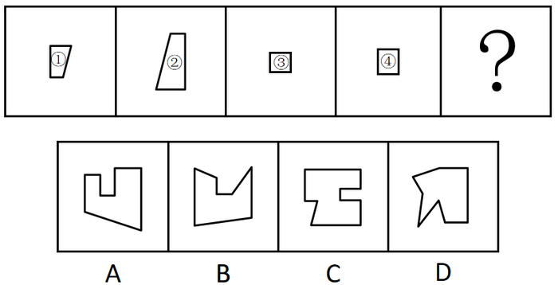

# 图形推理-平面拼合（平行且等长相消法）

考点：[[20-考点/判断推理/图形推理/图形推理-平面拼合（平行且等长相消法）|图形推理 / 图形推理-平面拼合（平行且等长相消法）]]

**问法模型**：问'由左边四个图形拼合而成的是哪个'→ 采用平行且等长相消法：拼合边必须平行且等长，相消后剩余边构成外轮廓，与选项逐一比对

## 推理链
1. 第1步：观察左侧四个源图形：图1为带斜边的小四边形，图2为直角梯形，图3、图4为两个小正方形，各图均有水平、竖直及斜向边
2. 第2步：明确平面拼合规则——两块图形相接的边必须平行且等长，相接后该边从轮廓中消去，剩余未相消的边构成整体外轮廓
3. 第3步：对四个图形的边按方向和长度两两配对：正方形的边可与梯形、四边形的对应水平/竖直边相消，斜边与斜边相消，凹口由未完全相消的短边形成
4. 第4步：相消拼合后得到的外轮廓是一个带内凹缺口、含水平底边和斜边的不规则多边形
5. 第5步：逐项对照——A项凹口为方形缺口且底边斜率不符；B项凹口为V形斜边且左上角外凸走向不符；D项左上出现尖角突出、轮廓带尖锐折角，与源图形平缓边线拼合结果不符
6. 第6步：C项轮廓的凹口位置、水平/竖直/斜边组合与相消后的剩余边完全吻合，故为正确答案

**最快解法**：⚡ 平行且等长相消法：先把四个小图形的边按'水平/竖直/斜向'分类并估长度，两两配对相消平行等长边，剩余边勾勒出的外轮廓（带凹缺口+斜底边）直接锁定C项，无需逐项精算

## 易错点
- ⚠ 误认为任意边相接即可拼合，忽略拼合边必须'平行且等长'的硬性条件
- ⚠ 忽略图形拼合时可旋转（甚至翻转），只按原图摆放方向硬拼导致排除正确项
- ⚠ 只看轮廓大致相似就选，未核对凹口位置、形状（方口/V口/尖角）与斜边走向，错选A、B或D

## 母题抽象
> 🧩 当题干出现'由左边几个图形拼合而成'时，用平行且等长相消法——将各图形的边按方向与长度两两相消，验证剩余边构成的外轮廓与哪个选项一致

**同类特征**：平面拼合类问法、左侧多个小块图形、选项为不规则多边形轮廓、需两两相消平行等长边、拼合后形成凹形外轮廓

## 相关题
- [[10-真题/判断推理/图形推理/10975247 图形推理-平面拼合（平行且等长相消法）|10975247]]（江苏 2024，相关度2）
- [[10-真题/判断推理/图形推理/12304870 图形推理-平面拼合（平行且等长相消法）|12304870]]（江苏 2024，相关度2）
- [[10-真题/判断推理/图形推理/1791820 图形推理-平面拼合（平行且等长相消法）|1791820]]（江苏 2016，相关度2）
- [[10-真题/判断推理/图形推理/2172380 图形推理-平面拼合（平行且等长相消法）|2172380]]（江苏 2018，相关度2）
- [[10-真题/判断推理/图形推理/2172477 图形推理-平面拼合（平行且等长相消法）|2172477]]（江苏 2018，相关度2）

---

### 题干

下列选项中由左边四个图形拼合而成的是：

### 选项
- A. A
- B. B
- C. C　✅
- D. D

### 官方解析

本题考查平面拼合，可采用平行且等长相消的方式解题。消去平行且等长的线段后进行组合可得到轮廓图，即为C项。平行且等长相消的方式如下图所示：

故正确答案为C。

### 给定材料
（无）
