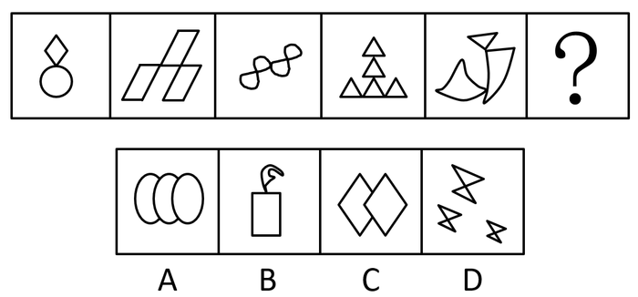

# 图形间关系（相交于点）+ 部分数（整体为一部分）

考点：[[20-考点/判断推理/图形推理/图形间关系（相交于点）+ 部分数（整体为一部分）|图形推理 / 图形间关系（相交于点）+ 部分数（整体为一部分）]]

**问法模型**：每幅图由多个小图形构成且元素组成不同 → 优先看图形间关系（相交于点/线/面），再用部分数（是否连通为一部分）二次筛选

## 推理链
1. 第1步：题干五幅图均由多个小图形组合而成，且元素组成不同，排除样式类和数量类优先级，按'图形间关系'切入
2. 第2步：图1菱形与圆、图2两个平行四边形、图3连环曲线、图4三个三角形、图5两个弧形，两两之间均只相交于一个点（点接触）
3. 第3步：对照选项——A项三个椭圆两两重叠、相交于面（线状重叠区），C项两个菱形相交于一条线段，均不符合'相交于点'，排除A、C
4. 第4步：进一步观察题干每幅图的所有小图形均连成一个整体，即均为一部分
5. 第5步：D项为三个散放的蝴蝶结形，互不接触，是多个部分，排除D
6. 第6步：B项矩形与上方曲线图形仅相交于一个点，且整体连通为一部分，与题干规律完全吻合，当选

**最快解法**：⚡ 排除法+口诀'多图形先看关系（点/线/面），再看部分数'：先以'相交于点'秒杀A、C，再以'均为一部分'排除D，锁定B

## 易错点
- ⚠ A项三个椭圆看似也有交点，实际是相交于面（存在重叠区域），误当成点相交而误选A
- ⚠ 只验证'相交于点'一层规律就匆忙作答，漏掉'部分数'这一二级规律（本题必须两层都满足）
- ⚠ C项两菱形相交处是一条短线段而非一个点，需区分'点相交'与'线相交'

## 母题抽象
> 🧩 当每幅图由多个小图形构成且元素组成不同时，先用'图形间关系'（相交于点/线/面）排除，再用'部分数（是否为一部分）'二次筛选，两层规律同时满足的才为答案

**同类特征**：多个小图形组合、相交于点（点接触）、整体连通为一部分、元素组成不同、图形间关系优先、需两层规律叠加筛选

## 相关题
- [[10-真题/判断推理/图形推理/10204454 数量规律-部分数（黑白球连通区域数做和）|10204454]]（甘肃 2024，相关度1）
- [[10-真题/判断推理/图形推理/10204604 数量规律-线数量（汉字横线数）|10204604]]（辽宁 2024，相关度1）
- [[10-真题/判断推理/图形推理/10297050 数量规律-特殊计数（线条穿过小白球的数量）|10297050]]（天津 2025，相关度1）
- [[10-真题/判断推理/图形推理/10297127 图形间关系-相交图形中不相交边数量（黑白图形相交）|10297127]]（天津 2025，相关度1）
- [[10-真题/判断推理/图形推理/10297148 数量规律-线的细化（端点连线穿过线条数；备选：平行线组数）|10297148]]（天津 2025，相关度1）

---

### 题干

从所给的四个选项中，选择最合适的一个填入问号处，使之呈现一定的规律性：

### 选项
- A. A
- B. B　✅
- C. C
- D. D

### 官方解析
元素组成不同，且每幅图均由多个图形构成，优先考虑图形间关系。观察发现，题干所有图形均相交于点，排除A、C两项。进一步观察发现，题干图形均为一部分，排除D项。
故正确答案为B。

### 给定材料
（无）
