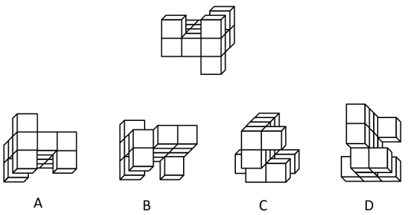

# 空间重构-立体旋转与镜像辨析（方块相对位置-参照物定位）

考点：[[20-考点/判断推理/图形推理/空间重构-立体旋转与镜像辨析（方块相对位置-参照物定位）|图形推理 / 空间重构-立体旋转与镜像辨析（方块相对位置/参照物定位）]]

**问法模型**：'与图中所给几何图不一致的是'（选非）→ 标记块定位法：给特征方块标号，以黑色粗线贯穿的三连块为参照，找相对方位改变的选项

## 推理链
1. 第1步：题干立体图形由若干小方块堆叠而成，其中三个方块被黑色粗线条贯穿（带斜线阴影面），构成天然参照系
2. 第2步：将题干中左上角的方块标为'1号方块'，解题只看一个关系：1号方块与黑色粗线三连块处于同侧还是异侧（旋转不改变该相对方位）
3. 第3步：观察题干，1号方块与黑色粗线贯穿的三个方块在同侧
4. 第4步：对照A项：旋转角度不同，但1号方块与三黑线方块仍保持同侧，与题干一致
5. 第5步：对照B、D项：与题干互为镜像/旋转关系，'1号与三黑线方块同侧'的结构关系未变，按官方口径视为一致
6. 第6步：对照C项：相应位置的1号方块与黑色粗线贯穿的三个方块位于斜对侧，相对方位发生改变，结构不同于题干
7. 第7步：本题为选非题，要求选出'不一致'的一项，故选C

**最快解法**：⚡ 参照物定位法：以黑色粗线三连块为'锚'，给左上角方块标'1号'，逐项只判断'1号与三连块同侧还是对侧'，同侧为一律排除，斜对侧者即答案→C

## 易错点
- ⚠ 误把镜像当作'不一致'：B、D与题干互为镜像，考生易据此错选B或D，官方口径下镜像结构关系未变不算不一致
- ⚠ 不取黑色粗线三连块作参照，仅凭整体轮廓相似度目测，图形旋转后极易误判
- ⚠ 选非题审题失误：错选成与题干一致的A/B/D

## 母题抽象
> 🧩 当题干给出积木堆叠立体图并问'哪个不一致/不同'时，以阴影、粗线等标记块为参照给特征块标号，只比较标记块与特征块的相对方位（同侧/对侧），方位不变者为一致，方位改变者为答案

**同类特征**：立方块堆叠立体图、黑色粗线贯穿的标记三连块、选非问法（找不一致）、多视角旋转比较、镜像与旋转辨析、相对方位（同侧/斜对侧）

## 相关题
（暂无）

---

### 题干

下列选项中与图中所给几何图不一致的是：

### 选项
- A. A
- B. B
- C. C　✅
- D. D

### 官方解析

如下图，将题干立体图形中左上角的方块标为1号方块，观察发现，题干立体图形中1号方块与黑色粗线条贯穿的三个方块在同侧，而C项中相应位置的1号方块与黑色粗线条贯穿的三个方块在斜对侧，所以C项与题干所给几何图不一致。

本题为选非题，故正确答案为C。

注：本题不严谨，因为问“不一致”，说明出题人把与题干互为镜像的B、D两项当成了一致，所以唯一完全不一致的只有C项。

### 给定材料
（无）

> [!warning] 疑点（官方解析可能有误，待人工复核）
> 官方解析已自注本题不严谨：严格而言B、D与题干互为镜像，旋转不可得，也属'不一致'；但按'结构相对位置是否改变'的口径，仅C项1号方块与黑线三连块由同侧变为斜对侧，故C为唯一应选项，答案C成立。
