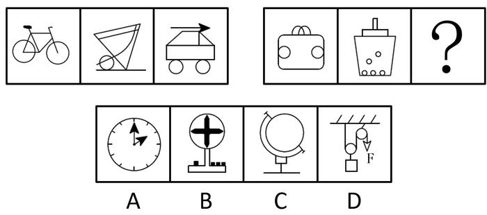

# 数量规律-切点数（圆与直线相切计数）

考点：[[20-考点/判断推理/图形推理/数量规律-切点数（圆与直线相切计数）|图形推理 / 数量规律-切点数（圆与直线相切计数）]]

**问法模型**：两组图类比型'替代问号呈现规律性'→ 先找第一组的统一数量规律（切点数递增），再应用到第二组确定问号处数值，最后逐项计数匹配

## 推理链
1. 第1步：题干两组图元素组成不同（自行车、小车、包、桶等实物化图形），且无明显的对称、曲直、封闭等属性规律，按'属性不通走数量'转向数量规律
2. 第2步：观察发现每幅图均由明显的圆和直线构成，且圆与直线存在相切关系，锁定'切点数'这一数量考点
3. 第3步：数第一组切点数：图1自行车为0、图2独轮车类图形为1、图3带箭头小车为2，呈0、1、2递增规律
4. 第4步：数第二组前两图切点数：包形图为2、桶形图为3，按递增规律问号处应为4个切点
5. 第5步：逐项对照：A时钟、B指示牌、C地球仪的圆与线相切数均不为4，D滑轮组中圆（滑轮）与绳线相切，切点数为4
6. 第6步：只有D项满足切点数4的规律，故选D

**最快解法**：⚡ 切点计数法：见'元素组成不同+圆和直线组合+存在相切'，直接数切点。第一组0→1→2递增，第二组2→3→需为4；快速扫选项，D滑轮图中滑轮与绳线相切共4处，直接锁定

## 易错点
- ⚠ 图形为自行车、滑轮等实物化/情境化图形，易误判为立体或常识类考点，忽略数量规律
- ⚠ 混淆'交点'与'切点'，把圆与直线的相交点也计入，导致第一组或选项计数出错
- ⚠ 只盯着单幅图的封闭区域数、线条数等常规数量，没有从'圆+直线相切'这一组合特征切入

## 母题抽象
> 🧩 当题干两组图元素组成不同、无属性规律，且每幅图均含圆和直线并出现相切特征时，数'切点数'，验证第一组呈等差递增后，令第二组延续该规律并匹配选项

**同类特征**：两组图类比型问号、元素组成不同、圆与直线组合、圆与直线相切、实物化图形（自行车/小车/包/桶/滑轮）、切点数递增0-1-2 / 2-3-4

## 相关题
- [[10-真题/判断推理/图形推理/5408661 数量规律-笔画数（一笔画与多笔画，奇点计数）|5408661]]（四川 2022，相关度2）
- [[10-真题/判断推理/图形推理/10204454 数量规律-部分数（黑白球连通区域数做和）|10204454]]（甘肃 2024，相关度1）
- [[10-真题/判断推理/图形推理/10204604 数量规律-线数量（汉字横线数）|10204604]]（辽宁 2024，相关度1）
- [[10-真题/判断推理/图形推理/10297050 数量规律-特殊计数（线条穿过小白球的数量）|10297050]]（天津 2025，相关度1）
- [[10-真题/判断推理/图形推理/10297127 图形间关系-相交图形中不相交边数量（黑白图形相交）|10297127]]（天津 2025，相关度1）

---

### 题干

从四个选项中选择一个替代问号，使之呈现一定规律性，最适合的是（    ）。

### 选项
- A. A
- B. B
- C. C
- D. D　✅

### 官方解析
元素组成不同，且无明显属性规律，考虑数量规律。观察发现，题干每幅图形均存在明显的圆和直线，且圆与直线多存在相切，优先考虑切点数。第一组图切点数分别为0、1、2，数量递增；第二组图切点数分别为2、3、？，故问号处图形的切点数应为4，只有D项满足规律。
故正确答案为D。

### 给定材料
（无）
