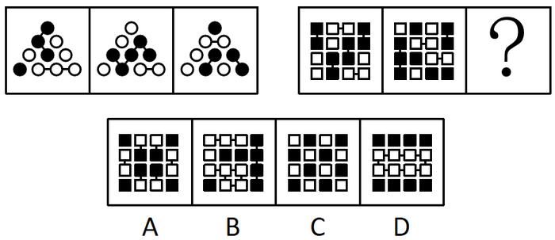

# 图形推理-连线规律（短线连接同色元素）+两套图形类比

考点：[[20-考点/判断推理/图形推理/图形推理-连线规律（短线连接同色元素）+两套图形类比|图形推理 / 图形推理-连线规律（短线连接同色元素）+两套图形类比]]

**问法模型**：题干为'两套图形，前组给规律、后组问号求同'问法 → 先归纳第一组图形共性规律，再代入第二组逐项排除验证

## 推理链
1. 第1步：观察第一组三个三角形，均由黑球、白球、短线三种元素组成，但三种元素在各图中数量不同，数量上无规律
2. 第2步：转向元素间位置关系找规律：每条短线均连接两个球，且被连接的两球颜色相同（黑连黑、白连白），这是第一组的共同规律
3. 第3步：第二组已知两图同样由黑白方块与短线组成，将'短线只连接同色方块'规律代入？处，A、C两项中存在短线连接异色方块的情况，排除A、C
4. 第4步：对B、D做二级辨析：题干图形中短线连接的既有黑色图形也有白色图形，而D项短线只连接白色方块，不符合，排除D
5. 第5步：B项既满足'短线连接同色方块'，又满足'黑白连线均出现'，与第一组规律相似性最大，故选B

**最快解法**：⚡ 连线颜色法+排除法：先由第一组锁定'短线两端同色'规律，一眼排除A、C；再比B、D——D项只连白色、题干黑白都连，锁定B

## 易错点
- ⚠ 执着于数黑白球/方块的数量找规律，而数量本无规律，陷入死胡同
- ⚠ 只看'有短线连接'而不检查连线两端元素颜色是否一致，误选A或C
- ⚠ 二级辨析缺位：B、D均满足同色连线后，忽略'连线连接的既有黑色也有白色图形'这一细节，误选D

## 母题抽象
> 🧩 当两套图形均由黑白两种元素加短线组成且元素数量无规律时，改用'短线连接元素的颜色关系'造规律（同色/异色、黑白连线是否齐全），代入第二组用排除法筛选

**同类特征**：两套图形类比求同、黑球白球+黑白方块、短线连接相邻元素、数量无规律转看位置关系、连线两端同色、末位二级辨析（B/D）

## 相关题
（暂无）

---

### 题干

从四个选项中选择一个替代问号，使两套图形的规律表现出最大的相似性，最适合的是（    ）。

### 选项
- A. A
- B. B
- C. C
- D. D

### 官方解析
解析一：观察第一组图形，发现图形均由黑球、白球、短线组成，但数量不同且无规律，再观察发现每条短线均连接两个图形，且两个图形的颜色相同，第二组图形应用此规律，排除A、C两项；比较B、D两项发现，D项短线连接的只有白色图形，题干图形中短线连接的既有黑色图形也有白色图形，排除D项。
故正确答案为B。
解析二：观察第一组图形，发现斜向相邻的黑球以短线相连，横向相邻的白球以短线相连；第二组前两个图形中竖向相邻的黑块以短线相连，横向相邻的白块以短线相连，故？处图形应与其规律保持一致，排除A、B、D三项。
故正确答案为C。

### 给定材料
（无）

> [!note] 复核版本状态
> 原题不可计分（underdetermined；来源记录的答案键/竞争项：B、C）；仅当前明确标注的编辑版按答案B计分。
> 详细原题疑点、修订题面、解析和证据见下方独立复核记录。

<!-- CODEX-ANSWER-REVIEW:BEGIN -->
### 本次独立复核

**复核结论：** `resolved`（答案与解析已核定）

**原题计分状态：** 不计分（`underdetermined`：原题证据不足以唯一判定）。来源中记录的答案键/竞争项：B、C；这些记录不代表原题已核准答案。

**原题疑点与处理：**

深圳市考 2020 〔20-考点/判断推理/图形推理/图形推理-连线规律（短线连接同色元素）+两套图形类比〕 — 官方解析二按'斜向黑球相连、横向白球相连→第二组竖向黑块相连、横向白块相连'推出排除A、B、D得C，与官方正确答案B及解析一直接矛盾；且其方向规律在第一组图中难…

**当前计分版本：** 明确标注的编辑版；未列出的题干、材料或选项沿用固定题源。答案不回填为原题答案。

**计分答案：** B（可计分）

**复核解析：**

【编辑版】按每条短线连接两个同色元素的规则检查。第一组短线连接同色元素；第二组前两图也各有黑色同色连接和白色同色连接。缺项中B同时保留这两种连接，D只有白色连接，A/C不满足，故选B。原题还可按线段方向类比导向C，编辑题干限定同色连接。

**修订题干：**

【编辑修订版】以短线两端元素的颜色关系为唯一判据：待选图形应同时包含一条连接两个黑色元素的短线和一条连接两个白色元素的短线。请选择符合条件的图形。

**相关信息：**

类比图形中的线条关系需检查每一条短线两端元素，而不是只比较线段方向或图形外观。

**核对依据与来源边界：**

- 固定题源：[原题文件](https://github.com/Mentat-Uran/kaogongzhentizhengliu/blob/84ab93d4b64b61d897bece8a1c0a5bab06b4feb2/10-%E7%9C%9F%E9%A2%98/%E5%88%A4%E6%96%AD%E6%8E%A8%E7%90%86/%E5%9B%BE%E5%BD%A2%E6%8E%A8%E7%90%86/2730660%20%E5%9B%BE%E5%BD%A2%E6%8E%A8%E7%90%86-%E8%BF%9E%E7%BA%BF%E8%A7%84%E5%BE%8B%EF%BC%88%E7%9F%AD%E7%BA%BF%E8%BF%9E%E6%8E%A5%E5%90%8C%E8%89%B2%E5%85%83%E7%B4%A0%EF%BC%89%2B%E4%B8%A4%E5%A5%97%E5%9B%BE%E5%BD%A2%E7%B1%BB%E6%AF%94.md)；内容版本 `84ab93d4b64b61d897bece8a1c0a5bab06b4feb2`，源 Markdown blob `66ef9ee102f364e98a728e88475ca7ac9c51ff05`.
- 固定题图/公式图：`90-图片/题目图/1765fef8d0902ee.png`.

<!-- CODEX-ANSWER-REVIEW:END -->
