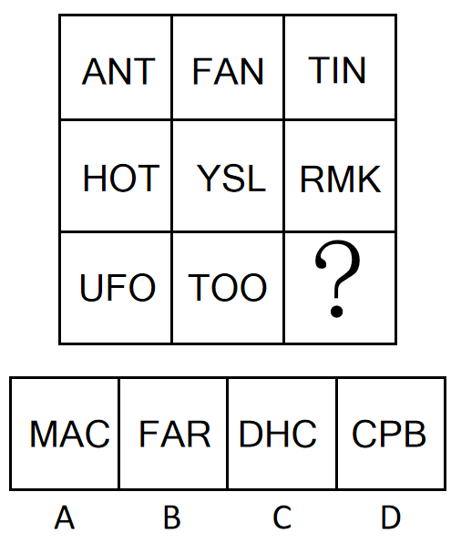

# 数量规律-含曲线字母的个数按行恒定（字母按直线-曲线分类计数）

考点：[[20-考点/判断推理/图形推理/数量规律-含曲线字母的个数按行恒定（字母按直线-曲线分类计数）|图形推理 / 数量规律-含曲线字母的个数按行恒定（字母按直线/曲线分类计数）]]

**问法模型**：九宫格问'？'处替代使之呈现规律性 → 元素组成不同且无属性规律时，优先按横行找数量规律（统计每格含曲线字母个数），行恒常数即定答案

## 推理链
1. 第1步：题干为3×3九宫格，元素为字母组合（第一行ANT/FAN/TIN，第二行HOT/YSL/RMK，第三行UFO/TOO/?），元素组成不同且无明显属性规律，优先考虑数量规律
2. 第2步：对字母按'笔画是否含曲线'分类计数——第一行所有字母（A/N/T/F/I）均由直线构成，三幅图各含曲线字母0个
3. 第3步：第二行HOT含曲线字母O、YSL含S、RMK含R（R含曲线笔画），三幅图各含曲线字母1个，行内恒定
4. 第4步：第三行UFO含U、O两个曲线字母，TOO含O、O两个曲线字母，前两图均为2个→'？'处应含2个曲线字母
5. 第5步：逐项对照——A项MAC仅C含曲线（1个）；B项FAR仅R含曲线（1个）；C项DHC中D、C含曲线（2个）；D项CPB中C、P、B均含曲线（3个）
6. 第6步：只有C项DHC含2个曲线字母，满足第三行'曲线字母数=2'的规律，故选C

**最快解法**：⚡ 曲线字母计数法+行优先口诀：直线字母集（A/E/F/H/I/K/L/M/N/T/V/W/X/Y/Z）与曲线字母集（C/O/S/U/D/P/R/B/G/Q）快速二分，第三行前两图各2个曲线字母，扫选项——MAC 1个、FAR 1个、DHC 2个、CPB 3个，直选C

## 易错点
- ⚠ '由曲线构成'指笔画中含曲线即可，D、P、R、B这类'直线+曲线'混合字母也要计入，漏计会误数成1个而错选A或B
- ⚠ 本题存在纵向干扰规律：按列数封闭面（面数量）每列之和恒为3，第三列缺2个面会指向B项FAR（A、R各1个面）；需牢记九宫格'优先看横行'的取舍规则，否则误选B
- ⚠ 字母类九宫格易先去数笔画数或封闭面数，忽略'直线/曲线分类'这一基础数量维度，导致迟迟找不到规律

## 母题抽象
> 🧩 当九宫格元素为字母（字符）且组成不同、属性无规律时，按行（行优先于列）统计'含曲线字母个数/封闭面数/笔画数'等数量维度，行内恒常数即为规律，'？'处补齐该常数即可

**同类特征**：九宫格字母图形、元素组成不同、无明显属性规律、含曲线字母个数按行恒定（0/1/2递增）、存在数封闭面（每列面数和恒为3）的干扰规律、问'？'处替代使之呈现规律性

## 相关题
- [[10-真题/判断推理/图形推理/10204454 数量规律-部分数（黑白球连通区域数做和）|10204454]]（甘肃 2024，相关度2）
- [[10-真题/判断推理/图形推理/10297050 数量规律-特殊计数（线条穿过小白球的数量）|10297050]]（天津 2025，相关度2）
- [[10-真题/判断推理/图形推理/10297262 数量规律-面的形状种类（封闭面种类数分组）|10297262]]（浙江 2025，相关度2）
- [[10-真题/判断推理/图形推理/10297314 数量规律-交点数（曲直交点）|10297314]]（浙江 2025，相关度2）
- [[10-真题/判断推理/图形推理/11454020 数量规律-小元素按行排布（每行个数自上而下递增1）|11454020]]（选调 2024，相关度2）

---

### 题干

从四个选项中选择一个替代问号，使之呈现一定规律性，最适合的是（    ）。

### 选项
- A. A
- B. B
- C. C　✅
- D. D

### 官方解析
思路一：
元素组成不同，且无明显属性规律，优先考虑数量规律。观察发现，第一行中，三幅图分别有0个由曲线构成的图形；第二行中，三幅图分别有1个由曲线构成的图形；第三行中，前两幅图均有2个由曲线构成的图形，故“？”处要有2个由曲线构成的图形，只有C项符合。
故正确答案为C。
思路二：
元素组成不同，且无明显属性规律，优先考虑数量规律。观察发现，题干存在明显封闭面，考虑数面。观察发现，第一列中，三幅图的面数量相加为3；第二列中，三幅图的面数量相加为3；第三列中，前两幅图的面数量相加为1，故“？”处要找一个面数量为2的图形，使第三列的面数量相加恒等于3，只有B项符合。
故正确答案为B。
本题有两个规律，但九宫格优先看横行，故粉笔倾向于第一种规律。
故正确答案为C。

### 给定材料
（无）

<!-- CODEX-ANSWER-REVIEW:BEGIN -->
### 本次独立复核

**复核状态：** `resolved`（答案与解析已核定）

**计分答案：** C（可计分）

**复核解析：**

【编辑版】按每行含曲线字母的图形数补位：第一行0个、第二行1个、第三行已有2个，缺项仍需含2个曲线字母。选项中只有C满足。原题另按面数列也可导向B，修订明确采用行内曲线字母数。

**修订题干：**

从四个选项中选择一个替代问号，使之呈现一定规律性，最适合的是（    ）。

**【编者修订条件】** 【编辑版】只按每行含曲线字母的图形个数补位：各行依次为0、1、2个。

**相关信息：**

数量规律—按行计数指定特征；先确认“含曲线字母的图形个数”，不要误数曲线段本身。

**题源依据：** [固定版本原题](https://github.com/Mentat-Uran/kaogongzhentizhengliu/blob/84ab93d4b64b61d897bece8a1c0a5bab06b4feb2/10-%E7%9C%9F%E9%A2%98/%E5%88%A4%E6%96%AD%E6%8E%A8%E7%90%86/%E5%9B%BE%E5%BD%A2%E6%8E%A8%E7%90%86/2730929%20%E6%95%B0%E9%87%8F%E8%A7%84%E5%BE%8B-%E5%90%AB%E6%9B%B2%E7%BA%BF%E5%AD%97%E6%AF%8D%E7%9A%84%E4%B8%AA%E6%95%B0%E6%8C%89%E8%A1%8C%E6%81%92%E5%AE%9A%EF%BC%88%E5%AD%97%E6%AF%8D%E6%8C%89%E7%9B%B4%E7%BA%BF-%E6%9B%B2%E7%BA%BF%E5%88%86%E7%B1%BB%E8%AE%A1%E6%95%B0%EF%BC%89.md)；固定内容 commit `84ab93d4b64b61d897bece8a1c0a5bab06b4feb2`，Markdown blob `0a6b4bbc41e04dcb0f8973f6d69f1240a5e7c0fc`。
<!-- CODEX-ANSWER-REVIEW:END -->
