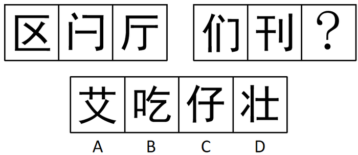

# 数量规律-汉字笔画数（叠加结构规律二次辨析）

考点：[[20-考点/判断推理/图形推理/数量规律-汉字笔画数（叠加结构规律二次辨析）|图形推理 / 数量规律-汉字笔画数（叠加结构规律二次辨析）]]

**问法模型**：两套图形求同规律填问号 → 先找组内恒定数量规律（笔画数）分层排除，剩余项再叠加结构（半包围/左右/上下）二级辨析

## 推理链
1. 第1步：题干为两组汉字，第一组'区、闪、厅'，第二组'们、刊、?'，元素组成不同且无对称、封闭等属性规律，转向数量规律
2. 第2步：汉字图形优先数笔画数：第一组'区'4画、'闪'4画、'厅'4画，组内笔画数恒定为4
3. 第3步：第二组'们'5画、'刊'5画，依此规律问号处汉字应为5画
4. 第4步：数选项笔画：'艾'5画、'吃'6画、'仔'5画、'壮'6画，排除B、D，剩A、C
5. 第5步：A、C笔画数相同，启用二级规律——结构：第一组'区、闪、厅'均为半包围结构，第二组'们、刊'均为左右结构，故问号处应为左右结构
6. 第6步：'艾'为上下结构，'仔'为左右结构，排除A，确定C

**最快解法**：⚡ 笔画数排除法+结构二次筛选：第一组均4画、第二组均5画，选项中'吃、壮'6画先排除，再比较'艾（上下结构）'与'仔（左右结构）'，由第二组'们、刊'均为左右结构锁定C

## 易错点
- ⚠ 只做笔画数一层规律就作答，未注意到'艾'与'仔'同为5画，漏掉结构（半包围/左右/上下）这一二级辨析而误选A
- ⚠ 汉字笔画数数错，如'闪'（门2+人2=4画）、'厅'（厂2+丁2=4画）多算或少算
- ⚠ 把'区、闪、厅'的结构笼统看成'包围结构'，未能准确识别半包围结构，导致二级规律无法建立

## 母题抽象
> 🧩 当题干图形全为汉字且元素组成不同时，先数笔画数找组内恒定规律筛选选项；若笔画数出现并列，再用结构（左右/上下/半包围）作二级规律定答案

**同类特征**：两套图形各含三个汉字、选项亦为汉字、元素组成不同、无属性规律、组内笔画数恒定（第一组4画、第二组5画）、笔画并列时需叠加汉字结构规律

## 相关题
- [[10-真题/判断推理/图形推理/12561867 数量规律-相同元素的位置关系（对角相对-边邻相邻）分组分类|12561867]]（浙江 2024，相关度1）
- [[10-真题/判断推理/图形推理/14993424 数量规律-元素个数（黑-灰矩形数量等差递增）|14993424]]（选调 2024，相关度1）
- [[10-真题/判断推理/图形推理/15419022 数量规律-图形间关系（面相贴-被完全隔开，内部线条部分数）|15419022]]（湖北 2025，相关度1）
- [[10-真题/判断推理/图形推理/16069776 数量规律-面数量（总面数恒定+全直线面数量递减二级规律）|16069776]]（广西 2026，相关度1）
- [[10-真题/判断推理/图形推理/1789602 数量规律-波峰波谷个数差+位置规律（最高波峰与竖轴左右关系）|1789602]]（江苏 2016，相关度1）

---

### 题干

从四个选项中选择一个替代问号，使两套图形的规律表现出最大的相似性，最适合的是（    ）。

### 选项
- A. A
- B. B
- C. C　✅
- D. D

### 官方解析
元素组成不同，且无明显属性规律，考虑数量规律。题干图形均为汉字，考虑汉字笔画数。第一组汉字的笔画数均为4，第二组前两个汉字的笔画数均为5，故问号处汉字笔画数应为5，排除B、D两项；比较A、C两项发现，A项为上下结构，C项为左右结构，题干第一组汉字均为半包围结构，第二组前两个汉字均为左右结构，故问号处汉字也应为左右结构，排除A项。
故正确答案为C。

### 给定材料
（无）
