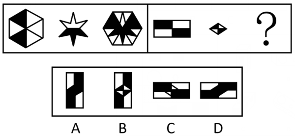

# 样式规律-旋转后叠加（位置变化+图形相加复合规律）

考点：[[20-考点/判断推理/图形推理/样式规律-旋转后叠加（位置变化+图形相加复合规律）|图形推理 / 样式规律-旋转后叠加（位置变化+图形相加复合规律）]]

**问法模型**：两组图问'？'处图形 → 先归纳第一组'图1旋转+与图2相加=图3'的复合规律，再原样套用到第二组

## 推理链
1. 第1步：第一组图1为黑白六边形、图2为黑白星形、图3为含星形图案的复杂黑白六边形，元素组成相似，优先考虑样式规律
2. 第2步：对比发现图3可拆解为'图1顺时针旋转后的黑白格局+图2星形图案'，即规律为图1先顺时针旋转、再与图2相加（叠加）得到图3
3. 第3步：第二组图1为两个横放的黑白长方形、图2为黑白菱形，套用同规律：先把图1顺时针旋转变为竖放长方形格局，再与菱形相加
4. 第4步：逐项对照——C、D仍为横放长方形，未体现'旋转'这一步，排除
5. 第5步：B中菱形轮廓独立完整地保留在中央，不符合两图相加融合后的图案，排除
6. 第6步：A为竖放长方形，其黑白图案恰是旋转后的图1与图2叠加的结果，与第一组规律一致，故选A

**最快解法**：⚡ 口诀'先转再加'：把第二组图1顺时针旋转90°（横长方形变竖长方形），再与图2菱形叠加；先排除未旋转的C、D，再排除叠加后菱形仍单独成形的B，锁定A

## 易错点
- ⚠ 只看'相加'忽略'先顺时针旋转'的前提，误选保持横放的C或D
- ⚠ 把图2菱形当作独立图形原样保留，误选菱形轮廓仍清晰独立的B
- ⚠ 旋转方向或角度看错，导致黑白格局比对失误

## 母题抽象
> 🧩 当两组图元素组成相似、且图3明显是'图1的框架+图2的图案'组合体时，优先检验'图1经旋转（位置变化）后与图2叠加（样式相加）'的复合规律，第二组照搬验证

**同类特征**：两组式图形推理、元素组成相似、黑白相间图案、图3为前两图叠加组合、旋转与相加复合规律、'？'处求问

## 相关题
- [[10-真题/判断推理/图形推理/19889502 样式规律-黑白运算（黑白叠加）|19889502]]（上海 2019，相关度2）
- [[10-真题/判断推理/图形推理/2166149 样式规律-黑白运算（黑白叠加）|2166149]]（深圳市考 2018，相关度2）
- [[10-真题/判断推理/图形推理/2262991 样式规律-叠加（两图叠加+封闭空间内外线条连通）|2262991]]（四川 2016，相关度2）
- [[10-真题/判断推理/图形推理/4695885 样式规律-加减同异（去同存异）|4695885]]（选调 2018，相关度2）
- [[10-真题/判断推理/图形推理/5690245 图形推理-样式规律（叠加求异-去同存异）|5690245]]（上海 2017，相关度2）

---

### 题干

下列选项中，符合所给图形的变化规律的是：

### 选项
- A. A　✅
- B. B
- C. C
- D. D

### 官方解析

元素组成相似，优先考虑样式规律。观察发现，第一组图，图1先顺时针旋转后，再与图2相加得到图3。第二组图满足同样的规律，图1先顺时针旋转后，再与图2相加得到图3，只有A项符合。

故正确答案为A。

### 给定材料
（无）
