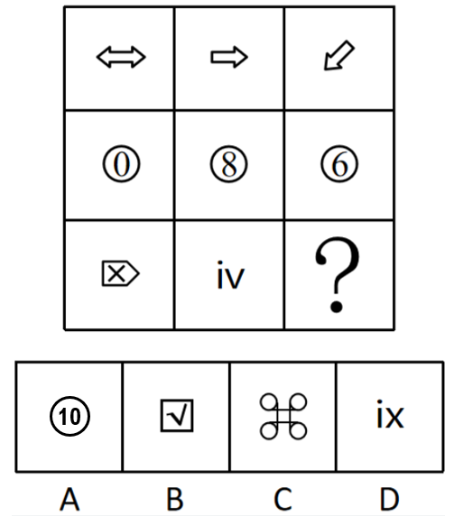

# 数量规律-笔画数（多笔画按行递增）

考点：[[20-考点/判断推理/图形推理/数量规律-笔画数（多笔画按行递增）|图形推理 / 数量规律-笔画数（多笔画按行递增）]]

**问法模型**：九宫格'替代问号呈现规律'→元素组成不同且含字母数字多部分图形时，按行归纳笔画数规律，用奇点法定每图最少笔画数

## 推理链
1. 第1步：提取图形——第一行三个空心箭头（双向、单向、斜向），第二行圆圈包数字'①⑧⑥'，第三行'方框内X'、字母'iv'、问号，元素组成不同，属性（对称、开闭）无统一规律
2. 第2步：题干出现字母、数字和多部分图形且部分数无规律，按官方思路转向笔画数，用'数奇点'方法确定每个图形的最少一笔画数
3. 第3步：第一行三个箭头轮廓均为闭合多边形、无奇点，均为一笔画；第二行每图=外圈1笔+内部数字（0、8、6均可一笔画）1笔=两笔画
4. 第4步：第三行前两图：方框1笔+内部'X'有4个奇点需2笔=3笔；'iv'中i为2笔（点+竖）、v为1笔，共3笔，故问号应为三笔画图形
5. 第5步：对照选项数笔画——A'⑩'=圆1笔+'1'1笔+'0'1笔=3笔；B=方框1笔+√1笔=2笔；C为四圆加连线远超3笔；D'ix'=i2笔+x2笔=4笔，只有A为三笔画

**最快解法**：⚡ 笔画数口诀+按行验证：先看第一行箭头均为一笔画、第二行'圈+数字'均为两笔画，锁定'行内笔画数相同、逐行递增'规律，第三行直接数选项笔画，A为圆+1+0共3笔，秒选A

## 易错点
- ⚠ 把交叉的'X'误当一笔画，忽略其4个奇点实为2笔，导致第三行笔画数算错
- ⚠ 数'⑩'时漏数外圈或把'10'误看成一个整体，错算成2笔而排除正确答案
- ⚠ 受行内元素种类杂乱（箭头、数字、字母）干扰，误以为无规律或误找列规律/部分数规律

## 母题抽象
> 🧩 当九宫格元素组成不同、出现字母/数字/多部分组合图形且属性与部分数均无规律时，按行数笔画（奇点法：奇点数÷2或奇点数为0/2记一笔），验证'一行一笔、二行两笔、三行三笔'式递增规律

**同类特征**：九宫格按行规律、字母与数字混排出现、多部分组合图形（圆圈包数字、方框内含X）、部分数无规律需转笔画数、笔画数按行1/2/3递增、空心箭头类一笔画轮廓图

## 相关题
- [[10-真题/判断推理/图形推理/19889494 数量规律-小元素数量运算（框内外分布）|19889494]]（上海 2019，相关度1）
- [[10-真题/判断推理/图形推理/4651744 样式规律-旋转+求异（去同存异复合规律）|4651744]]（江苏 2022，相关度1）
- [[10-真题/判断推理/图形推理/4673178 图形拼合（灰白方块无缝拼合成4×3矩形，以白色块定位）|4673178]]（广东 2022，相关度1）

---

### 题干

从四个选项中选择一个替代问号，使之呈现一定规律性，最适合的是（    ）。

### 选项
- A. A　✅
- B. B
- C. C
- D. D

### 官方解析
元素组成不同，无明显属性规律，考虑数量规律。观察发现，题干出现字母、数字和多部分图形且部分数无规律，可以考虑笔画数。题干第一行的图形均为一笔画图形，第二行的图形均为两笔画图形，第三行的前两幅图为三笔画图形，因此“？”处也应选择一个三笔画图形，只有A项符合。
故正确答案为A。

### 给定材料
（无）
