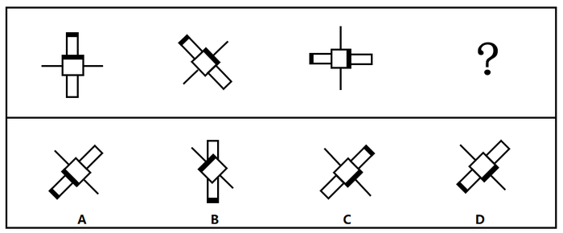

# 位置规律-旋转（双元素异向旋转：正方形顺时针、长方形逆时针各45°）

考点：[[20-考点/判断推理/图形推理/位置规律-旋转（双元素异向旋转：正方形顺时针、长方形逆时针各45°）|图形推理 / 位置规律-旋转（双元素异向旋转：正方形顺时针、长方形逆时针各45°）]]

**问法模型**：“符合所给图形变化规律”且元素组成相同 → 位置规律模型：分元素追踪各标记的旋转方向与步长，逐项排除锁定答案

## 推理链
1. 第1步：题干三幅图与？处元素组成相同，均由中心黑边正方形、带黑端的白色长方形及细直线构成，优先考虑位置规律（旋转）。
2. 第2步：追踪中心黑边正方形：图1黑边在下（南），图2顺时针转45°至左下（西南），图3再顺时针转至左（西），规律为每幅顺时针旋转45°。
3. 第3步：追踪黑边长方形：图1黑端在上（北），图2逆时针转45°至左上（西北）且整体斜置，图3再逆时针转45°呈水平、黑端在左（西），规律为每幅逆时针旋转45°。
4. 第4步：？处正方形黑边应在图3（黑边朝西）基础上再顺时针旋转45°，转到左上（西北）方向，A、B两项正方形黑边位置不符，排除A、B。
5. 第5步：？处长方形应在图3（水平、黑端在左）基础上再逆时针旋转45°，呈“左下—右上”斜置且黑端位于左下（西南），C项黑端位置不符，只有D项符合。
6. 第6步：双元素各按相反方向旋转45°后，唯一同时满足两个规律的选项为D。

**最快解法**：⚡ 标记追踪法（排除法）：只盯两处“黑边”标记——正方形黑边每次顺时针45°、长方形黑端每次逆时针45°；先用正方形黑边在？处应指左上排除A、B，再用长方形黑端应转到左下锁定D。

## 易错点
- ⚠ 两个元素旋转方向相反（正方形顺时针、长方形逆时针），只验证单一元素易误选C
- ⚠ 图形斜置45°时顺/逆时针方向易看反，应以钟表12点方向为基准判定
- ⚠ 只看整体轮廓不看“黑边”标记位置，四个选项轮廓高度相似而无法排除

## 母题抽象
> 🧩 当图形元素组成相同且元素上带有黑边/黑点等标记时，分元素追踪每个标记的旋转方向与步长（常见45°或90°），用一个标记排除、用另一个标记锁定答案。

**同类特征**：元素组成相同、黑边/黑端标记、正方形与长方形双元素嵌套、每幅旋转45°、顺时针与逆时针混合旋转、三图+？求第四图

## 相关题
- [[10-真题/判断推理/图形推理/2172768 位置规律（旋转-翻转）|2172768]]（海南 2021，相关度1）
- [[10-真题/判断推理/图形推理/10204458 位置规律-平移（特征交点沿内圈循环平移）|10204458]]（甘肃 2024，相关度1）
- [[10-真题/判断推理/图形推理/10204614 图形推理-位置规律（旋转+翻转交替循环）|10204614]]（黑龙江 2024，相关度1）
- [[10-真题/判断推理/图形推理/10297399 位置规律—平移（多黑块分组循环平移）|10297399]]（四川 2025，相关度1）
- [[10-真题/判断推理/图形推理/11226892 位置规律-九宫格小元素沿固定循环链移动|11226892]]（上海 2025，相关度1）

---

### 题干

下列选项中，符合所给图形变化规律的是：

### 选项
- A. A
- B. B
- C. C
- D. D　✅

### 官方解析

元素组成相同，优先考虑位置规律。观察题干，图形中间部分的黑边正方形每幅图依次顺时针旋转，故？处图形中间部分的黑边正方形应在第三幅图形的基础上顺时针旋转，排除A、B两项；继续观察，题干图形的黑边长方形每幅图依次逆时针旋转，故？处图形的黑边长方形应在第三幅图形的基础上逆时针旋转，只有D项符合。

故正确答案为D。

### 给定材料
（无）
