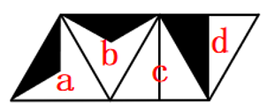
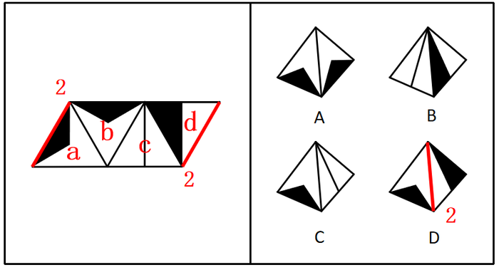
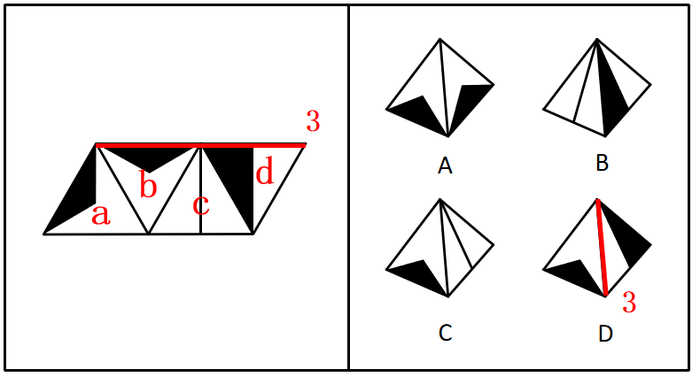

# 空间重构-四面体折叠（相邻面公共边-公共点特征排除）

考点：[[20-考点/判断推理/图形推理/空间重构-四面体折叠（相邻面公共边-公共点特征排除）|图形推理 / 空间重构-四面体折叠（相邻面公共边/公共点特征排除）]]

**问法模型**：给出四面体展开图与四个立体视图，问哪个符合折叠规律 → 用相邻面公共边、公共点上的图案特征逐项排除

## 推理链
1. 第1步：题干展开图含四个三角形面：两个黑色钝角三角形面（面a、面b）、一个带直线的面（面c）、一个黑色直角三角形面（面d），需折叠为四面体后与立体选项比对
2. 第2步：方法为特征面定位——锁定相邻面的公共边（公共边1、2、3）与公共点（m、n），检查图案与边/点的相对关系是否保持
3. 第3步：A项各面图案与公共边关系与题干一致，当选
4. 第4步：B项含面c与面d，题干公共点m在面d上位于黑色直角三角形较大锐角对应顶点，选项中m却落在较小锐角对应顶点，排除
5. 第5步：C项含面c与黑色钝角三角形面：若该面为面a，题干中面c的直线与公共边1垂直，选项中直线与公共边1仅在顶点相交，不符；若该面为面b，题干公共点n应为面b黑三角锐角顶点与面c直线的交点，选项中两点未相交，排除
6. 第6步：D项含面d与黑色钝角三角形面：题干公共边2在面a中是黑色钝角三角形的一条边，选项中不是，故非面a；公共边3与面b、面d的关系也与题干不符，故非面b，排除
7. 第7步：四项中仅A项与展开图各相邻面特征一致，锁定答案A

**最快解法**：⚡ 公共边/公共点特征排除法——先抓最醒目的面d黑色直角三角形：检查B项公共点m落在较大锐角还是较小锐角顶点（错，排除B）；再对C、D逐一假设黑钝角面是a或b，用'直线与公共边1垂直''公共边2是黑钝角三角形的一条边'两条硬特征排除；与题干完全一致的A当选

## 易错点
- ⚠ 混淆面d黑色直角三角形较大锐角与较小锐角各自对应的顶点，导致m点位置判断错误
- ⚠ 忽略面c直线与公共边1'垂直相交'和'仅在顶点相交'的区别
- ⚠ 对黑色钝角三角形面不做a/b两种假设逐一验证，漏检一种情况而误判

## 母题抽象
> 🧩 当题干出现四面体展开图+立体视图选项时，用'特征面公共边/公共点定位法'，验证每个选项中相邻面的图案与公共边（垂直、共边、顶点交点）关系是否与展开图保持一致

**同类特征**：四面体展开图、空间折叠立体视图、黑色直角三角形面、黑色钝角三角形面、含直线的面、公共边与公共点特征

## 相关题
- [[10-真题/判断推理/图形推理/1789614 空间重构-四面体展开图（画边法-唯一点法）|1789614]]（江苏 2016，相关度1）
- [[10-真题/判断推理/图形推理/2042726 空间重构-四面体折叠（相邻面相对位置-画箭头法）|2042726]]（江苏 2017，相关度1）
- [[10-真题/判断推理/图形推理/2144543 空间重构-四面体折叠（唯一点顺时针描边法）|2144543]]（选调 2018，相关度1）
- [[10-真题/判断推理/图形推理/2367814 空间重构-四面体折叠（相邻面公共边与特征线-箭头指向检验）|2367814]]（江苏 2019，相关度1）
- [[10-真题/判断推理/图形推理/2367987 空间重构-四面体展开图折叠（画边法-公共边法）|2367987]]（江苏 2019，相关度1）

---

### 题干

下列选项中，符合所给图形的变化规律的是：

### 选项
- A. A　✅
- B. B
- C. C
- D. D

### 官方解析

本题考查四面体的空间重构。将题干展开图中的面依次标注为面a、b、c、d，如下图，逐一进行分析。

A项：选项与题干一致，当选；

B项：选项中出现了面c和面d。题干中面c和面d的公共点m在面d上为黑色直角三角形较大锐角对应的顶点，而选项中面c和面d的公共点m在面d上为黑色直角三角形较小锐角对应的顶点，选项和题干不一致，排除；

C项：选项中出现了面c和黑色钝角三角形的面，其中黑色钝角三角形的面可能为面a或面b。假设黑色钝角三角形的面是面a，题干中面c的直线与公共边1垂直，选项中面c的直线和公共边1在顶点相交，因此选项中的面不是面a；假设黑色钝角三角形的面是面b，题干中面b和面c的公共点n为面b黑三角形锐角顶点和面c直线的交点，而选项中面b和面c的两点并没有相交，选项和题干不一致，排除；

D项：选项中出现了面d和黑色钝角三角形的面，其中黑色钝角三角形的面可能为面a或面b。题干中公共边2在面a中为黑色钝角三角形的一条边，而选项中公共边2在面a中并非为黑色钝角三角形的一条边，因此选项中的面不可能是面a；题干中面b和面d的公共边3与选项也不一致，因此选项中的面也不可能是面b；选项和题干不一致，排除。

故正确答案为A。

### 给定材料
（无）
