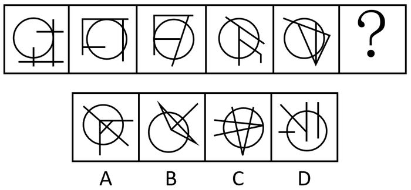

# 数量规律-面数量（圆内封闭区域数）

考点：[[20-考点/判断推理/图形推理/数量规律-面数量（圆内封闭区域数）|图形推理 / 数量规律-面数量（圆内封闭区域数）]]

**问法模型**：‘选择最合适的一个填入问号处，使之呈现一定的规律性’且各图均含圆+内部分割线 → 元素组成不同先排属性规律，转数量规律，锁定‘圆内面数量’计数递增模型

## 推理链
1. 第1步：题干五幅图元素组成不同，但每幅图都含一个圆，且均有直线穿过圆、将圆内部分割成多个封闭区域
2. 第2步：对称、曲直、开闭等属性规律均不明显，按‘元素组成不同→数量规律’的优先级转向计数；因图形共同特征是‘圆被线条分割’，故只统计圆内部的封闭面数量（不含圆外区域）
3. 第3步：从左到右逐图数圆内面：第1图圆内1个面、第2图2个面、第3图3个面、第4图4个面、第5图5个面，构成1、2、3、4、5的连续递增数列
4. 第4步：按等差递增规律，问号处图形的圆内面数量应为6
5. 第5步：逐项数选项圆内面数：A项为6个，B项为5个，C项为9个，D项为2个
6. 第6步：仅A项圆内面数量为6，与规律吻合，故选A

**最快解法**：⚡ 特征计数法：看到‘每图都有圆+圆内穿线分割’立即只数圆内封闭区域个数，得1、2、3、4、5→？=6；再快速数四个选项的圆内面数（A=6、B=5、C=9、D=2），排除法锁定A

## 易错点
- ⚠ 数面时把圆外部的封闭区域误计入，规律应只统计圆内被分割出的面
- ⚠ 只数三角形等规则面、漏数由圆弧与直线围成的不规则面，导致计数偏少
- ⚠ C项线条交叉繁杂易数错（实为9个），D项外部线条多但圆内仅2个面，易被表面线条数干扰

## 母题抽象
> 🧩 当题干每幅图都含同一封闭轮廓（圆/方框）且内部有线条分割时，优先数‘该轮廓内部的面数量’，常呈1、2、3…等差递增，问号处按数列取值对照选项

**同类特征**：所有图形均含一个圆、圆内有直线穿过分割圆面、圆内面数量依次为1、2、3、4、5、元素组成不同且无明显属性规律、问号处求延续数量规律的图形

## 相关题
- [[10-真题/判断推理/图形推理/14403697 图形推理-数量规律（外框边数与内部元素个数作差恒定分组）|14403697]]（山东 2025，相关度1）
- [[10-真题/判断推理/图形推理/16070043 数量规律-灰色多边形边数与白色面数量的差值运算分组|16070043]]（贵州 2026，相关度1）
- [[10-真题/判断推理/图形推理/16070177 数量规律-部分数（黑白块分堆-同色连通区域数）|16070177]]（重庆 2026，相关度1）
- [[10-真题/判断推理/图形推理/2423328 图形推理-数量规律（内部线条与外框角端点相接个数）|2423328]]（甘肃 2019，相关度1）
- [[10-真题/判断推理/图形推理/2448487 数量规律-曲直交点数与曲线数的倍数运算关系|2448487]]（国考 2020，相关度1）

---

### 题干

从所给的四个选项中，选择最合适的一个填入问号处，使之呈现一定的规律性：

### 选项
- A. A　✅
- B. B
- C. C
- D. D

### 官方解析
元素组成不同，且无明显属性规律，优先考虑数量规律。观察发现，题干图形均有圆，并且线条将圆明显分割成多个面，故考虑圆内面数量。题干图形圆内面数量从左到右依次为1、2、3、4、5，故“？”处圆内面数量应为6，A项圆内面数量为6，B项圆内面数量为5，C项圆内面数量为9，D项圆内面数量为2，只有A项符合规律。
故正确答案为A。

### 给定材料
（无）
