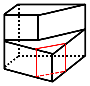

# 空间重构-截面图（剖切面判断，选非题）

考点：[[20-考点/判断推理/图形推理/空间重构-截面图（剖切面判断，选非题）|图形推理 / 空间重构-截面图（剖切面判断，选非题）]]

**问法模型**：题干问'从任一面剖开，哪一项不可能是该立体图形的截面'→ 用单一平面截切想象法逐项验证，选出无法切出的一项（选非题）

## 推理链
1. 第1步：观察题干左图：立体由多个长方体拼合而成（虚线为内部隐藏棱），所有表面均为平面、所有棱均为直线段，整体呈上下分层、带台阶的组合结构，无任何曲面
2. 第2步：明确截面规则——截面必须是'一个平面'与立体相交所得，故截面只能是直线段围成的平面多边形，其形状取决于剖切面穿过立体上哪些面、以什么角度穿过
3. 第3步：验证C项（正方形）：取与立体侧面平行的平面横切，剖切面只穿过四棱柱的平行侧面，截得矩形/正方形，C可切出，排除
4. 第4步：验证A项（带台阶的L形六边形）：让剖切面沿阶梯方向斜穿上下两部分长方体，截得的轮廓恰为底部带斜边、中部内收成台阶的六边形，A可切出，排除
5. 第5步：验证B项（右侧带凹口的五边形）：让剖切面斜穿组合体并同时经过外侧斜棱与台阶内凹棱，截得带一个凹折角的五边形，B可切出，排除
6. 第6步：验证D项（左右两侧对称内凹的'括号形'）：要截出该形状，剖切面需在左右两侧都形成内凹转折，即立体上须存在与之对应的内凹尖角结构；但该组合长方体只有一个方向的内凹台阶，任何单一平面截切都无法同时产生两侧内凹的轮廓，故D无法切出
7. 第7步：本题为选非题，A、B、C均可截出，D不可能，当选D

**最快解法**：⚡ 平面截切想象法+排除法：先切最容易的——平行侧面横切得正方形排除C；再沿阶梯方向斜切排除A；斜穿台阶棱排除B；剩余D因要求'两侧同时内凹'而立体无对应结构，无法切出，锁定答案

## 易错点
- ⚠ 忽略'不可能是'这一选非问法，误把能切出的选项当答案
- ⚠ 误以为任意凹多边形都能截出，忽视截面形状必须与立体实际的面数、棱的位置一一对应
- ⚠ 用折面（多个平面组合）或曲自己去想象截面，违反'单一平面截切'规则

## 母题抽象
> 🧩 当题干出现'给定组合立体，从任一面剖开，问哪项不可能是截面'时，用'单一平面截切验证法'逐项寻找可行剖切方向——凹口数量超出立体实际内凹结构的选项即为不可能截面

**同类特征**：从任一面剖开、不可能是截面（选非）、长方体组合立体、虚线隐藏棱、凹多边形选项、截面图辨析

## 相关题
- [[10-真题/判断推理/图形推理/10942400 截面图-台体挖圆柱孔的剖切判断（选非）|10942400]]（浙江 2022，相关度1）
- [[10-真题/判断推理/图形推理/1746878 立体图形-截面图（剖切形状判断）|1746878]]（国考 2016，相关度1）
- [[10-真题/判断推理/图形推理/2264356 图形推理-截面图（立体截取）|2264356]]（国考 2019，相关度1）
- [[10-真题/判断推理/图形推理/2444725 截面图-正方体组合体的剖切面截取（选非）|2444725]]（四川 2019，相关度1）
- [[10-真题/判断推理/图形推理/2662246 截面图（剖切面与立体表面交线的重构）|2662246]]（新疆 2020，相关度1）

---

### 题干

左图为给定的立体图形，将其从任一面剖开，右边哪一项不可能是该立体图形的截面？

### 选项
- A. A
- B. B
- C. C
- D. D　✅

### 官方解析

A项：如图所示可切出，排除；

B项：如图所示可切出，排除；

C项：如图所示可切出，排除；

D项：无法切出，当选。

本题为选非题，故正确答案为D。

### 给定材料
（无）
