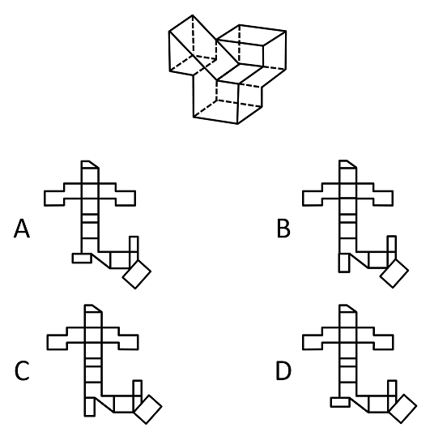
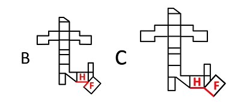

# 空间重构-立体图形外表面展开图（公共边等长且完全重合辨析）

考点：[[20-考点/判断推理/图形推理/空间重构-立体图形外表面展开图（公共边等长且完全重合辨析）|图形推理 / 空间重构-立体图形外表面展开图（公共边等长且完全重合辨析）]]

**问法模型**：'哪个是该立体图形的外表面展开图' → 特征面公共边法：锁定带独特边的特征面，逐边核对相邻面的边长与重合关系排除错误选项

## 推理链
1. 第1步：题干给出由七边形面G（正面带凸出三角的面）与多个矩形面拼接成的立体图形，四个选项展开图整体轮廓相似，主要区别在左下角小矩形和右下角矩形的位置
2. 第2步：采用公共边法，在七边形面G上以凸出三角底边为起点，顺时针标出边1、2、3，以各边与相邻面公共边的长短、重合情况为标尺逐项核对
3. 第3步：立体图中边3对应相邻矩形面的短边，而A、D项中边3对应的是矩形的长边，公共边长度不符，排除A、D
4. 第4步：边1对应最左侧的H面，H面与其相邻的较大长矩形面F（立体图中标阴影的面）有一条等长且完全重合的公共边4
5. 第5步：对比B、C项，C项中H面与F面公共边等长且完全重合，B项中两面公共边不完全重合，排除B
6. 第6步：仅C项满足七边形各边与相邻面的全部公共边对应关系，故正确答案为C

**最快解法**：⚡ 公共边法+排除法：先锁定带凸出三角的七边形面G，核对边3应接相邻矩形的'短边'，排除接长边的A、D；再核对最左H面与阴影F面的公共边4是否'等长且完全重合'，B不重合排除，锁定C

## 易错点
- ⚠ 忽略公共边必须等长：只看展开图轮廓相似，未核对七边形边3对应的是矩形短边还是长边，误选A或D
- ⚠ 只验证等长未验证'完全重合'：B项两面公共边等长但错位不重合，粗看易误判为正确
- ⚠ 特征面在展开图中被旋转/翻转后，未重新标定边的顺时针序号，导致边1、2、3与立体图对应关系弄错

## 母题抽象
> 🧩 当立体图形求外表面展开图且选项轮廓高度相似、仅局部矩形位置不同时，选定一个带独特边（凸三角、斜边等）的特征面，用公共边法核对相邻面公共边的长短与重合关系逐项排除

**同类特征**：立体图形外表面展开图、带凸出三角的七边形特征面、选项仅局部矩形位置不同、公共边等长且完全重合、空间重构、公共边法排除

## 相关题
- [[10-真题/判断推理/图形推理/11367779 空间重构-六面体折叠（相对面排除＋公共边特征验证）|11367779]]（江苏 2025，相关度1）
- [[10-真题/判断推理/图形推理/16069767 空间重构-组合体表面展开图（公共边法·黑白颜色匹配）|16069767]]（河南 2026，相关度1）
- [[10-真题/判断推理/图形推理/16095261 空间重构-六面体折叠（特征面字母朝向定位）|16095261]]（江苏 2024，相关度1）
- [[10-真题/判断推理/图形推理/1791642 空间重构-四面体折叠（相邻面公共边法）|1791642]]（江苏 2016，相关度1）
- [[10-真题/判断推理/图形推理/1791644 图形推理-空间重构（四面体折叠-公共边特征线）|1791644]]（江苏 2016，相关度1）

---

### 题干

左图是给定的立体图形，下面选项哪个是该立体图形的外表面展开图？

### 选项
- A. A
- B. B
- C. C　✅
- D. D

### 官方解析

本题为空间重构题。观察选项，主要区别在于左下角的小矩形和右下角的矩形位置不同。

 

回到原图中观察G面（从正面看到的七边形面），如上图，在其面上以凸出的三角底边为起点，顺时针分别标出序号1、2、3，边3对应相邻矩形面的短边，而在A、D项中边3对应的是矩形的长边,如下图，排除A、D项；

  

再次观察题干立体图形，边1对应的是H面（最左侧的面），H面与其相邻的较大的长矩形面F（立体图中标阴影的面）有一条等长且完全重合的公共边4，对比B、C项，C选项中两个面的公共边等长且完全重合，而B选项中两个面的公共边不完全重合，排除B项。

 

故正确答案为C。

### 给定材料
（无）
