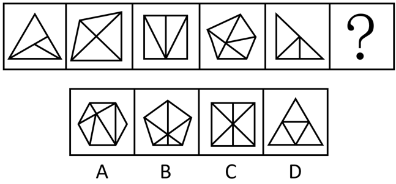

# 数量规律-面数量与外框直线数复合（面数=外框边数）

考点：[[20-考点/判断推理/图形推理/数量规律-面数量与外框直线数复合（面数=外框边数）|图形推理 / 数量规律-面数量与外框直线数复合（面数=外框边数）]]

**问法模型**：一组图形'元素组成不同、无属性规律'→先数面，面数无规律再数外框直线数，验证'面数量=外框直线数量'的等量规律→在选项中找满足同一等式的图形

## 推理链
1. 第1步：题干五幅图元素组成不同，对称、封闭、曲直等属性无统一规律，按解题顺序转向数量规律
2. 第2步：各图封闭区域（面）特征明显，优先数面，题干面数量依次为3、4、4、5、3，单看无规律
3. 第3步：再观察发现每幅图都有明显的多边形外框（三角形、四边形、五边形交替出现），于是数外框直线数，依次为3、4、4、5、3
4. 第4步：将两条数列逐位对照，发现每一位上面数量都等于外框直线数量，归纳出规律'面数量=外框直线数量'，问号处图形也必须满足该等式
5. 第5步：逐项验证：C项外框为四边形（4条边）但内部被分割出6个面，D项外框为三角形（3条边）但面数为4，均不满足等式；B项外框五边形但面数与5不相等，排除
6. 第6步：A项外框为六边形（6条直线），内部恰好被分割成6个面，面数量=外框直线数量=6，唯一符合规律，当选

**最快解法**：⚡ 双数列对照法（面数+外框边数）：数出题干面数3、4、4、5、3与外框边数3、4、4、5、3逐位相等，锁定规律'面数=外框边数'，直接到选项中找等式成立的图形——A项六边形6条边且6个面即中

## 易错点
- ⚠ 只数面得到3、4、4、5、3发现无规律就放弃或乱套等差/对称规律，漏掉再数外框直线数做复合对照这一步
- ⚠ 数面时漏数被内部线条分割出的小封闭区域，或把不封闭的部分误当面，导致面数与外框边数对不上
- ⚠ 验证选项时只数其中一个量（只数面或只数边），未对B、C、D同时核对'面数=外框边数'即匆忙排除或误选

## 母题抽象
> 🧩 当题干图形均带有明显多边形外框且内部被线条分割出多个小面、单看面数量无规律时，加数外框直线数，若两数列逐位相等（面数=外框边数），则到选项中找满足同一等式的图形

**同类特征**：元素组成不同、无属性规律、封闭区域（面）特征明显、每幅图都有清晰的多边形外框、内部线条将外框分割成多个小面、面数量单看不成规律、外框依次为三角形、四边形、五边形

## 相关题
- [[10-真题/判断推理/图形推理/12561867 数量规律-相同元素的位置关系（对角相对-边邻相邻）分组分类|12561867]]（浙江 2024，相关度1）
- [[10-真题/判断推理/图形推理/14993424 数量规律-元素个数（黑-灰矩形数量等差递增）|14993424]]（选调 2024，相关度1）
- [[10-真题/判断推理/图形推理/15419022 数量规律-图形间关系（面相贴-被完全隔开，内部线条部分数）|15419022]]（湖北 2025，相关度1）
- [[10-真题/判断推理/图形推理/16069776 数量规律-面数量（总面数恒定+全直线面数量递减二级规律）|16069776]]（广西 2026，相关度1）
- [[10-真题/判断推理/图形推理/1789602 数量规律-波峰波谷个数差+位置规律（最高波峰与竖轴左右关系）|1789602]]（江苏 2016，相关度1）

---

### 题干

请从所给的四个选项中，选出最恰当的一项填入问号处，使之呈现一定的规律。

### 选项
- A. A　✅
- B. B
- C. C
- D. D

### 官方解析

元素组成不同，无明显属性规律，考虑数量规律。观察发现，题干中的图形封闭区域明显，优先考虑数面，题干图形的面数量依次为3、4、4、5、3、？，单看无规律。再次观察发现，题干图形的外框均为多边形，且出现较多三角形、四边形，考虑外框直线数。外框直线数量依次为3、4、4、5、3、？。可知题干的规律为面数量外框直线数量，只有A项符合规律，当选。

故正确答案为A。

### 给定材料
（无）
