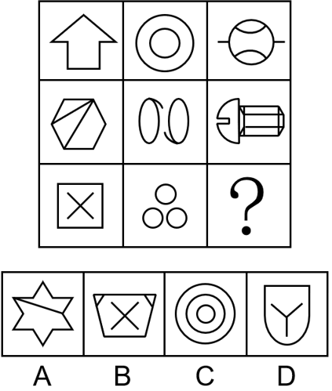

# 属性规律-曲直性

考点：[[20-考点/判断推理/图形推理/属性规律-曲直性|图形推理 / 属性规律-曲直性]]

**问法模型**：九宫格'？'处填图且元素组成不同 → 优先横行观察属性规律（曲直性）的遍历规律

## 推理链
1. 第1步：题干元素组成不同（箭头、圆、六边形、方块等形状各异），排除样式类，优先考虑属性规律
2. 第2步：图中同时出现全直线图（第一行箭头）与全曲线图（第一行同心圆），锁定'曲直性'考点，九宫格按横行看
3. 第3步：第一行：图1向上箭头全直线，图2同心圆全曲线，图3'圆+横线穿过的球状图形'直线曲线共存；第二行：图1六边形加对角线全直线，图2双水滴/椭圆全曲线，图3'半圆+圆柱体'直线曲线共存
4. 第4步：每行规律为'全直、全曲、直+曲'依次遍历，第三行：图1'方框内打叉'全直线，图2三个小圆全曲线，故？处应为直线+曲线混合图形
5. 第5步：对照选项：A六角星带斜线全直线，B梯形容器内打叉全直线，C同心圆全曲线，D盾形（外框底部为弧线、上部直线）内含字母Y（全直线），为直+曲混合
6. 第6步：只有D符合'直+曲'规律，当选

**最快解法**：⚡ 属性口诀法：'元素不同看属性，全直全曲同框先辨曲直'——横行扫描每行三个图的曲直构成，发现'全直/全曲/直+曲'遍历规律后，直接给选项贴标签：A全直、B全直、C全曲、D直+曲，秒选D

## 易错点
- ⚠ 误把规律当成数量类（交点、面数）而绕远路，未第一时间识别'全直图与全曲图同框'的曲直性提示
- ⚠ 对选项D辨析失误：盾形外框底部是弧线、内含直线Y，易被误判为全直线或全曲线
- ⚠ 忽略九宫格'优先横行看'的原则，若竖列看规律不成立（每列曲直构成不统一）会误判无规律

## 母题抽象
> 🧩 当九宫格中每行依次出现'全直线图、全曲线图、直曲混合图'三种构成时，按行遍历曲直性，问号处补齐缺失的'直+曲'项

**同类特征**：九宫格、元素组成不同、全直线图形与全曲线图形同框出现、每行三种曲直构成遍历、问号处补直曲混合图形、属性规律优先

## 相关题
- [[10-真题/判断推理/图形推理/4678606 属性规律-曲直性|4678606]]（选调 2020，相关度4）
- [[10-真题/判断推理/图形推理/5697901 属性规律-曲直性|5697901]]（江苏 2023，相关度4）
- [[10-真题/判断推理/图形推理/2144539 属性规律-对称轴数量（按行递变）|2144539]]（选调 2018，相关度3）
- [[10-真题/判断推理/图形推理/2187836 属性规律-直曲性与封闭性双重叠加|2187836]]（山东 2018，相关度3）
- [[10-真题/判断推理/图形推理/11367775 属性规律-对称性（对称轴数量等差递减）|11367775]]（江苏 2025，相关度2）

---

### 题干

请从所给的四个选项中，选出最恰当的一项填入问号处，使之呈现一定的规律。

### 选项
- A. A
- B. B
- C. C
- D. D　✅

### 官方解析
元素组成不同，优先考虑属性规律。观察发现，题干出现全直线、全曲线图形，优先考虑曲直性。九宫格优先横行看，第一行图1由全直线构成，图2由全曲线构成，图3由直线和曲线构成；第二行图1由全直线构成，图2由全曲线构成，图3由直线和曲线构成；第三行图1由全直线构成，图2由全曲线构成，故“？”处图形应该由直线和曲线构成，只有D项符合规律，当选。
故正确答案为D。

### 给定材料
（无）
