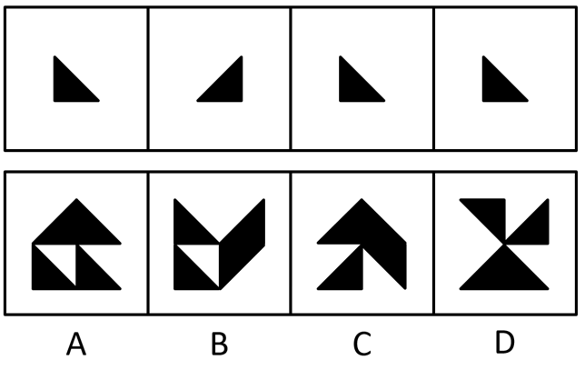
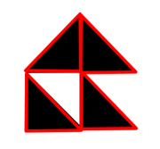

# 平面拼合-平移拼合（三角形朝向守恒）

考点：[[20-考点/判断推理/图形推理/平面拼合-平移拼合（三角形朝向守恒）|图形推理 / 平面拼合-平移拼合（三角形朝向守恒）]]

**问法模型**：四个图形只能平移拼合成一个 → 统计小图形朝向配比，排除需旋转/翻转的选项

## 推理链
1. 第1步：题干四个图形均为等腰直角三角形，第1、3、4个直角位于左下（竖边在左、横边在下），第2个直角位于右下（竖边在右），即'3个同向+1个反向'。
2. 第2步：依据题干'只能上、下、左、右平移'，三角形朝向不可改变，拼合结果必须恰好含3个'直角在左下'与1个'直角在右下'的三角形，且边缘无缝对接。
3. 第3步：验证A项——屋顶大三角形可拆为1个'直角在左下'+1个'直角在右下'的小三角形沿直角边拼成，底部左右两侧各1个'直角在左下'的小三角形，合计3左+1右，朝向与题干完全一致，可无缝拼合。
4. 第4步：检验B、C、D——D项四个三角形围绕中心呈四向分布，必须旋转才能拼出；B、C项内部存在直角朝上或朝侧向的三角形（需旋转/翻转）或朝向数量配比与题干不符，均排除。
5. 第5步：只有A项满足'平移不变朝向'且数量配比吻合，与官方答案A一致。

**最快解法**：⚡ 朝向计数法（平移守恒）：先数题干'3个直角在左下+1个直角在右下'，再逐项检查选项中各小三角形直角朝向，凡出现直角朝上/朝侧（需旋转）或数量不符的立即排除B、C、D，唯一吻合者为A。

## 易错点
- ⚠ 误以为可以旋转或翻转图形，把B、C、D也当作可行拼合
- ⚠ 只看整体轮廓美观或对称（如D的蝴蝶结形）而忽略内部小三角形朝向必须与题干一致
- ⚠ 忽略'3个同向+1个反向'的数量配比，误选朝向配比不对的选项

## 母题抽象
> 🧩 当题干出现'多个小图形只能平移拼合成一个图形'时，先统计各小图形的朝向与数量配比，再在选项中找朝向完全一致且能无缝拼合的项，凡需旋转/翻转的一律排除。

**同类特征**：等腰直角三角形拼合、只能平移、三个同向一个反向、直角朝向配比、无缝拼接

## 相关题
（暂无）

---

### 题干

下边四个图形中，只有一个是由上边的四个图形拼合（只能通过上、下、左、右平移）而成的，请把它找出来。

### 选项
- A. A　✅
- B. B
- C. C
- D. D

### 官方解析

本题考查平面拼合，题干已知图形均为等腰直角三角形，依据题干要求只能通过上、下、左、右平移实现拼合，经过拼合后只能得到A项。如下图所示：

故正确答案为A。

### 给定材料
（无）
