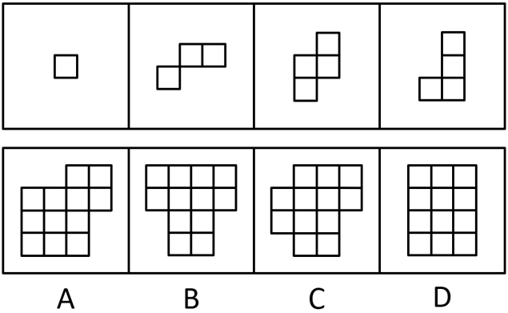

# 图形推理-平面拼合（仅平移拼合）

考点：[[20-考点/判断推理/图形推理/图形推理-平面拼合（仅平移拼合）|图形推理 / 图形推理-平面拼合（仅平移拼合）]]

**问法模型**：问'四个图形只能平移拼合成哪一个' → 先数分块小正方形总数定面积，再按轮廓互补+平移嵌入排除

## 推理链
1. 第1步：数四个分图的小正方形数量：图1为1个单格，图2为3个（L形三连块），图3为4个（Z形四连块），图4为4个（L形四连块），合计1+3+4+4=12个小正方形
2. 第2步：题干限定'只能通过上、下、左、右平移'，即分块不旋转、不翻转，拼合结果面积必为12格，且分块凹凸轮廓须两两互补嵌入
3. 第3步：逐项看选项轮廓：A、B、C虽可能接近12格，但其外轮廓存在与四个分块形状不匹配的凸出或缺口（如B为T形、C为十字形），四个给定的单格/L形/Z形分块无法在不旋转的前提下填满这些形状
4. 第4步：D为3×4规则矩形，恰为12格，面积与总量吻合
5. 第5步：将四个分块按平移方式嵌入D：单格补缺口，L形三连块与两个四连块沿行列互补排满，凹凸边完全咬合，拼合成立
6. 第6步：故正确答案为D

**最快解法**：⚡ 数格子+轮廓排除法：先算总面积12格锁定候选，再看外轮廓——只有D是能被这四个分块（1+3+4+4）不旋转填满的规则矩形，直接选D

## 易错点
- ⚠ 忽略'只能平移、不能旋转/翻转'，误把需要转动分块才能拼成的选项当正确
- ⚠ 只验证总面积12格而不验证轮廓互补，误选面积相同但形状不符的T形或十字形选项
- ⚠ 分块小正方形数目数错（把图2的3格看成2格等）导致面积总账对不上

## 母题抽象
> 🧩 当题干出现'若干小方块只能平移拼合成一个图形'的特征时，先数分块总格数定面积，再用轮廓互补法找能被不旋转嵌入的规则图形选项验证

**同类特征**：只能通过上、下、左、右平移、四个图形拼合、小正方形分块、凹凸轮廓互补、面积守恒（总格数不变）、选规则外形（矩形）

## 相关题
- [[10-真题/判断推理/图形推理/2742060 图形推理-平面拼合（平行且等长相消）|2742060]]（江苏 2021，相关度1）

---

### 题干

下边四个图形中，只有一个是由上边的四个图形拼合（只能通过上、下、左、右平移）而成的，请把它找出来。

### 选项
- A. A
- B. B
- C. C
- D. D　✅

### 官方解析

本题为平面拼合，拼合方式如下图所示：

故正确答案为D。

### 给定材料
（无）
