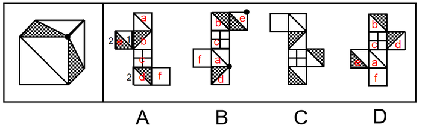

# 空间重构-六面体（立方体）外表面展开图：相对面排除＋相邻面公共边-公共点特征验证

考点：[[20-考点/判断推理/图形推理/空间重构-六面体（立方体）外表面展开图：相对面排除＋相邻面公共边-公共点特征验证|图形推理 / 空间重构-六面体（立方体）外表面展开图：相对面排除＋相邻面公共边/公共点特征验证]]

**问法模型**：“给定立方体，找哪一项是其外表面展开图”→空间重构模型：先给展开图各面标号，用相对面排除，再用公共边贴接关系与公共顶点锐角/直角特征验证

## 推理链
1. 第1步：观察立体图：可见三个面为“带单对角线的空白面＋两个带阴影三角形的面”，两个阴影三角形的锐角交于同一公共顶点，且两阴影三角形面的公共边两侧与空白三角形相接
2. 第2步：解题规则：给展开图各面标号（a、b、d、e等），先用“相对面在立体图中不能同时出现”排除，再核对相邻面公共边贴接与公共点处“锐角/直角”朝向特征
3. 第3步：A项：两个阴影三角形面若取面b与面e，其公共边与面b中阴影三角形相接；若取面b与面d，两者为相对面不能同时出现；若取面e与面d，其公共边与面e中阴影三角形相接——均与题干“公共边与空白三角形相接”不符，排除
4. 第4步：B项：面a与面b为相对面，故两阴影三角形面只能为面d和面e；立体图中面a、面d、面e的公共点是两阴影三角形“锐角与锐角”的交点，而展开图中三面公共点是“阴影三角形锐角与空白三角形直角”的交点，特征不符，排除
5. 第5步：D项：三个面的可能组合（a、b、d）、（a、b、e）、（a、e、d）中分别含相对面a与b、a与b、e与d，均不可能同时出现，排除
6. 第6步：C项折叠后各相邻面公共边的贴接关系及公共顶点“锐角对锐角”等特征均与立体图一致，当选

**最快解法**：⚡ 相对面排除法＋公共点画点法：先给展开图标号，用“隔一面相对”快速找出各组相对面，凡立体图中同时出现的图案面在选项展开图中互为相对面（A、B、D均踩中）直接排除；再在剩余项与立体图的同一公共顶点做标记，核对“两阴影三角形锐角是否相交”即可锁定C

## 易错点
- ⚠ 只认“都有阴影三角形、对角线、田字格”就比对形状，忽略“相对面不能同时出现”的排除规则，误选含相对面组合的A、B、D
- ⚠ 公共顶点特征看错：题干是“锐角与锐角”相交，B项展开图中是“锐角与直角”相交，粗看相同实则不同
- ⚠ 公共边贴接关系判断颠倒：题干中两阴影三角形面的公共边两侧为空白三角形，A项中却是阴影三角形贴公共边

## 母题抽象
> 🧩 当题干为“立方体＋四张展开图”折叠匹配时，先标号找相对面，排除“立体图中同时出现的面在展开图中互为相对面”的选项，再用公共边贴接与公共点处锐角/直角特征验证剩余选项

**同类特征**：立方体找外表面展开图问法、面内含阴影三角形与空白三角形、存在单对角线空白面、存在田字格面、两阴影三角形锐角交于公共顶点、相对面不能同时出现

## 相关题
- [[10-真题/判断推理/图形推理/12019707 空间折叠（六面体折纸盒）——相对面排除＋公共边画边法-公共点引线法|12019707]]（广东 2026，相关度1）
- [[10-真题/判断推理/图形推理/12561915 空间重构-六面体折叠（相对面排除+公共点法）|12561915]]（浙江 2024，相关度1）
- [[10-真题/判断推理/图形推理/16070182 空间重构-六面体展开图折叠（相对面排除＋相邻面数字方向验证）|16070182]]（湖北 2026，相关度1）
- [[10-真题/判断推理/图形推理/1746880 空间重构-六面体折叠（相对面排除+画边法）|1746880]]（国考 2016，相关度1）
- [[10-真题/判断推理/图形推理/1791826 空间重构-六面体折叠（公共点法+相对面排除）|1791826]]（江苏 2016，相关度1）

---

### 题干

左边给定的是立方体，右边哪一项是它的外表面展开图？请把它找出来。

### 选项
- A. A
- B. B
- C. C　✅
- D. D

### 官方解析

将展开图的面均标上序号，如下图所示。

A项：立方体中两个阴影三角形面的公共边与空白三角形相接，若两个阴影三角形的面为展开图中的面b和面e，两个面的公共边与面b中阴影三角形相接，与题干不符；若两个阴影三角形的面为面b和面d，面b和面d为相对面不可能同时出现；若两个阴影三角形的面为面e和面d，两个面的公共边与面e中阴影三角形相接，与题干不符。以上三种情况均与题干不一致，排除；

B项：展开图中面a与面b为相对面不可能同时出现，所以两个阴影三角形的面只能为面d和面e。立方体中面a、面d与面e的公共点为两个阴影三角形的锐角交点，展开图中三个面的公共点为阴影三角形的锐角和空白三角形直角的交点，与题干不一致，排除；

C项：与题干一致，当选；

D项：若立体图的展开图为面a、面b和面d，面a和面b为相对面不可能同时出现，与题干不符；若立体图的展开图为面a、面b和面e，面a和面b为相对面不可能同时出现，与题干不符；若立体图的展开图为面a、面e和面d，面e和面d为相对面不可能同时出现，与题干不符。以上三种情况均与题干不一致，排除。

故正确答案为C。

### 给定材料
（无）
