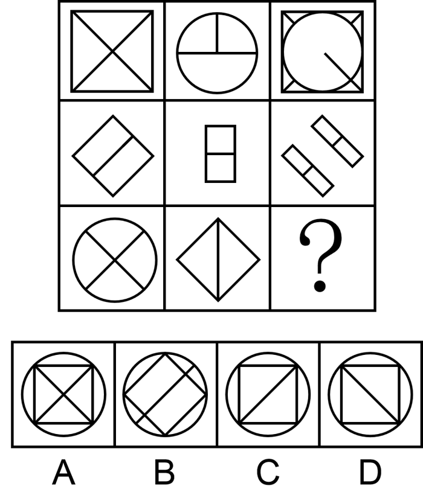

# 样式规律-加减同异（旋转+去同存异）

考点：[[20-考点/判断推理/图形推理/样式规律-加减同异（旋转+去同存异）|图形推理 / 样式规律-加减同异（旋转+去同存异）]]

**问法模型**：九宫格'填入问号呈现规律'且元素组成相似 → 按行考虑样式规律，先旋转对齐再做去同存异（求异）叠加

## 推理链
1. 第1步：九宫格中每行图形元素组成相似、相同线条（如圆、正方形、对角线）重复出现，优先考虑样式规律中的加减同异
2. 第2步：各图方向不一致，说明叠加前存在位置变化，需'先旋转、后求异'（相同线条抵消、不同线条保留）
3. 第3步：第一行验证——图2（圆及内部线）逆时针旋转45°后与图1（正方形+X对角线）求异，外框叠加为正方形内切圆、内部线条去同存异，得到图3
4. 第4步：第二行验证——图2（竖式双格矩形）逆时针旋转后与图1（斜菱形+内线）求异，相同线条抵消，得到两个倾斜矩形，规律成立
5. 第5步：第三行应用——图2为竖线分割的菱形，逆时针旋转45°后菱形变为正方形、内部竖线变为捺向对角线（\），且与图1的圆外框叠加
6. 第6步：与图1（圆+X双对角线）求异：共同的捺向对角线（\）抵消，只保留相异的撇向对角线（/）
7. 第7步：'？'处应为'圆+内接正方形+一条撇向对角线（/）'，对照选项，C符合，D为捺向对角线（旋转方向搞反的陷阱），排除

**最快解法**：⚡ 旋转+求异口诀'先转正，再去同'：第三行图2菱形逆时针转45°变正方形、竖线变对角线，与图1的X去同存异只剩一条对角线，且旋转方向决定对角线为'/'向，直接锁定C、排除镜像的D

## 易错点
- ⚠ 跳过旋转直接将图1与图2叠加，线条对不上而误判规律
- ⚠ 旋转方向弄反（顺时针当逆时针），对角线方向判断错误而误选D
- ⚠ 只关注内部线条变化，忽略外框（圆与正方形）同样参与叠加，可能误选B

## 母题抽象
> 🧩 当九宫格图形元素组成相似、相同线条重复出现但方向不一致时，按行用'先旋转对齐、再去同存异'的方法，用前两行验证规律后套用到第三行

**同类特征**：九宫格、元素组成相似、相同线条重复出现、图形方向不一致（含旋转）、去同存异、内外框同时叠加

## 相关题
- [[10-真题/判断推理/图形推理/2139604 样式规律-叠加运算（去同存异-求异）|2139604]]（天津 2017，相关度4）
- [[10-真题/判断推理/图形推理/10204610 样式规律-加减同异（去同存异），九宫格列规律|10204610]]（辽宁 2024，相关度3）
- [[10-真题/判断推理/图形推理/12019768 样式规律-加减同异（求同）与位置旋转的复合规律|12019768]]（浙江 2026，相关度3）
- [[10-真题/判断推理/图形推理/16070178 样式规律-加减同异（翻转+去同存异）|16070178]]（重庆 2026，相关度3）
- [[10-真题/判断推理/图形推理/17056529 样式规律-求同求异（分元素：直线求同、小圆圈求异）|17056529]]（上海 2026，相关度3）

---

### 题干

从所给的四个选项中，选择最合适的一个填入问号处，使之呈现一定的规律性：

### 选项
- A. A
- B. B
- C. C　✅
- D. D

### 官方解析

图形元素组成相似，优先考虑样式规律，且相同线条重复出现，故考虑样式规律中的加减同异。九宫格优先按行看，第一行中，图2逆时针旋转，然后与图1求异得到图3。经验证，第二行也满足此规律。第三行，应用此规律，将图2逆时针旋转，然后与图1求异，因此“？”处应选择C项。

故正确答案为C。

### 给定材料
（无）
