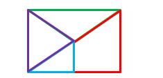

# 图形推理-平面拼合（平行且等长相消）

考点：[[20-考点/判断推理/图形推理/图形推理-平面拼合（平行且等长相消）|图形推理 / 图形推理-平面拼合（平行且等长相消）]]

**问法模型**：四个小图形只能上、下、左、右平移拼合成一个图形 → 用'平行且等长相消'法：将图形间平行且等长的边作为内部拼缝两两消去，剩余边围成的轮廓即为答案

## 推理链
1. 第1步：提取四个拼合件的边的方向与长度特征：①尖朝右、左侧为竖直边的三角形；②直角在右下、斜边从左下到右上（斜向／）的小直角三角形；③右边竖直、底边水平、左上为斜切边的四边形；④顶边水平、尖朝下的倒三角形
2. 第2步：规则限定'只能通过上、下、左、右平移'，故每条边的方向在拼合前后都不改变；两图形拼合时的公共（内部）边必然'平行且等长'，应两两配对相消
3. 第3步：逐边配对相消：斜向边只与斜向边配对（①与④的斜边、②与③的斜边分别平行且等长），竖直边与竖直边、水平边与水平边按等长配对，消去全部内部拼缝
4. 第4步：相消后剩余的边全部为水平或竖直方向，恰好围成一个横向（长大于宽）的长方形轮廓，无任何凹口
5. 第5步：对照选项：B为横向长方形，与剩余轮廓一致；A虽是长方形但为竖放，由于不允许旋转、各边方向已定，方向不符排除；C顶部出现V形凹口、D右侧出现三角形凹口，与'平行等长边全部相消后应为规则矩形轮廓'矛盾，排除
6. 第6步：四个图形按平移方式拼合的结果即为B

**最快解法**：⚡ 平行且等长相消法：先把四图形中方向相同（平移不改方向）且长度相等的边两两配对相消（斜边配斜边、竖边配竖边），剩余的水平、竖直边直接围出轮廓——得横向长方形即B；再用'只能平移不能旋转'秒杀竖放的A，用'相消后轮廓无凹口'排除C、D

## 易错点
- ⚠ 忽略'只能平移'的限制，误以为图形可旋转，从而错选与B同形但竖放的A
- ⚠ 只凭面积或直觉拼合，不逐边验证'平行且等长'，误选C、D等带凹口的轮廓（凹口边在相消后无对应外边）
- ⚠ 配对时只看平行不核对长度相等（或只看长度不看方向），错消不该消的边导致轮廓判断失误

## 母题抽象
> 🧩 当题干出现'若干小图形只能平移拼合成一个图形'时，用平行且等长相消法：把各图形间平行且等长的边作为内部拼缝两两消去，剩余边围成的轮廓即为唯一答案

**同类特征**：四个小图形拼合、只能上、下、左、右平移、含三角形与四边形混合、只有一个正确轮廓、斜边方向保持不变、平行且等长相消

## 相关题
- [[10-真题/判断推理/图形推理/2742197 图形推理-平面拼合（平行且等长相消）|2742197]]（江苏 2021，相关度5）
- [[10-真题/判断推理/图形推理/16095258 图形推理-平面拼合（平行且等长相消）|16095258]]（江苏 2024，相关度4）
- [[10-真题/判断推理/图形推理/2367807 图形推理-平面拼合（平行且等长相消）|2367807]]（江苏 2019，相关度4）
- [[10-真题/判断推理/图形推理/2742175 图形推理-平面拼合（平行且等长相消）|2742175]]（江苏 2021，相关度4）
- [[10-真题/判断推理/图形推理/12536406 图形推理-平面拼合（平行且等长相消）|12536406]]（四川 2024，相关度3）

---

### 题干

下面四个图形中，只有一个是由上面的四个图形拼合（只能通过上、下、左、右平移）而成的，请把它找出来。

### 选项
- A. A
- B. B　✅
- C. C
- D. D

### 官方解析

本题考查平面拼合，可采用平行且等长相消的方式解题。

消去平行且等长的线段后进行组合即可得到轮廓图，即为B选项。

平行且等长相消的方式如下图所示：

故正确答案为B。

### 给定材料
（无）
