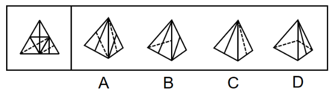
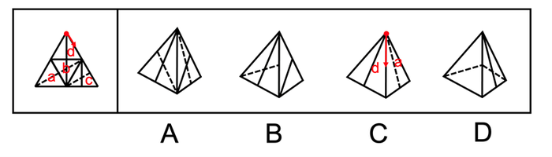

# 空间重构-四面体折叠（画边法：相邻面时针方向与压线顺序判定）

考点：[[20-考点/判断推理/图形推理/空间重构-四面体折叠（画边法：相邻面时针方向与压线顺序判定）|图形推理 / 空间重构-四面体折叠（画边法：相邻面时针方向与压线顺序判定）]]

**问法模型**：题干问'左边多面体外表面展开图，右边哪一项能由它折叠而成'（四面体类）→ 用画边法：在题干与选项中选同一特征顶点为起点，沿面内顺时针画边，逐项比对各边的邻面与所经线条顺序

## 推理链
1. 第1步：题干为四面体外表面展开图（大三角形内分出4个小三角形面），官方将四个面标为a、b、c、d，各面绘有实线与虚线，形成'虚线顶点''实线顶点'两类可作画边起点的特征顶点
2. 第2步：采用画边法规则——题干与选项中选同一特征顶点为起点、在该面内顺时针画边，比对第1、2条边的公共边（邻面）以及所经过的虚线/实线顶点的先后顺序，顺序不符即排除
3. 第3步：A项由面b和面c构成：题干中面b、面c都以虚线顶点为起点顺时针画边，无论哪个面第1条边都是面b和面c的公共边；而选项中以此顶点为起点顺时针画边，第1条边都不是该公共边，与题干不一致，排除
4. 第4步：B项由面c和面d构成：按同一起点顺时针画边，第1条边邻面关系与线条经过顺序均与题干一致，当选
5. 第5步：C项由面a和面d构成：题干中面d以实线顶点为起点顺时针画边，第1条边挨着面c；而选项中第1条边挨着面a，与题干不一致，排除
6. 第6步：D项：题干中面a以虚线顶点为起点顺时针画边，第2条边先经过面b中的虚线再经过实线顶点；而选项中第2条边先经过面b中的实线顶点再经过虚线，顺序颠倒，排除；综上只有B与展开图完全吻合

**最快解法**：⚡ 画边法（描边法）：先给展开图4个面标号并锁定'虚线顶点/实线顶点'作起点→题干与选项同起点顺时针描边→A、C两项只看第1条边的邻面（公共边）即可秒杀排除，D项看第2条边的压线顺序排除，B项全部吻合直接锁定

## 易错点
- ⚠ 顺时针方向搞反：画边必须以'正对该面'观察为准，折叠后若把方向取反，邻面（公共边）判断会全部出错（A、C两项正是考这一点）
- ⚠ 混淆两类虚线：选项立体图中的虚线是不可见的隐藏线，而展开图面上的实线/虚线是面内线条特征，D项比较的是'先经过虚线还是先经过实线顶点'的顺序，二者不能混为一谈
- ⚠ 凭整体轮廓相似直接目测选答案：B与A、C、D外形接近，不做逐项画边验证极易被镜面/旋转后的相似图形欺骗

## 母题抽象
> 🧩 当题干为'大三角形分4个小三角形面'的四面体展开图且面上带实线/虚线特征时，用画边法：以特征顶点为起点在面内顺时针描边，将题干与选项的第1、2条边的'邻面+压线顺序'逐一比对，完全一致者才可折叠

**同类特征**：四面体外表面展开图、大三角形分为4个小三角形面、面内绘有实线与虚线两种线条、存在虚线顶点/实线顶点等特征起点、选项为折叠后的立体图（含虚线隐藏线）、问'哪一项能由它折叠而成'

## 相关题
- [[10-真题/判断推理/图形推理/2042116 空间重构-四面体折叠（相邻面公共边+箭头法）|2042116]]（江苏 2017，相关度2）
- [[10-真题/判断推理/图形推理/1805286 空间重构-立体折叠（五棱柱展开图，相邻面黑白关系排除）|1805286]]（上海 2016，相关度1）
- [[10-真题/判断推理/图形推理/2042114 空间重构-四面体折叠（画箭头法-相邻面相对位置）|2042114]]（江苏 2017，相关度1）
- [[10-真题/判断推理/图形推理/2043634 空间重构-六面体折叠（相对面排除＋时针法＋公共点法）|2043634]]（江苏 2017，相关度1）
- [[10-真题/判断推理/图形推理/2133640 空间重构-六面体折叠（特征边定位+相邻关系验证）|2133640]]（国考 2018，相关度1）

---

### 题干

左边给定的是多面体的外表面，右边哪一项能由它折叠而成？请把它找出来。

### 选项
- A. A
- B. B　✅
- C. C
- D. D

### 官方解析

将原展开图标上序号如下图，逐一进行分析。

A项：该项由面b和面c构成，题干中面b和面c都以虚线顶点为起点，在面中顺时针画边，无论是哪个面第一条边都是面b和面c的公共边。而选项中以此顶点为起点顺时针画边，无论哪个面第一条边都不是面b和面c的公共边，选项与题干不一致，排除；

B项：该项由面c和面d构成，选项与题干一致，当选；

C项：该项由面a和面d构成，题干中面d以实线顶点为起点，在面中顺时针画边，第一条边挨着面c。而选项以此顶点为起点顺时针画边，第一条边挨着a面，选项与题干不一致，排除；

D项：题干中面a以虚线顶点为起点，在面中顺时针画边，第二条边先经过面b中的虚线再经过实线顶点，而选项以此顶点为起点顺时针画边，第二条边先经过面b中的实线顶点再经过虚线，选项与题干不一致，排除。

故正确答案为B。

### 给定材料
（无）
