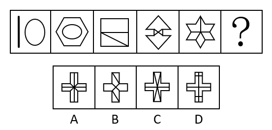

# 数量规律-面数量（封闭区域数）+图形种类数二级验证

考点：[[20-考点/判断推理/图形推理/数量规律-面数量（封闭区域数）+图形种类数二级验证|图形推理 / 数量规律-面数量（封闭区域数）+图形种类数二级验证]]

**问法模型**：“选择最合适的一个填入问号处，使之呈现一定的规律性”且元素组成不同→先排属性规律，数面找递增数列，剩余选项再用图形种类数等细分规律二次筛选。

## 推理链
1. 第1步：题干五幅图元素组成不同（竖线+椭圆、六边形内嵌椭圆、矩形被分割、双三角夹蝴蝶结、六角星分割），且无明显对称/曲直/开闭等属性规律，转向数量规律。
2. 第2步：题干图形空白区域明显，优先数面（封闭区域数）：图1仅椭圆内1个面，图2六边形套椭圆2个面，图3矩形被横线加斜线分割成3个面，图4上下三角形加中间蝴蝶结共4个面，图5六角星被分割成5个面。
3. 第3步：面数量构成1、2、3、4、5的连续自然数列，故“？”处应填入有6个面的图形。
4. 第4步：逐项数面：A项十字形被分割为8个面，D项亦为8个面，均不等于6，排除A、D。
5. 第5步：对剩余选项做二级验证——题干每幅图均只由两种不同的图形构成（图一圆和直线、图二圆和六边形、图三三角形和四边形、图四三角形和六边形、图五菱形和五边形）。
6. 第6步：B项由三种图形构成，不符合；C项面数为6且仅含两种图形，与题干规律完全吻合，当选。

**最快解法**：⚡ 数面法+二级验证口诀：先数题干面数1、2、3、4、5递增锁定“6个面”，快速排除8个面的A、D；再用“每图只含两种图形”这一细分规律排除含三种图形的B，锁定C。

## 易错点
- ⚠ 只按面数筛完后停止验证：B、C面数可能相同（均为6个面），若不做“图形种类数”二级辨析，易在B、C间误选B
- ⚠ 选项十字形分割线密集，面数容易数错，把A、D的8个面误数成6个面
- ⚠ 图1中的竖线是开敞线条不构成面，易误将其与椭圆合计当2个面，导致整个数列错位

## 母题抽象
> 🧩 当题干图形元素组成不同、属性无规律且空白区域明显时，先数面找等差递增数列（如1~5→问号为6）划定范围；若多选项面数相同，再用图形种类数、线条数等二级规律二次筛选。

**同类特征**：元素组成不同、无明显属性规律、空白区域明显（提示数面）、面数量1~5等差递增、每幅图仅含两种不同图形、问号处延续数量数列

## 相关题
- [[10-真题/判断推理/图形推理/10204454 数量规律-部分数（黑白球连通区域数做和）|10204454]]（甘肃 2024，相关度2）
- [[10-真题/判断推理/图形推理/10297050 数量规律-特殊计数（线条穿过小白球的数量）|10297050]]（天津 2025，相关度2）
- [[10-真题/判断推理/图形推理/10297262 数量规律-面的形状种类（封闭面种类数分组）|10297262]]（浙江 2025，相关度2）
- [[10-真题/判断推理/图形推理/10297314 数量规律-交点数（曲直交点）|10297314]]（浙江 2025，相关度2）
- [[10-真题/判断推理/图形推理/11454020 数量规律-小元素按行排布（每行个数自上而下递增1）|11454020]]（选调 2024，相关度2）

---

### 题干

从所给的四个选项中，选择最合适的一个填入问号处，使之呈现一定的规律性：

### 选项
- A. A
- B. B
- C. C　✅
- D. D

### 官方解析
元素组成不同，且无明显属性规律，优先考虑数量规律。观察发现，题干图形空白区域明显，考虑数面。题干图形面数量依次为：1、2、3、4、5，？，故“？”处应该选择有6个面的图形，A项和D项均为8个面，排除。再次观察发现，题干均含有两种不一样的图形（图一为圆和直线，图二为圆和六边形，图三为三角形和四边形，图四为三角形和六边形，图五为菱形和五边形），B项有三种图形，C项有两种图形，C项符合规律，当选。
故正确答案为C。

### 给定材料
（无）
