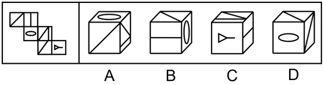

# 空间重构-六面体折叠（相对面排除+公共点引线验证）

考点：[[20-考点/判断推理/图形推理/空间重构-六面体折叠（相对面排除+公共点引线验证）|图形推理 / 空间重构-六面体折叠（相对面排除+公共点引线验证）]]

**问法模型**：给定展开图问'哪一项能折叠而成'→ 先用相对面排除法排掉含相对面的选项，再用公共点引线/公共边法验证相邻面细节

## 推理链
1. 第1步：将展开图六面标号：面a（斜线+平行双线面）、面b（椭圆面）、面c（斜线三角面）、面d（喇叭/小三角图案面）
2. 第2步：用相对面规则（同行/列隔一面、'Z'字形两端为相对面）确定面a与面d为相对面，折叠后不能同时可见
3. 第3步：A项三个面为面a、面c、面d，其中a与d同现，违反相对面规则，排除A
4. 第4步：D项顶面与右侧面呈现的均为面a的图案（斜线+平行线），而面a在展开图中只有一个，出现重复面，排除D
5. 第5步：对B、C采用公共点法：三个相邻面相交于一个公共点，检查该点在各面上是否有线条引出
6. 第6步：B项三面为面a、面b、面c，题干展开图中三面公共点落在面a上时未引出任何线条，而B项中该公共点在面a上引出了线条，与题干矛盾，排除B
7. 第7步：C项三个面的图案、相邻位置及公共点引线情况均与展开图一致，当选C

**最快解法**：⚡ 排除法三步走：①相对面排除——面a与面d为相对面，排除A（a、d同现）；②重复面排除——D项顶面与右侧面均为面a，排除D；③公共点引线排除——B项中面a、b、c的公共点在面a上引出了线条，题干中没有，排除B，锁定C

## 易错点
- ⚠ 相对面判定失误：'Z'字形两端或隔一面的相对面漏判，误认为a、d可同时出现
- ⚠ 公共点法忽略面的旋转方向：折叠后需把面a旋转到选项视角再比对公共点处是否引线，直接平面对比易判错B项
- ⚠ 忽视低级矛盾：D项同一面a出现两次，若只顾对线条细节容易漏掉重复面这一最简排除依据

## 母题抽象
> 🧩 当六面体展开图折叠题中各面含特征线条（斜线、平行线、图案）时，先用相对面排除，再用'公共点引线/公共边特征'逐项验证剩余选项

**同类特征**：六面体展开图折叠、面内含斜线与平行双线、面内含椭圆、喇叭形图案、选项均为三面可见的立体图、相对面不能同时出现、公共点引线验证相邻关系

## 相关题
- [[10-真题/判断推理/图形推理/12019707 空间折叠（六面体折纸盒）——相对面排除＋公共边画边法-公共点引线法|12019707]]（广东 2026，相关度2）
- [[10-真题/判断推理/图形推理/18899566 空间重构-折纸盒（相对面排除+无中生有面排除）|18899566]]（上海 2021，相关度2）
- [[10-真题/判断推理/图形推理/2452620 空间重构-六面体折叠（相对面排除+相邻面公共边-公共点验证）|2452620]]（江苏 2020，相关度2）
- [[10-真题/判断推理/图形推理/12561915 空间重构-六面体折叠（相对面排除+公共点法）|12561915]]（浙江 2024，相关度1）
- [[10-真题/判断推理/图形推理/12882220 空间重构-六面体折纸盒（相对面排除+相邻面验证）|12882220]]（内蒙古 2025，相关度1）

---

### 题干

左边给定的是多面体的外表面，右边哪一项能由它折叠而成？请把它找出来。

### 选项
- A. A
- B. B
- C. C　✅
- D. D

### 官方解析

将原展开图标上序号如下图，逐一进行分析。

A项：选项三个面为面a，面c和面d，面a和面d为相对面，相对面不能同时出现，选项与题干不一致，排除；

B项：选项三个面为面a，面b和面c，在题干展开图中，三个面的公共点在a面没有引出线条，在选项中，三个面公共点在a面引出了线条，选项与题干不一致，排除；

C项：选项与题干一致，当选；

D项：选项上面和右侧面均为面a，题干面a只出现一次，选项与题干不一致，排除。

故正确答案为C。

### 给定材料
（无）
