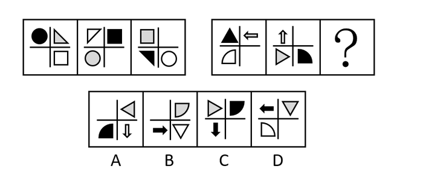

# 位置规律-平移（十字格四象限逆时针移动）

考点：[[20-考点/判断推理/图形推理/位置规律-平移（十字格四象限逆时针移动）|图形推理 / 位置规律-平移（十字格四象限逆时针移动）]]

**问法模型**：两套图形具有相似性又有差异、选最适合取代问号的图形 → 元素组成相同优先考虑位置规律，先归纳第一组移动规律再迁移到第二组

## 推理链
1. 第1步：第一组每幅图均由三角形、圆、方块、空白四种元素分占十字格的四个区域，元素组成相同，优先考虑位置规律而非样式/数量规律
2. 第2步：追踪第一组各元素位置——圆：左上→左下→右下；三角形：右上→左上→左下；方块：右下→右上→左上；空白：左下→右下→右上，归纳出'每种元素每次逆时针平移一个格子'的规律
3. 第3步：将规律应用到第二组并验证——图1中三角形在左上、箭头(←)在右上、扇形在左下、空白在右下；图2中箭头(↑)到左上、三角形到左下、扇形到右下、空白到右上，逆时针平移一格的规律在第二组成立
4. 第4步：据此推导？处位置——三角形由左下逆时针移到右下角，箭头移到左下（方向←→↑→→每次顺时针转90°），扇形移到右上（阴影按白→黑→灰循环），空白移到左上
5. 第5步：逐项对照——A项三角形在右上、C项三角形在左上、D项三角形在右上，均不符合；仅B项三角形位于十字格右下角，且箭头(→)在左下、灰色扇形在右上、空白在左上全部吻合，故选B

**最快解法**：⚡ 定锚追踪法：锁定特征最明显的'三角形'元素，第一组中其轨迹为右上→左上→左下（逆时针逐格），第二组中延续为左上→左下→？，直接推出？处三角形应在右下角，扫一眼选项只有B符合，秒杀

## 易错点
- ⚠ 解题顺序错误：图形元素组成相同时应优先考虑位置规律，若先去数元素数量或找样式叠加规律会陷入僵局
- ⚠ 移动方向看反：把'逆时针平移一格'误判为顺时针，会推出三角形在左上或右上而错选C或D
- ⚠ 忽略第二组自身特征：箭头方向每次顺时针旋转90°、扇形阴影白→黑→灰循环等细节可用于二次验证，只盯一个元素易被相似干扰项迷惑

## 母题抽象
> 🧩 当两套图形'元素组成完全相同、仅位置发生变化'时，用定锚追踪法：在第一组锁定一个特征元素找出其移动路径（如逆时针逐格平移），将规律迁移到第二组推出问号处位置，再逐项排除

**同类特征**：两套图形求同存异、元素组成相同、十字格四象限结构、元素逆时针平移一格、位置规律优先、最适合取代问号

## 相关题
- [[10-真题/判断推理/图形推理/11226892 位置规律-九宫格小元素沿固定循环链移动|11226892]]（上海 2025，相关度2）
- [[10-真题/判断推理/图形推理/12334416 图形推理-位置规律（旋转-翻转组合变换）|12334416]]（江苏 2024，相关度2）
- [[10-真题/判断推理/图形推理/1787214 位置规律-旋转（分色分组跟踪、旋转方向交替）|1787214]]（选调 2024，相关度2）
- [[10-真题/判断推理/图形推理/2033336 位置规律-旋转（双元素分别旋转：曲线顺时针90°、直线逆时针45°）|2033336]]（河南 2016，相关度2）
- [[10-真题/判断推理/图形推理/2456413 位置规律-旋转（内外层分开看）|2456413]]（浙江 2020，相关度2）

---

### 题干

每道题包含两套图形和可供选择的4个图形。这两套图形具有某种相似性，也存在某种差异。要求你从四个选项中选择最适合取代问号的一个。正确的答案应不仅使两套图形表现出最大的相似性，而且使第二套图形也表现出自己的特征。

### 选项
- A. A
- B. B　✅
- C. C
- D. D

### 官方解析
元素组成相同，优先考虑位置规律。观察第一组图发现，每幅图均有三角形、圆、方块和空白四种元素组成，并且每种元素有明显位置变化，考虑平移。第一组图中，每种小元素依次逆时针平移一个格子，将规律应用到第二组图，故？处三角形的位置应当在十字格右下角，只有B项符合，当选。
故正确答案为B。

### 给定材料
（无）
