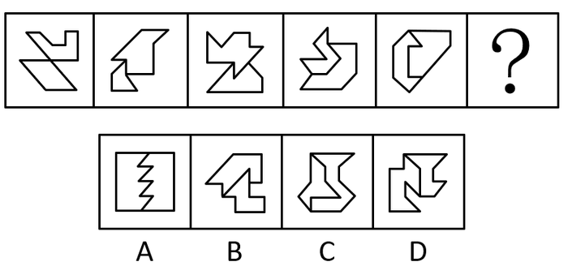

# 图形间关系-两图相交线（公共边）数量

考点：[[20-考点/判断推理/图形推理/图形间关系-两图相交线（公共边）数量|图形推理 / 图形间关系-两图相交线（公共边）数量]]

**问法模型**：每幅图均由两个图形构成且元素组成不同 → 优先考虑图形间关系，定量数两图相交线条数找规律

## 推理链
1. 第1步：题干五幅图元素组成不同，且每幅图均由两个图形拼合/相交而成，排除位置、样式类规律
2. 第2步：优先考虑图形间关系，逐幅数两个图形之间相交（重合公共边）的线段数量
3. 第3步：图1两图相交但无公共线段（计0条），图2至图5两图相交线依次为1、2、3、4条，呈0、1、2、3、4的等差递增规律
4. 第4步：依规律？处应选两图相交线数量为5的图形
5. 第5步：逐项数选项：A、B、D两图相交线数量均不为5，C项两图相交线恰为5条，符合规律

**最快解法**：⚡ 图形间关系口诀'两图组合数交线'：先数出题干0→4等差递增，直接在选项中找相交线为5条者，排除法锁定C

## 易错点
- ⚠ 把图1'两图相交于点/交叉'误计为相交线1条，导致规律起点错位成1、2、3、4、5，误选需6条线的方向
- ⚠ 只定性看'两图是否相交'，忽略定量数公共边的条数，规律挖掘不到位
- ⚠ A项折线分割易误数：需按两图实际公共边逐段计数，不能凭折线视觉段数直觉判断

## 母题抽象
> 🧩 当题干每幅图均由两个图形组合且样式各异时，优先数'两图相交线（公共边）数量'，若呈等差数列则按规律选下一项

**同类特征**：每幅图由两个图形构成、元素组成不同、图形间相交/相贴、相交线数量等差递增0→4、问号处延续数量规律

## 相关题
- [[10-真题/判断推理/图形推理/2033324 数量规律-面数量（等差数列）|2033324]]（河南 2016，相关度2）
- [[10-真题/判断推理/图形推理/2050882 数量规律-部分数（连通区域计数）|2050882]]（江西 2017，相关度2）
- [[10-真题/判断推理/图形推理/2452827 数量规律-面数量（封闭区域数）|2452827]]（河南 2019，相关度2）
- [[10-真题/判断推理/图形推理/3523643 数量规律-面数量（封闭区域数）等差递增|3523643]]（四川 2021，相关度2）
- [[10-真题/判断推理/图形推理/5518369 数量规律-数曲线（曲线条数递增）|5518369]]（湖北 2021，相关度2）

---

### 题干

每道题包含一套图形和四个选项，请从四个选项中选出最恰当的一项填在问号处，使图形呈现一定的规律性。

### 选项
- A. A
- B. B
- C. C　✅
- D. D

### 官方解析
元素组成不同，且每幅图均由两个图形构成，优先考虑图形间关系。观察发现，题干图形面与面之间相交的线数量分别为0、1、2、3、4，则？处要找一个面与面之间相交的线数量为5的图形，只有C项符合，当选。
故正确答案为C。

### 给定材料
（无）
