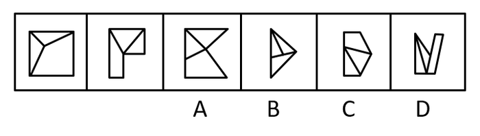

# 数量规律-面的细化（面的形状构成：三角形-四边形个数）

考点：[[20-考点/判断推理/图形推理/数量规律-面的细化（面的形状构成：三角形-四边形个数）|图形推理 / 数量规律-面的细化（面的形状构成：三角形/四边形个数）]]

**问法模型**：选非题'去掉哪一个后剩下图形呈现规律' → 先归纳题干共性规律，再剔除不符合该规律的选项

## 推理链
1. 第1步：题干为'去掉一个后呈现规律'的选非题；各图元素组成不同、无属性规律，但图形均被线条分割、封闭面明显，优先考虑数量规律中的数面
2. 第2步：数面数量：题干前两幅图与A、B、C、D各图均含3个封闭面，面个数完全相同，无法据此排除任何选项，需进入'面的细化'——看每个面的形状
3. 第3步：细化题干两图的面形状：两幅图均由2个三角形面和1个四边形面构成，即'2三角+1四边形'为题干规律
4. 第4步：逐项对照面形状：A、C、D均由2个三角形面+1个四边形面构成，符合题干规律；B由3个三角形面构成，不含四边形面
5. 第5步：B与题干'2三角+1四边形'的规律不符；本题为选非题，去掉B后其余图形呈现一致规律，故正确答案为B

**最快解法**：⚡ 数面+面形状细化法：先统一数出面个数均为3（排除不了），立刻转向'面的细化'——盯住每图三个面是几个三角形、几个四边形，题干为'2三角+1四边形'，扫一眼选项，只有B是3个三角形，直接锁定B

## 易错点
- ⚠ 只数到'所有图都是3个面'便认为无规律可循，止步于面数量而未做面的形状细化
- ⚠ 忽略本题为选非题，错把符合'2三角+1四边形'规律的选项当答案
- ⚠ 被图形外轮廓形状干扰：B的外框看似四边形，误以为B也含四边形面，实际其内部3个封闭面均为三角形

## 母题抽象
> 🧩 当'去掉一个'选非题中各图形封闭面明显且面数量相同时，用'数面→面的形状细化（三角形/四边形等构成占比）'找与题干构成不一致的选项即为答案

**同类特征**：选非题（去掉哪一个）、元素组成不同、无属性规律、图形被分割、封闭面明显、面数量相同（均为3个面）、需细化面的形状（三角形与四边形构成）

## 相关题
- [[10-真题/判断推理/图形推理/12561867 数量规律-相同元素的位置关系（对角相对-边邻相邻）分组分类|12561867]]（浙江 2024，相关度1）
- [[10-真题/判断推理/图形推理/14993424 数量规律-元素个数（黑-灰矩形数量等差递增）|14993424]]（选调 2024，相关度1）
- [[10-真题/判断推理/图形推理/15419022 数量规律-图形间关系（面相贴-被完全隔开，内部线条部分数）|15419022]]（湖北 2025，相关度1）
- [[10-真题/判断推理/图形推理/16069776 数量规律-面数量（总面数恒定+全直线面数量递减二级规律）|16069776]]（广西 2026，相关度1）
- [[10-真题/判断推理/图形推理/1789602 数量规律-波峰波谷个数差+位置规律（最高波峰与竖轴左右关系）|1789602]]（江苏 2016，相关度1）

---

### 题干

从所给的四个选项中，去掉哪一个后，剩下的图形序列可以呈现一定的规律性？

### 选项
- A. A
- B. B　✅
- C. C
- D. D

### 官方解析
图形元素组成不同，且无属性规律，考虑数量规律。观察发现，图形被分割，封闭面明显，考虑数面，题干图形和选项都是3个面，无法排除，考虑面的细化。发现题干的两幅图都是由2个三角形的面和1个四边形的面组成，观察选项，只有B项是由3个三角形的面组成，没有四边形的面，不能和题干形成规律性，故只有B项不符合规律。
本题为选非题，故正确答案为B。

### 给定材料
（无）
