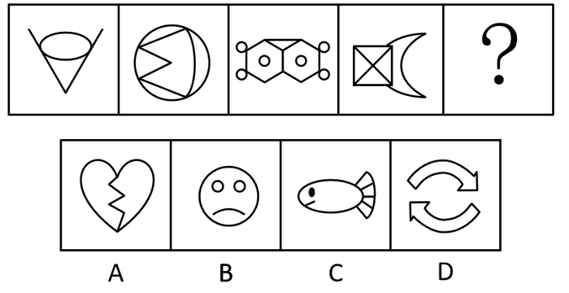

# 属性规律-对称性（对称轴条数与竖横方向交替）

考点：[[20-考点/判断推理/图形推理/属性规律-对称性（对称轴条数与竖横方向交替）|图形推理 / 属性规律-对称性（对称轴条数与竖横方向交替）]]

**问法模型**：问'最符合所给图形规律'→ 对题干图形逐一画对称轴，数条数、记方向，归纳交替规律后排除选项

## 推理链
1. 第1步：题干五幅图元素组成不同（V形加椭圆、圆内带三角缺口、双六边形加圆点、正方形加月牙、？），优先考虑属性规律；图1、图3存在明显等腰元素，考虑对称性
2. 第2步：给每个图形画对称轴：图1（V加椭圆）仅1条竖直对称轴，图2仅1条水平对称轴，图3（双六边形组合）仅1条竖直对称轴，图4（正方形+月牙）整体仅1条水平对称轴
3. 第3步：归纳规律：题干图形的对称轴都只有1条，且方向按'竖、横、竖、横'交替出现，故？处应选仅1条竖直对称轴的图形
4. 第4步：对照选项A：碎心的裂缝为折线，整体不对称，排除
5. 第5步：对照选项B：哭脸（圆脸、两眼、下弯嘴）仅1条竖直对称轴，符合要求
6. 第6步：对照C、D排除：C小鱼为横轴对称，D双循环箭头为中心对称（旋转180°重合）而非竖轴对称，只有B符合，故选B

**最快解法**：⚡ 对称轴'三看'口诀（画轴→数条数→记方向）：题干方向为'竖、横、竖、横'交替，？处要竖轴对称；直接扫描选项——B哭脸仅竖轴对称即选，A不对称、C横轴、D中心对称，秒排

## 易错点
- ⚠ 只验证'是否轴对称'而不看对称轴方向，误选C（小鱼同样是轴对称图形，但为横轴）
- ⚠ 忽略'对称轴只有一条'的前提，把D（中心对称、无轴）误当作对称候选
- ⚠ 对图4这类组合图形（正方形+月牙）只看正方形局部有多条轴，未整体画轴导致方向误判

## 母题抽象
> 🧩 当图形元素组成不同且含等腰形、圆、月牙等对称感强的元素时，画出对称轴并记录'条数+方向'，若方向呈竖横交替，则？处选只有一个该方向对称轴的图形

**同类特征**：元素组成不同、存在明显等腰元素、对称轴均只有一条、竖轴与横轴交替出现、组合图形需整体画轴

## 相关题
- [[10-真题/判断推理/图形推理/2136980 属性规律-轴对称（对称轴数量+对称轴与图形中线条重合的二级辨析）|2136980]]（北京 2018，相关度2）
- [[10-真题/判断推理/图形推理/10204454 数量规律-部分数（黑白球连通区域数做和）|10204454]]（甘肃 2024，相关度1）
- [[10-真题/判断推理/图形推理/10204604 数量规律-线数量（汉字横线数）|10204604]]（辽宁 2024，相关度1）
- [[10-真题/判断推理/图形推理/10297050 数量规律-特殊计数（线条穿过小白球的数量）|10297050]]（天津 2025，相关度1）
- [[10-真题/判断推理/图形推理/10297127 图形间关系-相交图形中不相交边数量（黑白图形相交）|10297127]]（天津 2025，相关度1）

---

### 题干

下列选项中最符合所给图形规律的是：

### 选项
- A. A
- B. B　✅
- C. C
- D. D

### 官方解析
图形元素组成不同，考虑属性规律。观察发现，图1、图3存在明显的等腰元素，考虑对称性。画出图形对称轴发现，题干图形的对称轴都只有一条，且竖轴和横轴交替出现，图4是横轴对称，故？处应该选择竖轴对称的图形，只有B项符合。
故正确答案为B。

### 给定材料
（无）
