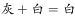
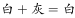
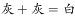
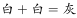

# 样式规律-黑白运算

考点：[[20-考点/判断推理/图形推理/样式规律-黑白运算|图形推理 / 样式规律-黑白运算]]

**问法模型**：‘两组图，前两图叠加得规律，求问号处图形’→识别外轮廓相同、内部灰白分布不同的组合，按同一位置逐块做黑白（灰白）运算建立加法规则，再逐位套用到第二组并对照选项

## 推理链
1. 两组图外轮廓均为六等分圆形且完全相同，内部仅灰、白颜色分布不同，元素组成相似→优先考虑样式规律中的黑白运算（灰色视为‘黑’、白色视为‘白’）
2. 把圆面按方位切成‘正上、右上、右下、正下、左下、左上’六个扇区，逐位对比第一组图1与图2叠加得到图3的颜色
3. 第一组逐位验证：正上‘黑+白=白’，左上、右上‘白+黑=白’，左下、右下‘黑+黑=白’，正下‘白+白=黑’→运算规则为‘白+白=黑，其余组合均得白’
4. 将规则用于第二组图4与图5：正上‘白+黑=白’，左上、右上‘黑+白=白’，左下、右下‘黑+黑=白’，正下‘白+白=黑’→问号处仅正下方为黑，其余扇区全白
5. 对照选项：C正上方为黑，排除；A全白、D正下方为白，均排除；B仅正下方为黑，与推理结果完全一致，故选B

**最快解法**：⚡ 黑白运算+特征位置排除法：无需逐位算全六个扇区，只算‘正上’与‘正下’两格即可——正上=白+黑=白（排除正上为黑的C），正下=白+白=黑（排除正下为白的A、D），直接锁定B

## 易错点
- ⚠ 惯性套用常见口诀‘同色得黑/异色得白’或‘同色得白/异色得黑’，本题实际规则是‘白+白=黑、其余组合均得白’，须逐位实证不可想当然
- ⚠ 把灰色底纹误当成独立于黑白的第三种颜色，放弃运算或规则列错
- ⚠ 扇区方位对应错位（如把‘左下/右下’与‘正下’混淆），导致逐位叠加结果错位、误选C或D

## 母题抽象
> 🧩 当两组图形外轮廓完全相同、内部区域仅有黑白（灰白）颜色差异时，用黑白运算：逐位叠加前两图建立‘黑+白/白+黑/黑+黑/白+白’的运算表，再用正上、正下等特殊位置快速排除选项

**同类特征**：两组图、前两图推第三图（问号）、外部轮廓相同（六等分圆）、内部扇区黑白（灰白）分布不同、元素组成相似→样式规律、黑白运算、特殊位置（正上/正下）验证排除

## 相关题
- [[10-真题/判断推理/图形推理/10297349 样式规律-黑白运算|10297349]]（浙江 2025，相关度3）
- [[10-真题/判断推理/图形推理/2660510 样式规律-黑白运算（五角星-空白定义叠加）|2660510]]（选调 2018，相关度1）
- [[10-真题/判断推理/图形推理/5510377 样式规律-黑白运算（黑-白-点三色叠加）|5510377]]（山东 2023，相关度1）
- [[10-真题/判断推理/图形推理/5660586 图形推理-样式规律（黑白运算-定义叠加，含'点'三种元素）|5660586]]（上海 2020，相关度1）

---

### 题干

下列选项中最符合所给图形规律的是：

### 选项
- A. A
- B. B　✅
- C. C
- D. D

### 官方解析

图形元素组成相似，优先考虑样式规律。观察发现图形外部轮廓相同，但内部颜色不同，考虑黑白运算。第一组图：、、、；第二组图运用此规律，正上方：，排除C项；正下方：，排除A、D两项。

故正确答案为B。

### 给定材料
（无）
