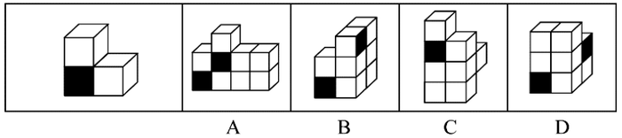
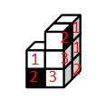
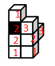
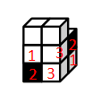

# 立体拼合-小立方体组合拼合（含涂色面朝向验证）

考点：[[20-考点/判断推理/图形推理/立体拼合-小立方体组合拼合（含涂色面朝向验证）|图形推理 / 立体拼合-小立方体组合拼合（含涂色面朝向验证）]]

**问法模型**：题干问'不可能由三个左侧立体图形构成'（选非）→ 采用'总数拆块＋逐项拼合验证'模型：把选项的9个小方块拆成三个可旋转的带黑面L形块，能拆出三个的排除，拆不出的当选

## 推理链
1. 第1步：题干立体由3个小方块组成'L形'（底层2块＋上层1块，标号1、2、3），仅一个外表面涂黑；三个题干图形拼合后小方块总数应为3×3=9块
2. 第2步：确立规则——每个L形块可任意旋转、不可镜像，黑面既可朝外可见，也可朝内被相邻方块遮挡（官方解析中A、B、C项均出现'黑面朝内，无法看到'的合法摆放）；解题目标是把每个选项拆成3个满足黑面约束的L形块
3. 第3步：A项——左下角与中间的方块组（各标1、2、3）可拼成2个题干图形，右下角方块组（1、2、3）经位置变换（黑面朝内不可见）得到第3个题干图形，A可以构成，排除
4. 第4步：B项——左下角与右上角方块组可拼成2个题干图形，右下角标2的方块（黑面朝内）左侧补一个标3的方块即组成第3个题干图形，B可以构成，排除
5. 第5步：C项——上方与右侧方块组（右侧黑面朝内）可拼成2个题干图形，第三层（从上往下数）标2的方块（黑面朝内）内侧补一个标3的方块组成第3个，C可以构成，排除
6. 第6步：D项——左下角与右面的方块组虽各可拼出1个题干图形，但由题干图形特征及黑面位置，拼法唯一；剩下第一层（从上往下数）的2个小方块无法与内部方块再组成带黑面的L形题干图形，故D不可能，当选

**最快解法**：⚡ 拆块排除法：每个选项9块=3个'L形三连块'，优先找'孤立/悬空'的方块组——D项第一层（顶层）的2个小方块无论怎样旋转都无法与内部方块构成带黑面的L形块，直接锁定D

## 易错点
- ⚠ 忽略'黑面朝内被遮挡'是合法摆放（A/B/C均靠此成立），误以为黑面必须朝外可见而错判
- ⚠ 只验证小方块总数为9就认为能拼合，忽视方块间的连接关系与L形拆分是否成立
- ⚠ 空间旋转想象出错：误以为D项顶层2块可与下方拼成L形，忽视黑面位置使拼法唯一、剩余方块无法独立成块

## 母题抽象
> 🧩 当题干给出'仅一面带涂色标记的立体小积木'并问'能/不能拼成给定组合体'时，用'总数拆块→逐块旋转拼合→涂色面朝向验证（可见或朝内遮挡）→剩余方块能否独立成块'四步逐项排查

**同类特征**：立体拼合、L形三连块（3个小方块）、仅一面涂黑、选非问法（不可能构成）、黑面可朝内不可见、三个相同图形拼成9块整体

## 相关题
- [[10-真题/判断推理/图形推理/2776149 图形推理-立体拼合（小方块计数守恒+分层形状咬合）|2776149]]（浙江 2021，相关度1）
- [[10-真题/判断推理/图形推理/10204640 立体拼合（多面体组合：数量守恒+凹凸互补+旋转）|10204640]]（河南 2024，相关度1）
- [[10-真题/判断推理/图形推理/12019797 立体拼合-由两视图及全等小块反推小立体（数小立方体+旋转试装）|12019797]]（浙江 2026，相关度1）
- [[10-真题/判断推理/图形推理/12536475 图形推理-立体拼合（正方体堆叠多面体组合）|12536475]]（四川 2024，相关度1）
- [[10-真题/判断推理/图形推理/12881949 立体拼合-多块拼合正方体（凹凸互补+旋转）|12881949]]（广东 2025，相关度1）

---

### 题干

左侧立体图形仅有图中所示的一个面被涂黑。下列选项不可能由三个左侧立体图形构成的是（    ）。

### 选项
- A. A
- B. B
- C. C
- D. D　✅

### 官方解析

本题考查立体拼合。题干立体图形由3个小方块组成，分别标1、2、3，如下图所示。

A项：如下图所示，左下角和中间的立体图形（分别标记为1、2、3）可以拼成2个题干中的立体图形，右下角（标记为1、2、3）的立体图形可由题干中的立体图形通过位置变换得到（此时黑面朝内，无法看到），排除；

B项：如下图所示，左下角和右上角的立体图形（分别标记为1、2、3）可以拼成2个题干中的立体图形，在右下角标2的立体图形（此时黑面朝内，无法看到）的左侧可以有另外一个立体图形（标记应为3），组合拼成题干中的立体图形，排除；

C项：如下图所示，上方的立体图形和右侧的立体图形（分别标记为1、2、3，此时右侧图形黑面朝内，无法看到）可以拼成2个题干中的立体图形，在第三层（从上往下数）标2（此时黑面朝内，无法看到）的立体图形的内侧可以有另外一个立体图形（标记应为3），组合拼成题干中的立体图形，排除；

D项：如下图所示，左下角的立体图形（标记为1、2、3）可以拼成1个题干中的立体图形，右面的立体图形（标记为1、2、3）可以拼成1个题干中的立体图形，但根据题干图形的特征及黑面的位置，只存在图示中唯一的拼法。此时第一层（从上往下数）的2个小方块无法和内部的其他方块拼成题干中的立体图形，当选。

本题为选非题，故正确答案为D。

### 给定材料
（无）
