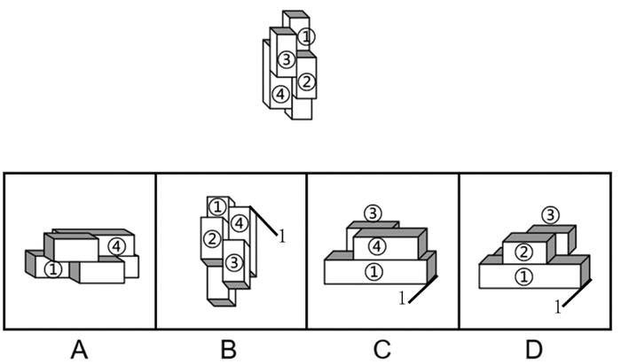

# 空间重构-立体图形旋转等价（多块长方体组合的同一性判断）

考点：[[20-考点/判断推理/图形推理/空间重构-立体图形旋转等价（多块长方体组合的同一性判断）|图形推理 / 空间重构-立体图形旋转等价（多块长方体组合的同一性判断）]]

**问法模型**：『与所给立体图形不可能是同一图形』（选非题）→ 给各小长方体标号，用三维旋转验证各选项能否与题干重合，排除可重合项，锁定相对位置矛盾的一项

## 推理链
1. 第1步：题干立体由4个小长方体（①②③④）堆叠而成，各块长短、摆放朝向存在差异，需先标号并记录关键相对位置，如『④号块偏左而非偏右』
2. 第2步：采用旋转等价验证法——同一立体经过若干次三维旋转（绕轴翻转+水平旋转）后各块相对位置关系不变
3. 第3步：A项：设②号块和③号块在前面、①号块和④号块在后面时，按其摆放关系④号块一定偏右，与题干『④号块偏左』矛盾，不可能是同一图形
4. 第4步：B项：沿图中轴1顺时针旋转后，各块相对位置与题干一致，可重合
5. 第5步：C项：先沿轴1顺时针旋转、再水平顺时针旋转后，与题干图形一致，可重合
6. 第6步：D项：先沿轴1逆时针旋转、再水平逆时针旋转后，与题干图形一致，可重合
7. 第7步：本题选『不可能是同一图形』的选项，只有A项与题干相对位置矛盾，故选A

**最快解法**：⚡ 参照块定位法（标号+特征块偏移方向）：给4块长方体标号，抓住特征块『④号偏左』这一硬性相对位置，A项无论怎样旋转在②③在前、①④在后的摆放下④必偏右，与题干矛盾直接锁定；B、C、D分别用绕轴1旋转（一次或两次）即能与题干重合，快速排除

## 易错点
- ⚠ 选非题审题失误：误把能与题干重合的B/C/D当成答案
- ⚠ 只看整体轮廓相似就判断为同一图形，忽略块与块之间的相对偏移方向（④偏左还是偏右）
- ⚠ 旋转方向（顺时针/逆时针）或旋转轴想错，把本可重合的选项误判为不可重合

## 母题抽象
> 🧩 当题干给出多个小长方体组合的立体并问『不可能是同一图形』时，先给各块标号、记住特征块的偏移方向等相对位置关系，再用绕轴旋转逐一验证：旋转后与题干相对位置矛盾者即为答案

**同类特征**：四个小长方体堆叠组合立体、选非问法（不可能是同一图形）、三维旋转等价验证、给小长方体标号①②③④、特征块相对偏移（④号偏左）

## 相关题
（暂无）

---

### 题干

下列选项中，与所给的立体图形不可能是同一图形的是：

### 选项
- A. A　✅
- B. B
- C. C
- D. D

### 官方解析

将题干的小长方体分别标上序号，逐一进行分析。

A项：当②号块和③号块在前面，①号块和④号块在后面时，根据题干，④号块一定偏左而非偏右，与题干图形不一致，当选；

B项：将选项沿图中轴1顺时针旋转之后，与题干图形一致，排除；

C项：将选项先沿图中轴1顺时针旋转，再水平顺时针旋转之后，与题干图形一致，排除；

D项：将选项先沿图中轴1逆时针旋转，再水平逆时针旋转之后，与题干图形一致，排除。

本题为选非题，故正确答案为A。

### 给定材料
（无）
