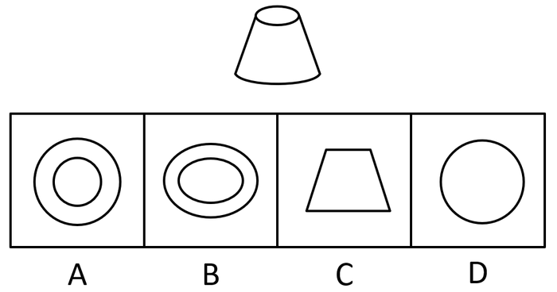

# 立体图形视图（三视图与投影辨析）

考点：[[20-考点/判断推理/图形推理/立体图形视图（三视图与投影辨析）|图形推理 / 立体图形视图（三视图与投影辨析）]]

**问法模型**：选非题问'不可能属于该圆台视图'→ 按上/下/前/后六个标准观察方向逐一想象正投影，排除可得到的图形，剩余项即'不可能'项

## 推理链
1. 第1步：题干立体图形为圆台，上底是小圆、下底是大圆且同轴，侧面为锥面，问法为选非（找'不可能'的视图）
2. 第2步：所用方法为标准视图想象法——沿平行轴线方向（俯视、仰视）与垂直轴线方向（主视、后视、左视、右视）分别做正投影
3. 第3步：从上往下看，上底小圆与下底大圆的投影重合为'两个同心圆'，与A项图形一致，排除
4. 第4步：从前往后看，圆台轮廓投影为'上短下长的等腰梯形'，与C项图形一致，排除
5. 第5步：从下往上看，下底大圆在最外侧，遮住上方所有投影，只能看到'一个大圆'，与D项图形一致，排除
6. 第6步：沿轴线方向投影圆仍是圆、垂直轴线方向投影是梯形，任何标准视图方向都无法出现'两个同心椭圆'，B项不可能得到，当选

**最快解法**：⚡ 三视图口诀+排除法：记住'圆台俯视=同心圆、主视/侧视=梯形、仰视=单个大圆'，先排除A、C、D，剩余B即'不可能'项；选非题最后确认选不得到的那个

## 易错点
- ⚠ 选非题惯性思维：按常规'找正确视图'去做，误选A、C、D其中一个
- ⚠ 误解椭圆来源：误以为斜着看可得椭圆，但标准视图只沿三个轴向投影，圆的正投影仍是圆，永远得不到同心椭圆
- ⚠ 忽略仰视遮挡关系：误以为仰视也能同时看到上下两个圆（同心圆），错把D项当答案

## 母题抽象
> 🧩 当题干给出立体几何体并问'可能/不可能属于其视图'时，用'六向正投影逐一想象'法，先排除可得到的平面图形，剩余项即答案；若为选非题，最后一步必须选'得不到'的那一项

**同类特征**：圆台（锥台）立体图、选非题：'不可能属于视图'、选项为圆、同心圆、椭圆、梯形等平面图形、考查俯视/主视/仰视三视图、同心圆与同心椭圆辨析、投影遮挡关系（大圆遮小圆）

## 相关题
（暂无）

---

### 题干

如图所示是一个圆台，则下列选项不可能属于该圆台视图的是：

### 选项
- A. A
- B. B　✅
- C. C
- D. D

### 官方解析
本题考查立体图形的视图问题。
A项，从上往下看，可以看到，为俯视图，排除；
B项，无法得到两个椭圆形，当选；
C项，从前往后看，可以看到，为主视图，排除；
D项，从下往上看，可以看到，为仰视图，排除。
本题为选非题，故正确答案为B。

### 给定材料
（无）
