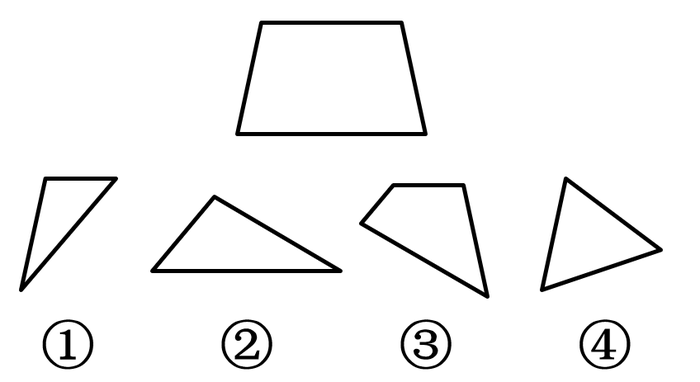
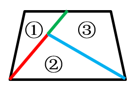

# 平面拼合（不旋转平移拼合-边线匹配）

考点：[[20-考点/判断推理/图形推理/平面拼合（不旋转平移拼合-边线匹配）|图形推理 / 平面拼合（不旋转平移拼合-边线匹配）]]

**问法模型**：'不经过旋转，能组成所给图形'→ 平面拼合模型：只允许平移，用水平边/斜边的方向与长度逐边匹配，锁定参与拼合的图形

## 推理链
1. 第1步：题干目标图形为梯形，含两条水平线——上方短横线与下方长横线；条件'不经过旋转'意味着图①②③④只能平移，各图的水平边拼合后仍保持水平方向
2. 第2步：采用水平边匹配法：拼合结果中每条水平边必须由某个（或某几个）图形的水平边直接提供或拼接而成
3. 第3步：梯形下方长横线与图②下方的横线方向、长度对应，确定②承担梯形底边
4. 第4步：梯形上方短横线对应图①上方的短横线与图③上方的短横线，二者需拼接成顶边，①③同时提供两侧斜边的上段
5. 第5步：①②③已能完整拼出梯形（底边+拼接顶边+两斜腰），无需图④；图④三条边均为斜边，无法提供必需的水平边段
6. 第6步：对照选项：A②③④、B①③④、C①②④均含④，全部排除；D①②③与拼合方式一致，故选D

**最快解法**：⚡ 水平边匹配+排除法：抓住'梯形有两条横线'且'不旋转'两个要点，图②下横线对应底边、图①③上短横线拼接成顶边，①②③即可拼成；而A/B/C均含无法贡献水平边的④，直接排除锁定D

## 易错点
- ⚠ 忽略'不经过旋转'的限制，习惯性旋转图形去凑形状，导致拼合判断失误
- ⚠ 只看整体轮廓相似，不逐边核对水平边的方向与长度，误以为④的斜边可以拼入梯形斜腰
- ⚠ 漏看梯形上方短横线需由①③两段拼接而成，误以为必须由单个图形提供完整顶边

## 母题抽象
> 🧩 当题干要求'不旋转拼合成目标图形'时，先锁定目标图形的水平/竖直边，寻找碎片中方向一致、长度可对应的边逐一匹配，无法提供必需边段的碎片直接排除

**同类特征**：不经过旋转、平面拼合、梯形有两条横线、四个编号碎片图形、选项为三图组合、上短横线需拼接

## 相关题
- [[10-真题/判断推理/图形推理/10975247 图形推理-平面拼合（平行且等长相消法）|10975247]]（江苏 2024，相关度1）
- [[10-真题/判断推理/图形推理/10975248 平面拼合（分割重组-三角形拼合）|10975248]]（江苏 2024，相关度1）
- [[10-真题/判断推理/图形推理/11367796 平面拼合-平行且等长相消|11367796]]（江苏 2025，相关度1）
- [[10-真题/判断推理/图形推理/12304870 图形推理-平面拼合（平行且等长相消法）|12304870]]（江苏 2024，相关度1）
- [[10-真题/判断推理/图形推理/12536406 图形推理-平面拼合（平行且等长相消）|12536406]]（四川 2024，相关度1）

---

### 题干

不经过旋转，下列选项能组成所给梯形的是：

### 选项
- A. ②③④
- B. ①③④
- C. ①②④
- D. ①②③　✅

### 官方解析

本题考查平面拼合。观察发现梯形具有两条横线，下方长横线对应图②下方的横线，梯形上方横线对应图①与图③上方的短横线（需要拼接），故题干所给梯形可由图①②③组合得到，具体拼合方式如下图：

故正确答案为D。

### 给定材料
（无）
