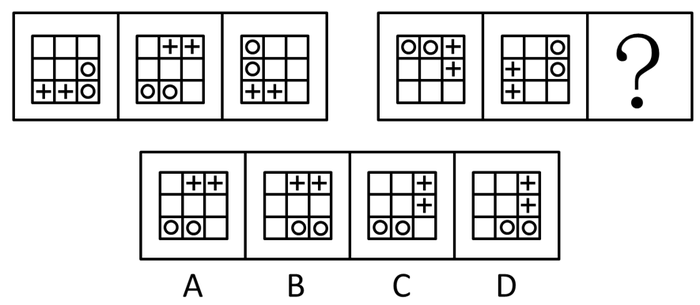

# 位置规律-平移（九宫格外圈循环移动+双元素分组跟踪）

考点：[[20-考点/判断推理/图形推理/位置规律-平移（九宫格外圈循环移动+双元素分组跟踪）|图形推理 / 位置规律-平移（九宫格外圈循环移动+双元素分组跟踪）]]

**问法模型**：两组图类比、问号处填第三幅图 → 元素组成相同先想位置规律，给外圈编号后分别跟踪两类元素的平移步长，用第一组定规律、第二组推答案

## 推理链
1. 第1步：两组各3幅3×3九宫格图，元素组成完全相同（均为两个白球O、两个十字+），仅位置变化 → 优先考虑位置规律（平移）。
2. 第2步：将九宫格外圈8格顺时针编号：①(1,1)②(1,2)③(1,3)④(2,3)⑤(3,3)⑥(3,2)⑦(3,1)⑧(2,1)，中心格不参与。
3. 第3步：第一组验证白球：图1在④⑤位（(2,3)(3,3)）→顺时针移2格→图2的⑥⑦位（(3,2)(3,1)）→再移2格→图3的⑧①位（(2,1)(1,1)），白球规律=整体顺时针平移2格。
4. 第4步：第一组验证十字：图1在⑦⑥位→移4格→图2的③②位（(1,3)(1,2)）→再移4格→图3的⑦⑥位（(3,1)(3,2)），十字规律=整体平移4格（8格外圈移4格顺逆等价）。
5. 第5步：第二组套用：图1白球在①②位、十字在③④位；图2白球到③④位（(1,3)(2,3)）、十字到⑦⑧位（(3,1)(2,1)），与题干一致，规律成立。
6. 第6步：问号处推算：白球由图2的③④位再顺时针移2格→⑤⑥位即(3,3)(3,2)；十字由⑦⑧位再移4格→③④位即(1,3)(2,3)。
7. 第7步：对照选项，只有D项十字在(1,3)(2,3)、白球在(3,2)(3,3)，完全吻合。

**最快解法**：⚡ 外圈编号跟踪法：外圈8格顺时针编1~8号，只盯两类元素的'整体'位置——白球每幅顺时针+2、十字每幅+4（顺逆皆可，因8格中对移4格即到对面）。第二组图2：白球③④、十字⑦⑧，直接算出问号处白球⑤⑥、十字③④，秒选D。

## 易错点
- ⚠ 把两个白球、两个十字当成四个独立元素分别找规律，其实每类元素是'整体同步平移'，应两两捆绑跟踪。
- ⚠ 外圈循环平移时忘记首尾相接（⑧号位后接①号位），导致跨角推错位置。
- ⚠ 纠结十字是顺时针还是逆时针移4格——8格外圈移动4格顺逆等价，不必浪费判断时间。

## 母题抽象
> 🧩 当题干出现'元素组成相同、仅位置不同'的九宫格/环形容器图时，给外圈格子顺时针编号，分别捆绑跟踪每类元素的循环步长（第一组定规律、第二组求答案），验证步长一致后直接算出问号位置。

**同类特征**：元素组成相同、3×3九宫格外圈、两类小元素（白球/十字）分组移动、位置循环平移、两组图类比求问号、步长2格与4格

## 相关题
- [[10-真题/判断推理/图形推理/4651708 位置规律-平移（外圈循环平移+元素重合）|4651708]]（江苏 2022，相关度2）
- [[10-真题/判断推理/图形推理/2172768 位置规律（旋转-翻转）|2172768]]（海南 2021，相关度1）
- [[10-真题/判断推理/图形推理/10204458 位置规律-平移（特征交点沿内圈循环平移）|10204458]]（甘肃 2024，相关度1）
- [[10-真题/判断推理/图形推理/10204614 图形推理-位置规律（旋转+翻转交替循环）|10204614]]（黑龙江 2024，相关度1）
- [[10-真题/判断推理/图形推理/10297399 位置规律—平移（多黑块分组循环平移）|10297399]]（四川 2025，相关度1）

---

### 题干

从所给的四个选项中，选择最合适的一个填入问号处，使之呈现一定的规律性：

### 选项
- A. A
- B. B
- C. C
- D. D　✅

### 官方解析
元素组成相同，优先考虑位置规律。观察发现，题干第一组图形中的两个白球在九宫格外圈整体顺时针平移2格，而两个“十字”在九宫格外圈整体顺/逆时针平移4格。第二组图形应遵循同样规律，只有D项满足。
故正确答案为D。

### 给定材料
（无）
