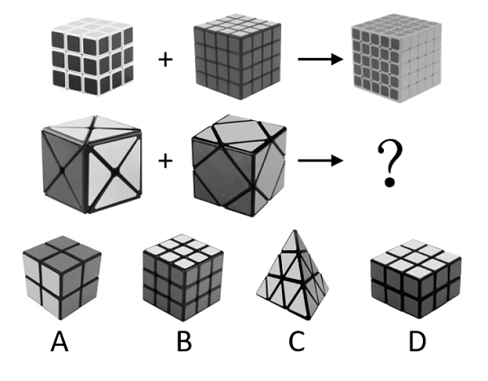
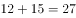

# 数量规律-面数量（两组图：图三面数=图一面数+图二面数）

考点：[[20-考点/判断推理/图形推理/数量规律-面数量（两组图：图三面数=图一面数+图二面数）|图形推理 / 数量规律-面数量（两组图：图三面数=图一面数+图二面数）]]

**问法模型**：两组图'图+图→图'选最合适填入问号处 → 属性规律不通时数封闭区域（面）数量，检验'前两图面数相加=第三图面数'的运算规律

## 推理链
1. 第1步：两组图元素组成不同，无对称、曲直等属性规律，且每个立体图形均被线条明显分割，优先考虑数量规律中的面数量。
2. 第2步：数第一组：图1为3×3×3魔方，露出3个面、每面3×3=9格，共27个面；图2为4×4×4立方体，共3×16=48个面；图3为5×5×5立方体，共3×25=75个面。
3. 第3步：验证运算关系：27+48=75，即'第三图面数=第一图面数+第二图面数'。
4. 第4步：数第二组：图1每面被X形分割成4个三角形，3个可见面共12个面；图2共15个面。
5. 第5步：代入规律：12+15=27，问号处图形应含27个面。
6. 第6步：逐项数面对照：A项2×2×2立方体共12个面；B项3×3×3立方体共3×9=27个面；C项18个面；D项21个面，仅B项满足，故选B。

**最快解法**：⚡ 面数量加法法：第一组27+48=75直接锁定'图三=图一+图二'规律；第二组12+15=27，无需逐项细数，直接认出B项是3×3×3立方体（27个面）即选

## 易错点
- ⚠ 把'面'误解为立方体的外表面个数（6个面），而非线条分割出的封闭小区域，会完全找不到数量规律
- ⚠ 第一组27、48、75不是等差数列（差为21、27），硬找等差/等比规律会卡住，应转向'前两图相加'的运算规律
- ⚠ 数面时只数可见的3个外表面上的分割区域，误按6个面计算会得出翻倍的错误数字

## 母题抽象
> 🧩 当题干为两组图'图+图→图'且图形被线条明显分割、属性规律不通时，数封闭区域（面）数量；若第三图面数=前两图面数之和，则问号处选面数等于前两图之和的选项

**同类特征**：两组图（图+图→图）、立方体/魔方等立体图形、线条分割明显、元素组成不同、无明显属性规律、面数量做加法

## 相关题
- [[10-真题/判断推理/图形推理/10204454 数量规律-部分数（黑白球连通区域数做和）|10204454]]（甘肃 2024，相关度2）
- [[10-真题/判断推理/图形推理/10297050 数量规律-特殊计数（线条穿过小白球的数量）|10297050]]（天津 2025，相关度2）
- [[10-真题/判断推理/图形推理/10297262 数量规律-面的形状种类（封闭面种类数分组）|10297262]]（浙江 2025，相关度2）
- [[10-真题/判断推理/图形推理/10297314 数量规律-交点数（曲直交点）|10297314]]（浙江 2025，相关度2）
- [[10-真题/判断推理/图形推理/11454020 数量规律-小元素按行排布（每行个数自上而下递增1）|11454020]]（选调 2024，相关度2）

---

### 题干

从所给四个选项中，选择最合适的一个填入问号处，使之呈现一定的规律性。

### 选项
- A. A
- B. B　✅
- C. C
- D. D

### 官方解析

元素组成不同，且无明显属性规律，优先考虑数量规律。观察发现，题干分为两组图，线条分割明显，优先考虑面数量。第一组中图1共27个面，图2共48个面，图三共75个面，面数量符合：。第二组运用规律，图1共12个面，图2共15个面，图三则需要选一个个面的选项。观察选项发现：A项12个面；B项27个面；C项18个面；D项21个面，只有B项符合规律，当选。

故正确答案为B。

### 给定材料
（无）
