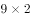
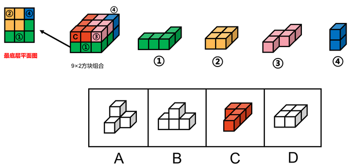

# 立体拼合-方块组合补块（分层拼合）

考点：[[20-考点/判断推理/图形推理/立体拼合-方块组合补块（分层拼合）|图形推理 / 立体拼合-方块组合补块（分层拼合）]]

**问法模型**：『选出能与给定①②③④零件共同构成目标方块组合的选项』→立体拼合模型：先算块数差锁定选项块数，数数无效则分层拼合、以小件补缺，剩余空缺形状即答案

## 推理链
1. 第1步：目标『9×2方块组合』即3×3×2共18个小方块；零件①②③各含4块、④含2块，合计14块，故所选选项必须恰好补足4块
2. 第2步：数块数排除——四个选项均含4块，数量上无法排除任何选项，转入分层拼合验证
3. 第3步：拼底层——图①贴边放、图②（2×2）与图①拼在同一层，该层共占8格只差1格；图④竖着放，其下方块恰好填补空缺，底层9格拼满
4. 第4步：拼上层——图③贴边放，且无论图③如何贴边放都留有1个单独的小方块空缺，恰好由图④竖放的另一个方块补齐
5. 第5步：此时上层剩余的4格空缺形状与C项图形完全一致，故C项能与①②③④共同构成目标组合
6. 第6步：与选项对照确认C；但按解析二拼法（③④先平铺、①②立起补缺）上层剩余恰为2×2正方形即D项，官方自注CD均可、暂定答案为C

**最快解法**：⚡ 分层拼合法+优先拼大件：先算块数差18-14=4；逐层拼——①②③贴边平铺占多数格，④（2块件）竖放补单块空缺，最后将剩余空缺形状与选项比对，锁定C

## 易错点
- ⚠ 只靠数块数排除：四个选项均为4块，数数法失效，必须实际分层拼合
- ⚠ 忽略零件可旋转/竖放：④必须竖着放才能同时补齐底层与上层的单块空缺，按平放思维会拼错
- ⚠ 验证路径单一：本题C、D均可拼成（官方自注不严谨），只试一种拼法易误认为答案唯一

## 母题抽象
> 🧩 当题干给出目标方块组合与若干零件问『共同构成』时，先用块数差锁定选项块数；若各选项块数相同则分层拼合——大件贴边放、2块小件竖放补单块缺，剩余空缺形状即答案

**同类特征**：9×2方块组合（3×3×2共18块）、零件①②③各4块、④为2块，合计14块、差4块、四个选项均含4块，数数无法排除、问法为『共同构成/拼合』的立体图形题、零件可旋转、可竖放补缺、官方自注存在多解（CD均可拼成）

## 相关题
（暂无）

---

### 题干

从所给四个选项中，选出能与给定的①、②、③、④零件共同构成如下图所示的方块组合的一项：

### 选项
- A. A
- B. B
- C. C　✅
- D. D

### 官方解析

注：本题不严谨，CD都能拼成，选哪个都算对，因粉笔题库系统只能设置一个正确答案，故暂定答案为C。

解析一：优先考虑数数，但是选项都是4个方块，无法排除选项，因此考虑拼合。优先考虑把方块数量多的图进行拼合，可将图①贴边放，图②可以与图①拼在同一层，该层只差一个小方块，图④刚好竖着放，能填补空缺的小方块，那么底下一层拼满；再看上面一层，可以把图③贴边放，而且无论图③如何贴边放，都有一个单独的小方块空缺，刚好可以和图④的另一个小方块拼凑起来，观察发现，剩余空缺的部分刚好就是C项中的图形。

故正确答案为C。

解析二：如下图所示，将图③、图④拼在一起，那么这层还差1个方块和2个连在一起的方块可以填满，图①立起来刚好有1个方块可以填到该层空缺处，图②立起来刚好能填满另外2个方块空缺处，最底下一层可拼满；再看上面一层，刚好差4个方块的正方形，即D项中的图形可以填满上面一层。

故正确答案为D。

### 给定材料
（无）

> [!note] 复核版本状态
> 原题不可计分（genuine_multi_answer；来源记录的答案键/竞争项：C、D）；仅当前明确标注的编辑版按答案C、D计分。
> 详细原题疑点、修订题面、解析和证据见下方独立复核记录。

<!-- CODEX-ANSWER-REVIEW:BEGIN -->
### 本次独立复核

**复核结论：** `genuine_multi_answer`（多个答案均成立）

**原题计分状态：** 不计分（`genuine_multi_answer`：多个答案均成立）。来源中记录的答案键/竞争项：C、D；这些记录不代表原题已核准答案。

**原题疑点与处理：**

青海 2021 〔20-考点/判断推理/图形推理/立体拼合-方块组合补块（分层拼合）〕 — 官方解析自注『本题不严谨，CD都能拼成，选哪个都算对』，且所附解析二实际推出『故正确答案为D』，与暂定唯一答案C直接冲突，系题库系统只能设一个答案所致；此为题目…

**当前计分版本：** 明确标注的编辑版；未列出的题干、材料或选项沿用固定题源。答案不回填为原题答案。

**计分答案集合：** C、D（按完整集合判分）

**复核解析：**

固定题源解析分别展示了两种完整拼法：按解析一，缺块为C；按解析二，把③④先拼后，剩余上层恰由D填满。两种拼法均不违反题干组件限制，因此原单选题没有唯一答案。编辑版改成多选，完整答案集合为C、D。

**修订题干：**

从所给四个选项中，选出能与给定的①、②、③、④零件共同构成如下图所示的方块组合的一项：

**【编者修订条件】** 【编辑版】请选择所有能够与①、②、③、④共同构成目标方块组合的选项（多选）。

**相关信息：**

立体拼合—逐层验证空缺体积；多种摆放方向均满足条件时应列出所有可行补块，而不是按题库系统只留一个答案。

**核对依据与来源边界：**

- 固定题源：[原题文件](https://github.com/Mentat-Uran/kaogongzhentizhengliu/blob/84ab93d4b64b61d897bece8a1c0a5bab06b4feb2/10-%E7%9C%9F%E9%A2%98/%E5%88%A4%E6%96%AD%E6%8E%A8%E7%90%86/%E5%9B%BE%E5%BD%A2%E6%8E%A8%E7%90%86/3523381%20%E7%AB%8B%E4%BD%93%E6%8B%BC%E5%90%88-%E6%96%B9%E5%9D%97%E7%BB%84%E5%90%88%E8%A1%A5%E5%9D%97%EF%BC%88%E5%88%86%E5%B1%82%E6%8B%BC%E5%90%88%EF%BC%89.md)；内容版本 `84ab93d4b64b61d897bece8a1c0a5bab06b4feb2`，源 Markdown blob `657ec96173fa6c2cb6381a6624e68d59fd0ab631`.
- 固定题图/公式图：`90-图片/公式图/formula-61a07b3310788d9b.png`, `90-图片/题目图/178a65276d7ea3c.png`, `90-图片/题目图/178a655cc812be4.png`, `90-图片/题目图/178a65632925368.png`.

<!-- CODEX-ANSWER-REVIEW:END -->
