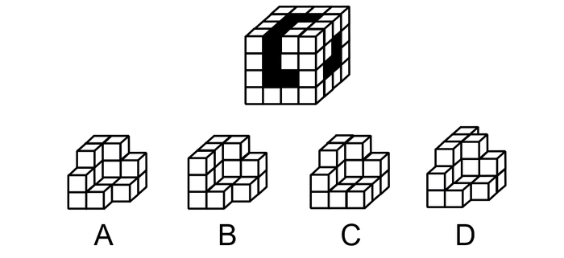

# 图形推理-立体拼合（凹凸一致-补全立方体）

考点：[[20-考点/判断推理/图形推理/图形推理-立体拼合（凹凸一致-补全立方体）|图形推理 / 图形推理-立体拼合（凹凸一致/补全立方体）]]

**问法模型**：问'嵌入黑色区域使之构成完整立方体'→立体拼合模型：先读出各面缺口的格数与形状，再按凹凸一致逐项排除，最后在能拼合的项中选无需旋转可直接嵌入者。

## 推理链
1. 第1步：题干为一个3×3×3立方体，表面黑色区域即缺失部分：正面缺构成'L'型的4个格子，上面第一层缺构成'L'型的4个格子，右面缺3个格子。
2. 第2步：依立体拼合'凹凸一致'原则，嵌入块对应面上的凸起必须与各面缺口的形状、位置完全互补，嵌入后与原立方体拼成27个小方块的完整立方体。
3. 第3步：正面4格L型缺口、上面4格L型缺口、右面3格缺口三者共同限定嵌入块的空间轮廓，A、D两项对应面的凸起形状与缺口不互补，排除A、D。
4. 第4步：对比B、C两项：C项需要旋转一定角度才能与缺口凹凸契合，而B项保持原方位即可直接嵌入黑色区域。
5. 第5步：依'使之构成完整立方体'的嵌入要求，选无需位置变化即可契合的B项。

**最快解法**：⚡ 凹凸一致+排除法：先数清三个面缺口（正面4格L、上面4格L、右面3格），排除凸起形状不对应的A、D；再在B、C中选不需旋转、按原图方位直接嵌入的B。

## 易错点
- ⚠ 只数缺口总格数而不看缺口形状与朝向，误把A/D当作可嵌入项
- ⚠ 忽视三个面缺口的空间方位对应（正面/上面/右面各对应嵌入块的不同面），仅做平面拼合判断
- ⚠ 默认拼合可以随意旋转，忽略本题'嵌入'要求下B无需旋转而C需旋转这一决定性差别

## 母题抽象
> 🧩 当题干出现'立体块嵌入缺口构成完整立方体'特征时，用凹凸一致法：先由各面缺失格数与形状（L型、条型等）限定嵌入块轮廓排除不互补项，再在剩余项中优先选无需旋转可直接嵌入者。

**同类特征**：立体拼合、完整立方体、黑色区域缺口、凹凸一致、L型缺口、多面缺口对应

## 相关题
- [[10-真题/判断推理/图形推理/1746876 立体拼合-凹凸对应（拼合成长方体）|1746876]]（国考 2016，相关度2）
- [[10-真题/判断推理/图形推理/2776149 图形推理-立体拼合（小方块计数守恒+分层形状咬合）|2776149]]（浙江 2021，相关度1）
- [[10-真题/判断推理/图形推理/10204640 立体拼合（多面体组合：数量守恒+凹凸互补+旋转）|10204640]]（河南 2024，相关度1）
- [[10-真题/判断推理/图形推理/12019797 立体拼合-由两视图及全等小块反推小立体（数小立方体+旋转试装）|12019797]]（浙江 2026，相关度1）
- [[10-真题/判断推理/图形推理/12536475 图形推理-立体拼合（正方体堆叠多面体组合）|12536475]]（四川 2024，相关度1）

---

### 题干

从所给的四个选项中选择最合适的一项，嵌入到题干图形的黑色区域使之构成一个完整的立方体：

### 选项
- A. A
- B. B　✅
- C. C
- D. D

### 官方解析
本题考查立体拼合，解题原则为凹凸一致。根据题干要求，可知正确选项嵌入到题干图形的黑色区域后应为一个完整的立方体。从题干可以得知，正面缺少构成“L”型的4个格子，上面第一层缺少构成“L”型的4个格子，右面缺少3个格子，排除A、D两项；对比B、C两项，C项需要进行一定的旋转才可嵌入进去，而B项不需要发生位置变化，因此B项最合适。
故正确答案为B。

### 给定材料
（无）

> [!note] 复核版本状态
> 原题不可计分（underdetermined；来源记录的答案键/竞争项：B）；仅当前明确标注的编辑版按答案B计分。
> 详细原题疑点、修订题面、解析和证据见下方独立复核记录。

<!-- CODEX-ANSWER-REVIEW:BEGIN -->
### 本次独立复核

**复核结论：** `resolved`（答案与解析已核定）

**原题计分状态：** 不计分（`underdetermined`：原题证据不足以唯一判定）。来源中记录的答案键/竞争项：B；这些记录不代表原题已核准答案。

**原题疑点与处理：**

甘肃 2021 〔20-考点/判断推理/图形推理/图形推理-立体拼合（凹凸一致-补全立方体）〕 — 官方解析以'C需旋转而B无需旋转'作为终选依据，隐含了'按原方位直接嵌入'的要求；若允许旋转后拼合，C亦可嵌入，题干未明示禁止旋转，规则表述略有含糊，但按官方口…

**当前计分版本：** 明确标注的编辑版；未列出的题干、材料或选项沿用固定题源。答案不回填为原题答案。

**计分答案：** B（可计分）

**复核解析：**

【编辑版】题干明确保持选项原方向，不旋转。B可以直接嵌入凹槽并补齐正方体；C只有旋转后才可嵌入；A、D无法补齐缺口。因此在不旋转约束下唯一选B。

**修订题干：**

从所给的四个选项中选择最合适的一项，嵌入到题干图形的黑色区域使之构成一个完整的立方体：

**【编者修订条件】** 【编辑版】保持选项原方向，不旋转；选择能够直接嵌入黑色区域并补成完整立方体的选项。

**相关信息：**

立体拼合是否允许旋转必须由题干明确；允许旋转和保持原方向会改变可行选项集合。

**核对依据与来源边界：**

- 固定题源：[原题文件](https://github.com/Mentat-Uran/kaogongzhentizhengliu/blob/84ab93d4b64b61d897bece8a1c0a5bab06b4feb2/10-%E7%9C%9F%E9%A2%98/%E5%88%A4%E6%96%AD%E6%8E%A8%E7%90%86/%E5%9B%BE%E5%BD%A2%E6%8E%A8%E7%90%86/3523441%20%E5%9B%BE%E5%BD%A2%E6%8E%A8%E7%90%86-%E7%AB%8B%E4%BD%93%E6%8B%BC%E5%90%88%EF%BC%88%E5%87%B9%E5%87%B8%E4%B8%80%E8%87%B4-%E8%A1%A5%E5%85%A8%E7%AB%8B%E6%96%B9%E4%BD%93%EF%BC%89.md)；内容版本 `84ab93d4b64b61d897bece8a1c0a5bab06b4feb2`，源 Markdown blob `6ab2da6edb798265723ac36eaf7866658387b61d`.
- 固定题图/公式图：`90-图片/题目图/1787468ae52e96d.png`.

<!-- CODEX-ANSWER-REVIEW:END -->
