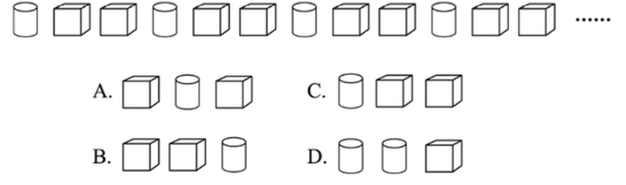

# 图形推理-数量-排列周期规律（图形循环遍历）

考点：[[20-考点/判断推理/图形推理/图形推理-数量-排列周期规律（图形循环遍历）|图形推理 / 图形推理-数量/排列周期规律（图形循环遍历）]]

**问法模型**：题干给出一串循环排列的图形并问大编号90、91、92对应什么图形 → 找循环节长度n，用编号÷n取余数定位循环内位置

## 推理链
1. 第1步：观察题干前12个图形：圆柱、六面体、六面体、圆柱、六面体、六面体……以'1个圆柱+2个六面体'为一组重复出现
2. 第2步：确定周期为3，一组内顺序固定：第1位圆柱、第2位六面体、第3位六面体（官方解析：'图1、图2、图3为一组，图4、图5、图6为一组'）
3. 第3步：90=3×30是3的倍数，恰为一完整组的结束，对应循环内第3位，即六面体
4. 第4步：91号是下一组第1位即圆柱，92号是下一组第2位即六面体
5. 第5步：对照选项，A项依次为六面体、圆柱、六面体，与推理完全一致，故选A

**最快解法**：⚡ 周期余数法：识别'圆柱、方、方'3个一循环，90÷3整除无余数取循环节末位六面体，91、92顺延取下组前两位圆柱、六面体，直接匹配A

## 易错点
- ⚠ 忽略'余0取循环节末位'，把90号误当下一组开头，误选以圆柱开头的C项
- ⚠ 数错循环起点，误把六面体当第1位，得出六面体、六面体、圆柱（B项）的错误顺序
- ⚠ 周期数错为2或其他数值，导致余数定位全部错误

## 母题抽象
> 🧩 当题干出现'一串图形按固定顺序重复+省略号+询问大编号图形'特征时，用周期余数法：先找循环节长度n，编号÷n取余，余数即循环内位置（整除则取末位），再逐个写出所求编号图形

**同类特征**：图形序列后带省略号（无限延伸）、询问特大编号（90、91、92）图形、前若干项以固定顺序循环重复、循环节长度为3、仅两种基本图形：圆柱与六面体

## 相关题
（暂无）

---

### 题干

若题干最左边的图形编号为1，其余图形的编号依次递增1，编号为90、91、92的图形应该是：

### 选项
- A. A　✅
- B. B
- C. C
- D. D

### 官方解析
该题为三个图形依次排列且呈周期性遍历，因此图1、图2、图3为一组，图4、图5、图6为一组······以此类推，当遇到3的倍数时恰好为完整的一组结束，因此90号应为上一组的最后一个图，即六面体，91、92为下一组的前两个图形，分别是圆柱、六面体。
故正确答案为A。

### 给定材料
（无）
