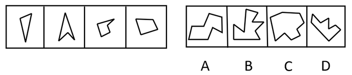

# 图形推理-平面拼合（平行且等长相消法，仅平移）

考点：[[20-考点/判断推理/图形推理/图形推理-平面拼合（平行且等长相消法，仅平移）|图形推理 / 图形推理-平面拼合（平行且等长相消法，仅平移）]]

**问法模型**：题干问'哪个图形可由左侧四个小图形仅通过平移拼合而成' → 应采用'平行且等长相消'模型：相邻图形拼接的公共边必平行且等长，两两相消后剩余外轮廓即为答案。

## 推理链
1. 第1步：提取题干要素——左侧四个不规则多边形（细长斜条、上尖下凹的箭头形、带折角的小箭头形、近梯形），规则限定只能上、下、左、右平移，不能旋转或翻转。
2. 第2步：方法规则——平面拼合中相邻两图的公共边必平行且等长，将四个小图形中'平行且等长'的边两两配对标记并消去。
3. 第3步：在①②③④之间寻找可互相抵消的边：箭头形②的凹口斜边、细长条①的斜边、小箭头③的折边、梯形④的斜边逐一配对相消，消去全部内部拼接线段。
4. 第4步：消线后剩余的边首尾相连，得到整体外轮廓：整体为块状多边形，上缘有折线凸起，底部带凹口。
5. 第5步：逐项对照——A项顶部阶梯状凸起与底部缺口的位置、方向与消线结果不符；B项上缘尖刺过多、锯齿形状对不上；D项为斜向波浪条带，与块状轮廓明显不符。
6. 第6步：C项轮廓的凸起位置与底部凹口和消线后的组合轮廓完全吻合，故正确答案为C。

**最快解法**：⚡ 平行且等长相消法+轮廓排除：把四个小图形中平行且等长的边两两相消，快速勾出整体轮廓特征（块状、上缘折角凸起、底部凹口），再排除——D项斜向条带需旋转才可能凑出（违反'只能平移'）、A/B凹凸位置方向不符，直接锁定C。

## 易错点
- ⚠ 忽略'只能平移'的限制，暗自旋转或翻转小图形去凑选项，尤其容易被D项斜向波浪形误导
- ⚠ 只凭整体大小或大致形状相似就选答案，未逐一核对凹凸边的位置与方向，误选A或B
- ⚠ 相消时把'平行但不等长'或'等长但不平行'的边也消去，导致拼出的轮廓错误

## 母题抽象
> 🧩 当题干出现'若干小图形只能平移拼合成一个大图形'的问法时，用'平行且等长相消法'：拼接公共边必平行等长，两两消去后，将剩余外轮廓与选项逐边比对凹凸位置即可锁定答案。

**同类特征**：平面拼合、只能上下左右平移、多个不规则多边形、拼合成唯一外轮廓、凹凸边互补、平行且等长相消

## 相关题
- [[10-真题/判断推理/图形推理/16095271 图形推理-平面拼合（平行且等长相消）|16095271]]（江苏 2024，相关度3）
- [[10-真题/判断推理/图形推理/17900982 图形推理-平面拼合（平行且等长相消）|17900982]]（江苏 2024，相关度3）
- [[10-真题/判断推理/图形推理/2367808 图形推理-平面拼合（平移拼合·平行且等长相消）|2367808]]（江苏 2019，相关度3）
- [[10-真题/判断推理/图形推理/2367986 图形推理-平面拼合（平行且等长相消）|2367986]]（江苏 2019，相关度3）
- [[10-真题/判断推理/图形推理/2452545 平面拼合（平行且等长线段相消）|2452545]]（江苏 2020，相关度3）

---

### 题干

右边四个小图形中，只有一个是由左边的四个图形拼合而成（只能通过上、下、左、右平移），请把它找出来。

### 选项
- A. A
- B. B
- C. C　✅
- D. D

### 官方解析

本题考查平面拼合，可采用平行且等长相消的方式解题。消去平行且等长的线段后进行组合即可得到轮廓图，即为C项。平行且等长相消的方式如下图所示：

故正确答案为C。

### 给定材料
（无）
